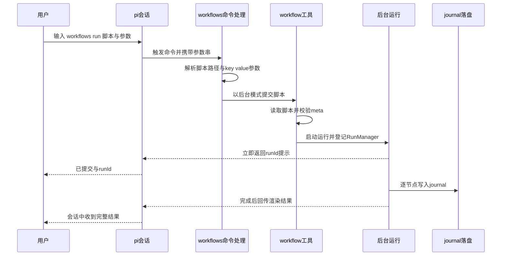

# /workflows 命令参考

`/workflows` 是 pi-code-mode 提供的斜杠命令，用于在 pi 会话中直接查看和执行动态工作流脚本，不必通过对话让模型调用工具。

## 类比理解

把 `/workflows` 想象成一个**后台车间的窗口**：

- 裸命令 `/workflows` ≈ **仪表盘**：一眼看到车间里登记了哪些生产线（已注册工作流）、最近跑完了哪些订单（最近运行）。
- `/workflows run xxx.js` ≈ **投一张派工单**：立刻拿到工单号（runId），车间照图纸（脚本）自动流水作业，你不用守在车间；完工后成品会自动送回你的会话（结果回传），全过程记录归档（journal 落盘）。
- `workflow_control` 工具 ≈ **车间控制台**：随时查看订单进度（status）、按下停机按钮（stop）；停机不报废——已完成工序记录在案，凭工单号可从断点续跑（resumeFromRunId）。

## 命令总览

| 命令 | 作用 | 执行方式 |
|------|------|----------|
| `/workflows` | 列出已注册工作流与最近运行状态 | 立即返回 |
| `/workflows run <脚本路径>` | 后台执行指定脚本 | 立即返回 runId，后台运行 |
| `/workflows run <注册表名>` | 按注册表名执行（等价于脚本路径） | 同上 |
| `/workflows run <路径或名> key=value ...` | 带参数执行，参数暴露给脚本的 `args` 全局 | 同上 |

## 各命令详解

### 1. `/workflows` —— 查看状态

```
/workflows
```

输出两部分：

- **已注册工作流**：pi 启动时从 `.pi/workflows/`（及兼容目录 `.opencode-workflows/workflows/`）扫描注册的脚本，每行显示 `工作流名  描述`；
- **最近运行**：本进程内的全部运行（在途 + 最近终态），每行显示 `状态  runId（标签）agents=数量`。

### 2. `/workflows run <脚本路径或注册表名>` —— 后台执行

```
/workflows run scripts/smoke.js
/workflows run daily-review
```

脚本来源按顺序解析（与 `workflow` 工具的 `scriptPath` 参数完全一致）：

1. **注册表名**：若命中 `.pi/workflows/` 注册表中的工作流名，按注册表解析；
2. **文件路径**：否则按相对项目根（或绝对路径）的文件读取。

执行采用**固定后台模式**，原因：工作流通常编排出多个子 Agent、耗时数分钟，若前台阻塞会让整个 pi 会话卡住无法交互。后台模式的完整流程见下文时序图，关键行为：

- 命令立即返回 `runId`；
- pi 底部的 workflow-tasks widget 实时显示各节点完成进度（`x/n nodes`）；
- 运行完成后，完整结果自动回传到当前会话（你可以继续干别的，结果到了会出现在对话里）；
- journal 逐节点落盘到 `.pi/workflows/journal/`，失败或手动停止后可断点续跑。

### 3. `/workflows run ... [key=value ...]` —— 带参数

```
/workflows run scripts/acceptance.js topic=性能 depth=3 dry=true tags=["a","b"]
```

参数规则：

- 每个 token 必须是 `key=value` 形式（按**首个** `=` 切分，值里可以再含 `=`）；
- 值若能按 JSON 解析则自动转类型（`3` 转 number、`true` 转 boolean、`["a","b"]` 转 array），否则保持字符串（如 `topic=性能`）；
- 全部收进 `args` 对象，脚本内通过全局 `args` 读取（如 `args.topic`）。

### 4. 配套控制：workflow_control 工具

`/workflows run` 提交后在对话中直接对模型说，或让模型调用 `workflow_control` 工具：

| 操作 | 说法示例 |
|------|----------|
| 查进度 | 「用 workflow_control 查一下 run-xxx 的状态」 |
| 列出全部 | 「用 workflow_control 列出所有 workflow 运行」 |
| 停止 | 「停止 run-xxx」（journal 保留） |
| 断点续跑 | 「用 workflow 工具从 runId=run-xxx 续跑」（最长未变前缀零成本回放，只重跑变更后的节点） |

## 执行模型（时序图）



## 脚本要求

`run` 的脚本是 JavaScript DSL（ESM），最低要求：

- 首条语句必须是 `export const meta = { name, description }`；
- 至少调用一次 `agent()`；
- 显式 `return` 结果对象。

编写脚本请参考 `skills/workflow-authoring` 技能与 `thirdparties/opencode-dynamic-workflows/examples/sample-project/scripts/` 中的 8 类样例。

## 引用说明

- 本仓库上手指南：`docs/getting-started.md`
- 验收清单（8 类脚本分类与批次门槛）：`docs/testing.md`
- 脚本编写规范：`skills/workflow-authoring/SKILL.md`
- 参考项目（脚本样例与分类基线）：`thirdparties/opencode-dynamic-workflows/examples/sample-project/`
- 参考项目（pi 宿主适配层方法论）：`thirdparties/pi-dynamic-workflows/`
- pi 扩展命令注册 API（`registerCommand`）：`node_modules/@earendil-works/pi-coding-agent/dist/core/extensions/types.d.ts`
