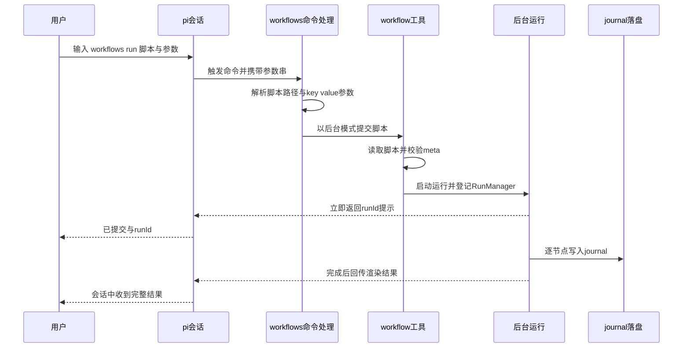

# /workflows 命令参考

`/workflows` 是 pi-code-mode 提供的斜杠命令，用于在 pi 会话中直接查看和执行动态工作流脚本，不必通过对话让模型调用工具。

## 类比理解

把 `/workflows` 想象成一个**后台车间的窗口**：

- `/workflows` ≈ **车间总控台的帮助面板**：列出这张控制台上所有可用的按钮。
- `/workflows list` ≈ **仪表盘**：一眼看到车间里登记了哪些生产线（已注册工作流）、最近跑完了哪些订单（最近运行，含全部 runId）。
- `/workflows run xxx.js` ≈ **投一张派工单**：立刻拿到工单号（runId），车间照图纸（脚本）自动流水作业，你不用守在车间；完工后成品会自动送回你的会话（结果回传），全过程记录归档（journal 落盘）。
- `workflow_control` 工具 ≈ **车间控制台**：随时查看订单进度（status）、按下停机按钮（stop）；停机不报废——已完成工序记录在案，凭工单号可从断点续跑（resumeFromRunId）。

## 命令总览

| 命令 | 作用 | 执行方式 |
|------|------|----------|
| `/workflows` | 显示所有子命令帮助 | 立即返回 |
| `/workflows list` | 列出已注册工作流与最近运行状态（含全部 runId） | 立即返回 |
| `/workflows run <脚本路径>` | 后台执行指定脚本 | 立即返回 runId，后台运行 |
| `/workflows run <注册表名>` | 按注册表名执行（等价于脚本路径） | 同上 |
| `/workflows run <路径或名> key=value ...` | 带参数执行，参数暴露给脚本的 `args` 全局 | 同上 |
| `/workflows register <脚本路径>` | 注册工作流（校验后配置入 `.pi/workflows/register.json`） | 立即返回 |
| `/workflows unregister <id或文件名>` | 注销工作流（从 register.json 与受管目录移除） | 立即返回 |
| `/workflows status <runId>` | 查看某次运行详情（节点状态/耗时/错误/结果预览） | 立即返回 |
| `/workflows cancel <runId>` | 停止某次运行（在飞子会话一并取消；journal 保留可续跑） | 立即返回 |
| `/workflows cancel` | 停止**全部在途**运行 | 立即返回 |
| `/workflows stop ...` | `cancel` 的同义词，用法完全一致 | 立即返回 |

## 各命令详解

### 1. `/workflows` / `/workflows list` —— 帮助与查看状态

```
/workflows          显示所有子命令帮助（不传任何参数时的默认行为）
/workflows list     列出已注册工作流与最近运行
```

`/workflows list` 输出两部分：

- **已注册工作流**：注册表来源分双模式——项目存在 `.pi/workflows/register.json`（由 register/unregister 指令维护）时以它为唯一事实源（排他，手工放置的文件不生效）；否则回退扫描兼容目录 `.opencode-workflows/workflows/`。每行显示 `工作流名  描述`；
- **最近运行**：本进程内的全部运行（在途 + 最近终态），每行显示 `状态  runId（标签）agents=数量`。

### 2.1 `/workflows register|reg <脚本路径>` / `unregister|unreg <id或文件名>` —— 注册与注销

```
/workflows register scripts/demo.js      注册（校验 meta 后配置入 register.json）
/workflows reg scripts/demo.js           reg 为 register 同义词
/workflows unregister demo_wf            按 workflowId 注销
/workflows unreg demo_wf                 unreg 为 unregister 同义词
```

- **register**：校验脚本 meta 信封 → 检查 workflowId（`meta.id ?? meta.name`）冲突 → 脚本副本复制到 `.pi/workflows/workflows/<id>.js` → 配置条目写入 `.pi/workflows/register.json`。源文件后续删除不影响执行（副本自包含）。
- **unregister**：从 register.json 移除条目并删除副本；按 workflowId 或副本文件名匹配。
- **排他边界**：一旦项目存在 register.json，注册表就以它为唯一事实源——手工往兼容目录放文件不会被识别，注册/移除只能通过这两个指令。
- **兼容**：没有 register.json 的存量项目仍按旧目录扫描行为工作，可用 `reg` 把脚本纳入 manifest 管理。

### 2. `/workflows run <脚本路径或注册表名>` —— 后台执行

```
/workflows run scripts/smoke.js
/workflows run daily-review
```

脚本来源按顺序解析（与 `workflow` 工具的 `scriptPath` 参数完全一致）：

1. **注册表名**：若命中 `.pi/workflows/` 注册表中的工作流名，按注册表解析；
2. **文件路径**：否则按相对项目根（或绝对路径）的文件读取。

执行采用**固定后台模式**，原因：工作流通常编排出多个子 Agent、耗时数分钟，若前台阻塞会让整个 pi 会话卡住无法交互。后台模式的完整流程见下文时序图，关键行为：

- 命令立即返回 `runId`；
- pi 底部的 workflow-tasks widget 实时显示各节点完成进度（`x/n nodes`）；
- 运行完成后，完整结果自动回传到当前会话（你可以继续干别的，结果到了会出现在对话里）；
- journal 逐节点落盘到 `.pi/workflows/journal/`，失败或手动停止后可断点续跑。

### 3. `/workflows run ... [key=value ...]` —— 带参数

```
/workflows run scripts/acceptance.js topic=性能 depth=3 dry=true tags=["a","b"]
```

参数规则：

- 每个 token 必须是 `key=value` 形式（按**首个** `=` 切分，值里可以再含 `=`）；
- 值若能按 JSON 解析则自动转类型（`3` 转 number、`true` 转 boolean、`["a","b"]` 转 array），否则保持字符串（如 `topic=性能`）；
- 全部收进 `args` 对象，脚本内通过全局 `args` 读取（如 `args.topic`）。

### 4. `/workflows status <runId>` / `cancel` / `stop` —— 查看与控制

```
/workflows status run-1794794826036-abc123    查看某次运行详情
/workflows cancel run-1794794826036-abc123    停止单个运行
/workflows cancel                             停止全部在途运行
/workflows stop                               同上（stop 与 cancel 同义）
```

心智模型很简单：**带 runId 操作单个，不带 runId 操作全部在途**。`cancel` 与 `stop` 完全同义，记哪个都行。

- **停止不是报废**：停止时会一并取消在飞子会话，但 journal 保留；之后在对话里说「从 runId=xxx 续跑」（模型调 `workflow(resumeFromRunId=...)`）即可断点续跑，已完成节点零成本回放，只重跑变更后的节点。
- 若 runId 不存在或已终态，命令会提示并用 `/workflows list` 查看全部 runId。

### 5. 配套工具：workflow_control

除斜杠命令外，同样能力可通过对话让模型调用 `workflow_control` 工具完成（适合自然语言场景，如「把所有在途的 workflow 停掉」）：

| 操作 | 说法示例 |
|------|----------|
| 查进度 | 「用 workflow_control 查一下 run-xxx 的状态」（= status） |
| 列出全部 | 「用 workflow_control 列出所有 workflow 运行」（= list） |
| 停止单个 | 「停止 run-xxx」（= cancel <runId>） |
| 断点续跑 | 「用 workflow 工具从 runId=run-xxx 续跑」（最长未变前缀零成本回放，只重跑变更后的节点） |

## 执行模型（时序图）



## 脚本要求

`run` 的脚本是 JavaScript DSL（ESM），最低要求：

- 首条语句必须是 `export const meta = { name, description }`；
- 至少调用一次 `agent()`；
- 显式 `return` 结果对象。

编写脚本请参考 `skills/workflow-authoring` 技能与 `thirdparties/opencode-dynamic-workflows/examples/sample-project/scripts/` 中的 8 类样例。

## 引用说明

- 本仓库上手指南：`docs/getting-started.md`
- 验收清单（8 类脚本分类与批次门槛）：`docs/testing.md`
- 脚本编写规范：`skills/workflow-authoring/SKILL.md`
- 参考项目（脚本样例与分类基线）：`thirdparties/opencode-dynamic-workflows/examples/sample-project/`
- 参考项目（pi 宿主适配层方法论）：`thirdparties/pi-dynamic-workflows/`
- pi 扩展命令注册 API（`registerCommand`）：`node_modules/@earendil-works/pi-coding-agent/dist/core/extensions/types.d.ts`
