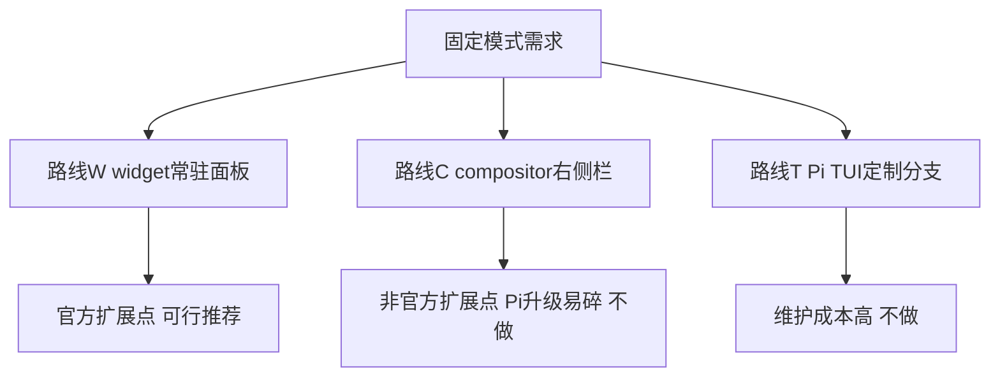
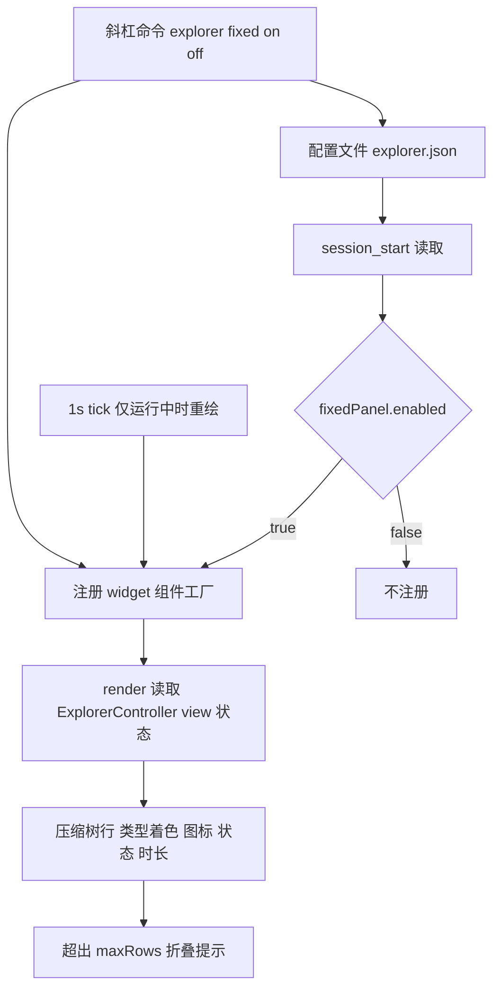

# Explorer 固定模式可行性分析（设置可开关，Ctrl+B overlay 不动）

> 建立时间：2026-11-19
> 关联：`dev-docs/todos/explorer-交互对齐opencode.md` §3（B 交互模型）与 §4（C 真常驻侧栏）
> 需求：新增一个「固定模式」——面板常驻显示（不按 Ctrl+B 也能看到执行树状态），可通过设置开启/关闭；Ctrl+B 的 overlay 模式保持不变。

## 1. 需求与约束

| 约束 | 说明 |
| --- | --- |
| Ctrl+B overlay 不动 | 现有全屏两态（树/详情）交互模式零改动 |
| 设置可开可关 | 配置驱动，默认关闭（不改变现有用户手感） |
| 固定 = 常驻 | 不抢焦点、不挡编辑器输入，对话同时可见面板 |

类比：overlay 是「全屏接管」（看大图），固定模式是「仪表盘常亮」（扫一眼）。两者互补而非替代。

## 2. 宿主能力事实（查证结论）

> **2026-11-19 重大修正**：初版分析认定「右侧常驻是宿主硬限制（widget 只有上下落位）」——**该结论有误**。
> 深入查证 pi-tui 源码与参考项目 pi-sidebar（REF-010，BSD-3-Clause）后发现：
> `ctx.ui.custom(factory, { overlay: true, overlayOptions: { anchor: "right-center", nonCapturing: true, ... } })`
> 是官方支持的「右侧 + 常驻 + 不抢焦点」路线（nonCapturing = 不捕获键盘焦点，主对话输入不受影响）。
> 局限：overlay 是**悬浮叠加**（遮住主区右侧内容），非 compositor 的真分屏让位。

| 事实 | 出处 | 对本需求的影响 |
| --- | --- | --- |
| `ctx.ui.custom` 支持 `overlayOptions.anchor: "right-center"` + `nonCapturing: true` | pi-tui `OverlayOptions`（源码已验证） | **右侧常驻官方路线，采纳** |
| `setWidget` 仅 aboveEditor/belowEditor | types.d.ts L49-52 | widget 路线无法右侧，弃用 |
| overlay 悬浮遮挡：宽度多少遮多少 | compositeOverlays 语义 | 缓解：宽度可配 + 后续可加 collapsed/autohide（pi-sidebar 同款策略） |
| `ctx.ui.onTerminalInput(handler)` 全局原始输入监听 | types.d.ts L82 | 进阶项不做 |
| `pi.getSettings()` 是严格 schema | settings-schema.d.ts L225 | 自定义键不可靠，走自管配置 |
| 仓库自管配置先例：model-tiers.json | `src/engine/agent/model-tiers.ts` | 固定模式开关走同款自管配置 |

## 3. 路线对比



| 路线 | 可行性 | 理由 |
| --- | --- | --- |
| **W：widget 常驻面板** | ✅ 可行，推荐 | 官方 API、仓库已有同形态先例、与 overlay 正交 |
| C：terminal compositor 右侧栏 | ❌ 不做 | todos §4 已归因：非官方扩展点，Pi 升级易碎，需持续回归 |
| T：维护 Pi TUI 定制分支 | ❌ 不做 | 维护成本远超收益 |

## 4. 推荐方案设计（路线 W）

### 4.1 架构



### 4.2 配置文件（自管，默认关）

```json
// .pi/workflows/explorer.json
{
  "fixedPanel": {
    "enabled": false,
    "placement": "aboveEditor",
    "maxRows": 10
  }
}
```

- 默认 `enabled: false`——不装配置文件 = 关闭，现有用户零感知
- 首次开启时可自动生成模板（同 model-tiers 模板先例）

### 4.3 开关三通道

| 通道 | 生效时机 | 说明 |
| --- | --- | --- |
| 配置文件 | 下次 session_start | 持久偏好 |
| `/explorer fixed on\|off` 命令 | 立即 | 注册/注销 widget 并写回配置文件 |
| Ctrl+B overlay | 与固定模式无关 | overlay 全屏覆盖，关闭后 widget 仍在——两者正交 |

### 4.4 渲染策略

- 数据源：`ExplorerController.view()`（已有 `ExplorerViewState`），与 overlay 共用同一棵树模型——**不新建第二数据链**
- 行内容：复用 `render.ts` 的 `KIND_ICON` / `statusIcon` / 类型着色 / 时长格式（抽公共小函数或直接 import）
- 压缩规则：run 头 1 行 + 节点每行 1 条，超出 `maxRows` 尾行折叠为 `…共 N 节点（Ctrl+B 看全量）`
- 刷新：`runManager.onEvent` 事件驱动（照抄 workflow-tasks 的 scheduler：lifecycle 即时、progress 500ms 节流）+ 1s tick 仅在 `hasRunningNodes()` 时重绘（空闲零渲染原则）
- 只读：widget 无键盘交互（详情查看走 Ctrl+B overlay，底部可加一行 `Ctrl+B 详情` 提示）

### 4.5 与现有部件的关系

| 部件 | 关系 |
| --- | --- |
| Ctrl+B overlay | 零改动；固定模式只是多一个常驻渲染源 |
| workflow-tasks widget | **互斥管理（会重复）**：其 run 级摘要（label done/total）是固定模式树信息的子集。固定模式 on → 注销 workflow-tasks；off → 重新注册恢复原样。空态策略继承：无 running run 时返回空行集（widget 自动隐藏不占空间） |
| status-line（setStatus 1 行） | footer 状态区，与 widget 不冲突；固定模式开启时可保留（信息粒度不同：单行 vs 树） |

## 5. 风险与对策

| 风险 | 对策 |
| --- | --- |
| render 异常击穿宿主（workflow-tasks 曾实测） | render 全程自防御 try-catch 返回空行集（先例已有模式） |
| 树大占屏 | `maxRows` 硬上限 + 折叠提示；`belowEditor` 可选 |
| 秒表走字需要重绘 | tick 仅运行中生效，空闲零开销 |
| 配置热生效 | 运行中改文件不生效是已知取舍，命令通道补即时切换 |
| 类型着色色名依赖主题角色 | 全部用已验证存在的角色名（accent/border/warning/text/success） |

## 6. 工作量与测试

**工作量**：约半天~一天。

| 项 | 内容 |
| --- | --- |
| 新增 `extensions/explorer/fixed-panel.ts` | 渲染纯函数（state → 行数组）+ 配置读写 |
| `pi-code-mode.ts` 接线 | session_start 按配置注册 widget + tick |
| `commands/explorer/fixed.ts` | on/off 子命令（即时生效 + 写回配置） |
| 契约测试 | 渲染折叠/截断/空态、配置 roundtrip、命令语义、render 自防御、与 overlay 无耦合（固定模式关掉不影响 ctrl+b） |

## 7. 结论

**可行**。widget 路线全部踩在官方扩展点与本仓库已验证先例上（workflow-tasks 同架构），Ctrl+B overlay 零改动，宿主硬限制（右侧停靠）已被绕开——固定模式落位编辑器上方/下方，定位为「只读仪表盘」，交互仍归 overlay。

## 引用

- pi widget API：`dist/core/extensions/types.d.ts`（setWidget 双形态 / ExtensionWidgetOptions）
- pi TUI 组件模型与输入：`pi` 包 `docs/tui.md`
- 仓库先例：`extensions/pi-code-mode.ts` workflow-tasks widget（事件驱动刷新 + render 自防御）
- 仓库先例：`src/engine/agent/model-tiers.ts` 自管配置文件模式
- todos 归因：`dev-docs/todos/explorer-交互对齐opencode.md` §1（宿主硬限制）/ §4（C 路线代价）
