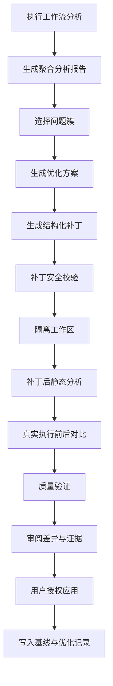

# Workflow JS 优化生命周期设计

- 日期：2026-11-20
- 主题：从 `/workflows anal` 的「分析与报告」升级为「可验证、可审阅、可回滚的 Workflow JS 优化闭环」
- 适用对象：pi-code-mode 的 Workflow JS，包括单文件、入口 + 子 workflow、目录模式
- 结论：现有工程已经具备约 **60% 的底层积木**（Analyzer、AI Rule Check、Planner、独立工作区优化环、Benchmark、Suggestion Review、Baseline Store），但缺失把这些积木接成用户可操作产品流程的**编排层、变更层、真实执行验收层与命令入口**。目前 `anal` 只能回答“哪里可能有问题”，还不能可靠完成“生成修改 → 验证 → 审阅 → 应用”。

---

## 一、目标：优化不是改代码，而是受控闭环

用户真正需要的不是一个优化建议列表，而是下面的状态机：

```text
分析
  → 选择问题簇
  → 生成候选优化补丁
  → 静态与 AI 复核补丁
  → 在隔离工作区真实执行 before after
  → 比较性能与质量
  → 用户审阅 diff 和证据
  → 显式授权应用
  → 归档基线与优化记录
```

其中任何一步不成立，就不能说“已优化”：

- 只有建议，没有补丁：只是咨询，不是优化。
- 有补丁，没有真实执行：只是静态猜测，不是验证。
- 有性能改善，没有质量证明：可能是删掉工作换来的“快”。
- 有验证，没有用户授权：不能改生产 Workflow JS。
- 应用后没有基线记录：下次回归无法发现。

### 类比

`anal` 目前像医院的影像科：能标出哪里可能有病灶、给出风险等级；完整优化流程还需要门诊会诊、手术方案、模拟手术、术后复查与病历归档。直接拿影像报告去“动刀”是不安全的。

---

## 二、现状盘点：已有能力与断点

### 2.1 已有能力

| 能力 | 现有模块 | 状态 | 备注 |
| --- | --- | --- | --- |
| 单文件/目录静态分析 | `analyzeWorkflow()` / `analyzeDirectory()` | 已接线 | 支持目录下全部 JS 聚合 |
| 跨文件聚合 | `tree-analyzer.ts` | 已接线 | entry + sibling workflow；目录模式为平级聚合 |
| 规则文档 | `rules/definitions/*.md` | 已接线 | 当前 14 条规则，代码与文档双向守卫 |
| 静态规则 | `rule-engine.ts` | 已接线 | AST / 正则 / 调用图 |
| AI Rule Check | `ai-rule-checker/` | 已接线 | 证据逐字校验、AI 不能覆盖静态事实 |
| AI Planner | `optimization-planner.ts` | 已接线 | 生成优化建议，但不是补丁生成器 |
| Markdown / JSON / Dashboard | `report-builder.ts` / `dashboard/` | 已接线 | 聚合口径已统一、问题簇已合并 |
| 独立工作区优化环 | `optimization-loop.ts` | **半成品** | 有六步状态机，但没有实际 patch producer / 用户入口 |
| Benchmark 框架 | `benchmark-runner.ts` | **半成品** | 可以比较 before/after，但真实 runOnce 接线不完整 |
| 优化建议回评 | `suggestion-review.ts` | 未接线 | 有数据模型，无产品流程 |
| 性能基线 | `baseline-store.ts` | 未接线 | 能存 P50/P90 / 回归检测，但没有自动归档点 |
| 工具入口 | `workflow_optimize` MCP tool | **半成品** | 默认没有 `patchSource`，所以必然中止于 workspace-edit |
| 斜杠命令 | `/workflows anal` | 已接线 | **没有** `/workflows optimize` / `apply` / `review` |

### 2.2 当前 optimize 的真实问题

`runOptimizationLoop()` 的设计方向是对的，但当前无法完成优化：

```ts
propose: async () => {
  // Planner 只能给 proposals，没有完整 patchedSource
  // patchSource 默认未注入
  return { recommendations }
}
```

随后必然发生：

```text
workspace-edit：未提供 patchedSource（无可应用修改）
→ 优化中止
```

而 `workflow_optimize` 虽注册为工具，当前没有对应 `/workflows optimize` 命令；用户无法以完整、可见、可审阅的方式使用它。

### 2.3 不能直接“让 AI 改整个文件”的原因

完整替换 `patchedSource` 是高风险接口：

- 模型可能改掉无关代码。
- 入口与子 workflow 可能需要联动，但只给一个文件路径会产生不一致。
- 目录 Workflow 的变更应是**多文件 patch 集合**，不是一个字符串。
- 模型输出内容可能丢注释、编码、换行、权限或原有导出。
- 真实脚本常依赖相对路径；临时目录中只复制一个 JS 文件无法真实运行。

因此补丁层必须使用**结构化、最小范围、可校验的统一 diff**，不能用“AI 返回整个文件字符串”作为生产接口。

---

## 三、目标架构



### 3.1 四层职责

| 层 | 职责 | 禁止做什么 |
| --- | --- | --- |
| Analyzer | 发现问题、提供证据、形成问题簇 | 不改代码、不虚构收益 |
| Optimizer | 把已选问题簇变成可执行补丁计划 | 不直接写生产文件 |
| Verifier | 静态重分析、真实执行、质量/性能比较 | 不因缺少数据而放行 |
| Approval | 展示 diff、证据、Benchmark，等待用户授权 | 不默认批准 |

---

## 四、用户体验：建议新增的命令族

现有 `/workflows anal` 保留为诊断入口；新增 `optimize` 目录型命令，所有状态落在 `.pi/workflows/optimizations/`。

```text
/workflows anal <file-or-dir>
/workflows optimize start <file-or-dir> [--rules REC-002,IO-001] [--tier fast]
/workflows optimize status <optimization-id>
/workflows optimize review <optimization-id>
/workflows optimize benchmark <optimization-id>
/workflows optimize apply <optimization-id>
/workflows optimize discard <optimization-id>
```

### 4.1 `optimize start`

职责：只创建候选优化，不改生产文件。

```text
/workflows optimize start <target>
```

执行：

1. 调用 `anal` 同一聚合分析链路。
2. 默认列出问题簇，要求用户选中要优化的簇；若命令传 `--rules` 则只处理指定规则。
3. AI Optimizer 按选中问题簇生成 `OptimizationPlan` + `PatchSet`。
4. 在隔离工作区应用 patch。
5. 对 patch 后工作区运行静态分析 + AI Rule Check。
6. 输出优化编号、工作区路径、补丁摘要、未做真实 Benchmark 的明确状态。

**安全默认**：不运行长 workflow，不修改生产文件，不自动 apply。

### 4.2 `optimize review`

职责：用户可以像 code review 一样看清“AI 到底改了什么”。

输出固定五块：

```text
1. 原问题簇
   - 规则、文件、位置、静态/AI 证据

2. 修改意图
   - 为什么能改、依赖关系、不能改的边界

3. 文件差异
   - unified diff，按文件折叠

4. 验证状态
   - 静态 before/after
   - AI Rule Check before/after
   - 真实 Benchmark：未运行 / 通过 / 失败

5. 结论
   - 可申请 apply / 仍需人工处理 / 已拒绝
```

### 4.3 `optimize benchmark`

职责：真实运行 before/after，绝不把估算当实测。

前提：目标 Workflow 必须提供下列之一：

1. 已有 `Plan`，含 Required Validation；或
2. 用户传入验证脚本 / 验收命令；或
3. 显式 `--unsafe-no-quality-gate`（仅测试环境，强提示且不能 apply 生产文件）。

运行约束：

- before 和 after 使用同一组输入 args。
- before 在原工作区，after 在隔离工作区。
- 并发最多 2 个长任务。
- 每轮有 watchdog。
- 证据以 journal / run snapshot 为准。
- 每次 run 标记 `inputScale`，不同规模不能混比。

### 4.4 `optimize apply`

必须同时满足：

```text
补丁校验通过
AND 静态风险未劣化
AND AI Rule Check 没有新增 high 或 critical 待确认项
AND Benchmark 有 >=5% 可测收益
AND Required Validation 全部通过
AND 用户在 review 后显式执行 apply
```

应用机制：

1. 再次检查生产文件 hash，防止 review 后文件被人改过。
2. 以 `writeFileAtomic` 写入。
3. 写入 `.bak` 备份。
4. 自动运行一次静态分析，生成最终报告。
5. 更新 baseline 与 optimization journal。
6. 输出 commit 建议，但**不自动 git commit**，除非用户单独授权。

### 4.5 `optimize discard`

清理隔离工作区，保留 JSON/Markdown 审计记录；不删生产文件。

---

## 五、核心数据模型

### 5.1 `OptimizationSession`

路径：

```text
.pi/workflows/optimizations/<optimization-id>/
  session.json
  before.report.json
  before.report.md
  before.dashboard.html
  proposal.json
  patchset.json
  review.md
  benchmark.json
  after.report.json
  after.report.md
  after.dashboard.html
  result.json
```

建议结构：

```ts
interface OptimizationSession {
  id: string
  createdAt: string
  target: {
    kind: "file" | "directory"
    root: string
    sourceHashes: Record<string, string>
  }
  selectedClusters: string[]
  status:
    | "analyzed"
    | "proposed"
    | "patched"
    | "verified"
    | "benchmarked"
    | "approved"
    | "applied"
    | "discarded"
    | "rejected"
  model: {
    tier: string
    resolvedModel?: string
  }
  workspace: {
    path: string
    patchApplied: boolean
  }
  validation: {
    staticOk?: boolean
    aiRuleCheckOk?: boolean
    benchmarkOk?: boolean
    qualityOk?: boolean
  }
}
```

### 5.2 `PatchSet`：禁止整文件 AI 覆盖

```ts
interface PatchSet {
  files: Array<{
    path: string
    expectedSourceHash: string
    edits: Array<{
      startLine: number
      endLine: number
      oldText: string
      newText: string
      rationale: string
      relatedCluster: string
    }>
  }>
}
```

补丁验证：

1. 路径必须位于 target root 内，禁止 `..`、绝对路径跳转。
2. 每个 `oldText` 必须在当前 source 中唯一匹配。
3. 变更行范围必须落在已选问题簇证据附近，或说明为什么需要扩大范围。
4. 修改后 JS 必须能 parse。
5. 不能修改 `node_modules`、`.git`、第三方参考目录、认证配置。
6. 多文件 patch 必须全部成功，任一失败则整体拒绝。

---

## 六、AI 在优化流程中的职责与模型档位

遵守项目强制规则：所有模型调用必须走 `.pi/workflows/model-tiers.json`；新增调用点的档位先向用户确认。

### 6.1 已确认档位

| 调用点 | 档位 | 依据 |
| --- | --- | --- |
| AI Rule Check | `fast` | 已确认；读代码 + JSON 规则结论，实测显著更快 |
| Planner 优化建议 | `fast` | 已确认；与规则检查一致 |

### 6.2 需要本次确认的新档位

| 新调用点 | 建议默认 | 原因 |
| --- | --- | --- |
| Patch Generator（生成结构化 PatchSet） | **需要用户确认** | 这会决定生产代码改动质量；不能擅自选 fast/big |
| Patch Reviewer（二次审查 patch 是否改变无关行为） | **需要用户确认** | 可与 Patch Generator 同档或用 big 交叉审查 |

推荐采用：

```text
Patch Generator: big
Patch Reviewer: fast
```

理由：生成补丁对正确性要求高，审查只需按约束检查；但这必须由用户确认后才实现。

### 6.3 AI Prompt 的明确边界

Patch Generator 的 prompt 必须包含：

- 已选问题簇及证据。
- 当前文件完整内容（仅受影响文件，不传整个仓库）。
- 相关规则 md（只传触发规则）。
- 补丁 JSON 格式。
- 禁止整文件重写。
- 禁止改动不相关文件。
- 禁止改 Plan Required Validation。
- 不确定时输出 `needsHumanDecision`，不要猜。

Patch Reviewer 的 prompt 必须包含：

- before / after diff。
- 关联问题簇。
- Required Validation。
- 允许范围。

输出：`approve` / `reject` / `needs-human` + 每条证据。

---

## 七、真实验证策略

### 7.1 静态验证（必须）

| 检查 | 通过条件 |
| --- | --- |
| JS parse | 所有修改文件能解析 |
| Analyzer | 不新增 critical/high finding；目标簇减少或消失 |
| AI Rule Check | 目标规则从 hit/both 降为 pass/uncertain，且不新增高风险 ai-hit |
| Patch scope | 所有 edit 都有 selected cluster 或 reviewer 依据 |

### 7.2 动态验证（决定是否可应用）

| 检查 | 通过条件 |
| --- | --- |
| before/after 同输入 | args 和 inputScale 相同 |
| 执行成功 | after run 成功，失败 Agent 不增加 |
| Required Validation | Plan 所有 required 项通过 |
| 性能 | 至少一个主指标改善 >=5% |
| 质量 | evidence coverage / validation pass 不下降 |
| 副作用 | 产物 hash、关键 JSON schema、预期文件清单通过 |

### 7.3 无法 Benchmark 的情况

不能假装“优化成功”。状态应为：

```text
static-verified / benchmark-pending / not-applicable
```

此时 `apply` 默认禁用，用户需要：

- 补充验收脚本，或
- 显式在测试项目执行 `--unsafe-no-quality-gate`，或
- 将补丁导出后手动处理。

---

## 八、分阶段实施计划

### O0：把现有半成品接成可见状态

目标：先让用户知道优化功能当前能做什么，不能做什么。

1. 新增 `/workflows optimize` 路由与帮助。
2. 将 `workflow_optimize` 底层工具转发给命令，不再只存在 MCP 工具。
3. 新建 `OptimizationSession` 落盘目录。
4. `optimize start` 先只做 analyze + 选问题簇 + proposal，不生成补丁。
5. Dashboard 增加「优化会话」入口，链接 review.md。

验收：用户运行 `optimize start` 能得到 optimization-id、选中的问题簇、建议、状态 `proposed`，没有生产文件变更。

### O1：结构化 PatchSet 与隔离工作区

目标：从“建议”到“候选修改”。

1. 实现 `patch-generator.ts` 与 PatchSet schema。
2. 使用独立工作区复制**目标目录结构**，不是只复制单个文件。
3. 实现 `patch-validator.ts`：路径、oldText、hash、parse、scope 校验。
4. 在工作区应用 patch，生产文件 hash 二次检查。
5. 重新 Analyzer + AI Rule Check。
6. 生成 unified diff 与 review.md。

验收：对一个低风险规则（建议选 `DET-001` 的确定性 JSON 统计）生成最小 patch，在工作区通过静态验证；生产文件 byte-for-byte 不变。

### O2：真实 Benchmark 与质量门

目标：从“候选修改”到“有证据的优化”。

1. 把 `benchmark-runner.ts` 的 `runOnce` 接到真实 workflow run。
2. 实现 run journal → `BenchmarkRunMetrics` 适配器。
3. 对 before / after 使用同输入规模与隔离 runDir。
4. 接 Plan Required Validation；没有 Plan 时要求显式 verifier。
5. 记录 `BaselineStore`。
6. 生成 benchmark.md 与 Dashboard before/after 视图。

验收：真实 workflow 的 before/after 结果能够显示墙钟、token、agent 数、失败数、质量门；任何一项质量降级，状态 `rejected`。

### O3：用户审阅与原子应用

目标：安全修改生产 Workflow JS。

1. `/workflows optimize review <id>` 显示问题 → patch → 验证 → benchmark。
2. `/workflows optimize apply <id>` 需要明确确认。
3. 应用前检查 source hash，防止 stale apply。
4. `writeFileAtomic` + backup。
5. 应用后重跑静态分析并归档结果。
6. `/workflows optimize discard <id>` 清理工作区。

验收：

- 未批准时生产文件不变。
- 修改后生产文件 hash 与 review 的 after hash 一致。
- stale source 时拒绝应用。
- 完整审计链落盘。

### O4：逐步自动化与优化知识库

目标：让系统从已验证优化中学习，但不擅自改代码。

1. `suggestion-review.ts` 接入每次 benchmark。
2. `BaselineStore` 记录同 inputScale 的性能趋势。
3. Dashboard 显示“该类建议历史有效率”。
4. 当某种 suggestion 在 3 次以上有效且无质量损伤时，仅提升“推荐优先级”，**不自动 apply**。
5. 建立优化模式库：如 `IO-001` 的确定性 read/write 改造、`DET-001` 的计数去重改造。

---

## 九、按规则选择第一批可优化对象

不要从高风险、跨文件副作用问题开始。

| 优先级 | 问题簇 | 是否适合第一批自动 patch | 原因 |
| --- | --- | --- | --- |
| 1 | `DET-001` | 是 | 局部确定性统计/去重可替换，副作用最少 |
| 2 | `IO-001` | 条件适合 | 前提是 runtime 已有安全文件工具；否则只能生成迁移方案 |
| 3 | `RETRY-001` | 条件适合 | 可将确定性错误的重试下调，但必须有故障注入验证 |
| 4 | `REC-002` | 适合但必须 review | 修复目标明确（impactSet 传递），但涉及恢复语义，必须真实 run 验收 |
| 5 | `CONC-002` | 不适合自动 patch | 动态分片与真实并发预算需运行时证据 |
| 6 | `SERIAL-002` / `SIDEFX-001` | 不适合自动 patch | 必须先证明无文件副作用/无顺序依赖 |
| 7 | `BUDGET-001` | 不适合自动 patch | 需先确认运行时并发闸门语义 |

首个端到端试点建议：

```text
目标：DET-001 中「JSON 文件列表提取与去重」
范围：单个子 workflow
补丁：用确定性 JS / 受治理工具替代 agent 中的数组提取、去重、计数
验证：同输入 before/after 输出 JSON 深度相等；耗时、token、agent 数下降
```

不要选择：把 `SERIAL-002` 直接改 `parallel()`。这是最容易“快了但错了”的优化。

---

## 十、风险与硬性约束

| 风险 | 约束 |
| --- | --- |
| AI 大范围重写 | 只接受 PatchSet；禁止完整文件覆盖 |
| 修改生产脚本 | 只能在 `apply` 且用户确认后原子写入 |
| 无质量门只看速度 | 无 Required Validation / verifier 不允许 production apply |
| 异步副作用被并行化 | `SERIAL-002`、`SIDEFX-001` 默认仅建议，不自动 patch |
| 模型慢 | 调用全部走 model-tiers；Patch Generator / Reviewer 档位需先向用户确认 |
| 输入规模不可比 | before/after 必须同 args + 同 inputScale |
| 原文件已变 | source hash 不一致拒绝 apply |
| 基线污染 | benchmark 失败/质量降级不写 accepted baseline |

---

## 十一、完成定义

“完整 Workflow JS 优化流程”达到以下状态才算完成：

1. 用户可从 `/workflows anal` 的问题簇进入 `optimize start`。
2. 优化会话有可追踪 id、状态、工作区、报告和审计文件。
3. AI 只生成结构化、最小范围 PatchSet；补丁有 hash / oldText / path 校验。
4. 补丁先在独立工作区应用，生产文件不变。
5. before/after 使用相同输入真实运行。
6. 静态、AI Rule Check、Required Validation、Benchmark 四道门都可见。
7. 未验证、质量下降、收益不足、源文件已变时不能 apply。
8. 用户 review 后显式 apply，原子写 + backup + 应用后重分析。
9. 基线和建议回评可供下次分析使用。
10. Markdown、Dashboard、Optimization Session 三份数据一致。

---

## 十二、当前建议

不要马上实现所有 O0~O4。

先做：

```text
O0 + O1
```

即先让用户能从问题簇创建优化会话、得到最小 PatchSet、在隔离工作区看到 diff 和静态复核。这样很快就能验证 Patch Generator 是否可靠，且不需要先跑几十分钟的真实 workflow。

在开始 O1 前，需要用户确认两个新模型调用点的档位：

1. Patch Generator：建议 `big`（生产 JS 改动质量优先）
2. Patch Reviewer：建议 `fast`（按约束二次审查，速度优先）

这两项确认后才能实现任何会生成代码修改的 AI 调用。

---

## 引用

- 当前分析入口：`src/tools/workflow-analyze-tool.ts`
- 当前 AI Planner：`src/engine/analyzer/optimization-planner.ts`
- 已有但未完整接线的闭环：`src/engine/evaluator/optimization-loop.ts`
- 真实 Benchmark 框架：`src/engine/evaluator/benchmark-runner.ts`
- 建议回评：`src/engine/evaluator/suggestion-review.ts`
- 性能基线：`src/engine/evaluator/baseline-store.ts`
- AI Rule Check：`src/engine/analyzer/ai-rule-checker/`
- 大模型档位规范：`CLAUDE.md`「大模型调用规范（强制）」
- 真实验证对象：`thirdparties/PrdGameSkill/.opencode-workflows/workflows/game-requirement-audit/`
