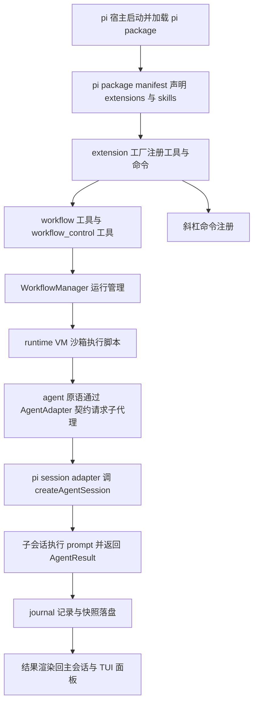
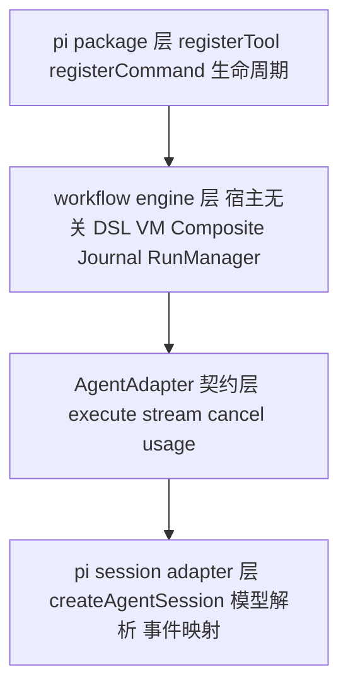

# pi-code-mode 插件需求文档

> 修订版 R2（2026-11-14）：吸收外部评审意见——修正 MVP 与验收冲突、Runtime 复用降级为待验证假设、新增 Adapter Contract 与执行边界章节、验收阶段重划（P0-A 至 P2）、新增 M0 技术验证里程碑与三层测试体系。修订记录见文末。
>
> 目标：开发一个基于 pi agent 的第三方 package（插件），把 `opencode-dynamic-workflows`（下称 opencode 版）的动态工作流能力移植到 pi 平台，形成 `pi-code-mode` 包，并以 `examples/sample-project` 下的测试脚本分类验收。

## 1. 背景与定位

### 1.1 三个代码库的角色

| 仓库 | 角色 | 类比 |
|---|---|---|
| `thirdparties/opencode-dynamic-workflows` | 功能蓝图。完整的 workflow 编排引擎：DSL、沙箱 VM、journal/resume、composite 子工作流、worktree 隔离、质量 DSL（judgePanel/verify）、schedule 定时调度、TUI 面板 | 「功能百科全书」——要做什么、做到什么程度，照它来 |
| `thirdparties/pi-dynamic-workflows` | 集成范本。已经踩平 pi 平台的全部坑：pi package manifest、`pi.registerTool`、`createAgentSession` 子会话、pi-tui widget、事件路由 | 「同乡带路党」——pi 平台怎么接入、怎么 spawn 子代理，抄它的路 |
| `pi-code-mode`（本仓库） | 新包。runtime 引擎移植自 opencode 版，平台适配层参考 pi-dynamic-workflows | 「合成品」——蓝图的灵魂，范本的躯体 |

### 1.2 引擎复用策略：待验证假设（非既定事实）

> R2 修订：原表述「引擎层不依赖宿主 API，移植成本低」降级为待验证假设。

opencode 版的架构红线是 runtime 层不 import 宿主 SDK，宿主触碰全部收敛在 `src/adapters/opencode-session-adapter.ts`，且 `src/agent/session-runner.ts` 存在 `AgentSessionRunner` 接口缝（测试注入 fake 用）。这是利好，但「没有 SDK import」不等于「没有宿主语义耦合」。以下隐含依赖必须在 M0 逐项审计：

- Agent 返回结果的结构假设（文本拼接方式、structured 字段位置）
- Token usage 的统计口径（opencode 版从 `step-finish` parts 求和补偿上游缺陷）
- Session 生命周期与取消行为（`AbortSignal` 到 `session.abort` 的传播链）
- 工具调用事件的顺序与 trace 采集方式（`collectSessionTrace` 拉全量消息）
- 上下文继承方式（主会话与子会话之间传什么）

M0 出口标准见第 9 章；审计矩阵见第 2.4 节。**真正重要的不是复用了多少行代码，而是 DSL 语义与 opencode 版是否一致。**

### 1.3 总体架构流程



### 1.4 目标架构分层与非目标



- Engine 只依赖第 4 章定义的 `AgentAdapter` 契约，**禁止直接 import pi SDK**（沿用 opencode 版架构红线）。
- **非目标（当前不做）**：不重构 opencode 仓库抽取共享 Core。待 M0/M1 验证接口稳定后，再评估「一个 Workflow Core + OpenCode Adapter + Pi Adapter」的长期演进。本包先以「Core + Pi Adapter」形态存在，为该演进留好接缝即可。

## 2. 平台差异与技术要点

### 2.1 注册方式对照

| 维度 | opencode 版 | pi-dynamic-workflows（范本） | pi-code-mode 方案 |
|---|---|---|---|
| 包声明 | `opencode.json` 的 `plugin` 字段 | `package.json` 的 `pi` 字段：`extensions` + `skills` | 同范本：`pi` manifest |
| 入口 | `src/index.ts` 导出 `PluginModule` | `extensions/workflow.ts` 6 行桥接 + `dist/pi-extension.js` | `extensions/pi-code-mode.ts`，default export `function extension(pi)` |
| 工具注册 | `tool({description, args, execute})` DSL | `pi.registerTool`（typebox schema，`exposure: "deferred"`） | 同范本 |
| 命令 | markdown 文件（`commands/schedule.md`） | `pi.registerCommand` | 同范本，代码内注册 |
| 子代理 | `client.session.prompt`（同步长请求等最终消息，非流式） | `createAgentSession` 创建内存态 AgentSession，流式驱动 | 同范本，但经由第 4 章 Adapter 契约 |
| 结构化输出 | `format: json_schema` + 网关降级为 prompt 要求 JSON | typebox schema 校验 + 修复循环 | 同范本（pi 无 format 参数问题） |
| TUI | `@opentui/solid` + solid-js | `@earendil-works/pi-tui` widget（`ui.setWidget`） | 同范本 |
| 模型指定 | `"provider/modelId"` 传给 session.prompt | `tier`(small/medium/big) 映射 `model-tiers.json`，或直接 `model` | 两者都支持 |

### 2.2 需要决策的差异点

1. **workflow 脚本目录约定**：opencode 版扫 `<项目>/.opencode-workflows/workflows/*.js`（一级目录进注册表）。pi 版主目录为 `.pi/workflows/*.js`，**兼容扫描 `.opencode-workflows/workflows/`** 以便 sample-project 零改动跑通。
2. **schedule 的宿主依赖**：ScheduleRuntime 需要创建 root session，pi 版改用 `createAgentSession`。pi-dynamic-workflows 没有调度功能，这部分从 opencode 版移植引擎 + 换 adapter，且按第 2.4 节审计矩阵属于「较大概率需要改造」档。
3. **后台结果回传**：opencode 版把汇总 `session.prompt` 发回父会话；pi 版用范本的 `installResultDelivery` 模式（事件路由回宿主会话）。
4. **`exposure: "deferred"`**：需要 pi >= 0.99；旧宿主按范本的降级分支处理。
5. **`inheritMainModel`**：opencode 版靠显式 model 参数；pi 版补 tier 体系（范本已有），`tier-fallback-test.js` 才有对应物。

### 2.3 AgentAdapter 契约（R2 新增，M0 锁定）

Engine 与 pi SDK 之间的唯一接缝。M0 阶段定稿为正式架构文档（`dev-docs/design/adapter-contract.md`），此为骨架：

```typescript
interface AgentAdapter {
  // 执行一次子代理调用：创建会话、注入 prompt、等待终态
  execute(request: AgentRequest, ctx: ExecutionContext): Promise<AgentResult>;
  // 按 executionId 取消在途执行（引擎级取消传播的落点）
  cancel(executionId: string): Promise<void>;
}

interface AgentRequest {
  prompt: string;
  model?: string;          // provider/modelId 或 tier 解析后的结果
  cwd?: string;            // worktree 隔离时为 worktree 路径
  tools?: ToolPolicy;      // 可用工具策略（第 5 章权限表）
  timeoutMs?: number;
  signal?: AbortSignal;
  outputSchema?: object;   // JSON Schema，结构化输出
}

interface AgentResult {
  status: "ok" | "error" | "cancelled" | "timeout";
  output: { type: "text" | "structured"; value: unknown };
  usage: { inputTokens: number; outputTokens: number };
  sessionId: string;
  error?: { kind: string; message: string };
}
```

设计约束：

- 流式/进度事件走独立的 `onEvent`（AsyncIterable 或回调），**不把 pi AgentSession 的内部事件原样暴露给 Engine**。
- 契约成立后，后续 pi SDK 变更只影响 Pi Session Adapter 实现，不影响 DSL 与 runtime。
- opencode 版的 `AgentSessionRunner`（`run(prompt, options): Promise<AgentExecutionResult>`）是本契约的简化前身，移植时以本契约为准。

### 2.4 Runtime 宿主依赖审计矩阵（M0 逐项过）

| 模块 | 预期复用方式 | 需要检查的内容 |
|---|---|---|
| VM / Prelude | 优先直接复用 | 全局对象注入、确定性中和、禁 import 的静态检查 |
| DSL 原语 | 优先直接复用 | 对 agent 结果结构与错误形态的隐含假设 |
| Workflow Runtime | 复用 + 局部适配 | 调度器、并发限制、取消传播（`AsyncLocalStorage` composite scope） |
| Journal | 优先复用 | ID/键格式、序列化、原子写入、hash 覆盖字段 |
| Composite | 优先复用 | race 胜出取消兄弟、可恢复失败塌缩 vs 结构性上抛 |
| Worktree | 复用 + 环境适配 | git 依赖、Windows 路径、清理时机（opencode 版注释明示目录 query 在真机不生效） |
| Schedule | 较大概率改造 | 进程生命周期、错过补跑策略、root session 创建方式 |
| TUI | pi 专用重写 | pi-tui widget 生命周期与事件模型（不移植 @opentui/solid 实现） |

## 3. sample-project 测试脚本分类与验收阶段映射

脚本根目录：`thirdparties/opencode-dynamic-workflows/examples/sample-project/`。共 60+ 个 workflow 脚本 + 3 个 benchmark。

> R2 修订：原「A 到 H 8 类、A+B 即 MVP」的划分有缺陷——B 类混入了依赖 P1 能力（resume/race/fallback 语义）的脚本，导致「按文档做完 P0 仍无法通过 P0 验收」。本节保留 8 类**资产分类**，验收改按第 3.2 节**阶段映射**执行。

### 3.1 资产分类（按依赖的插件能力维度）

| 类别 | 脚本 | 依赖能力 |
|---|---|---|
| A 基础编排 | `scripts/smoke-test.js`、`chain-root/middle/leaf.js`、`multi-tree-a/b.js`、`concurrency-limit-test.js`、`acceptance-10docs.js` | `agent/parallel/phase/log`、顺序链 prev 传递、`setConcurrency`、并发上限 |
| B 子工作流 | `native/*`（16 个：pipeline、深度限制、自环、error、mutate、resume、registry、compare）、`composite/*`（13 个：sequence/race/fallback/parallel 组合、失败门、队列计时、TUI checkpoint/enhance） | `workflow()` 原语、嵌套深度、错误传播、`sequence/race/fallback`、journal 跨 scope |
| C 质量与结构化 | `quality-dsl-test.js`、`schema-test.js` | `judgePanel/verify/checkpoint`、`schema` 结构化输出 |
| D 持久化与恢复 | `resume-test.js` | journal 落盘、`resumeFromRunId`、最长未变前缀回放 |
| E 隔离与后台 | `worktree-test.js`、`background-test.js` | worktree 隔离、`background: true`、`workflow_control`、结果回传 |
| F 定时调度 | `.opencode-workflows/workflows/schedule-test.js` | 注册表按名寻址、`schedule_*` 工具族 |
| G UI 观测 | `node-detail-*-test.js`（9 个）、`tui-progress/failure-test.js`、`phase-elapsed-test.js`、`composite/tui-checkpoint-test.js`、`tui-enhance-test.js`、`opencode-large-json-parallel-test.js` | pi-tui widget、节点详情面板、checkpoint 确认、大结果渲染 |
| H 模型分层与基准 | `tier-fallback-test.js`、`benchmarks/*` | tier 映射回退、fff 搜索基准（重写为 pi 命令，可选） |

> `.opencode/workflows/fff-search-benchmark.js` 是 benchmark 遗留物（不属于本插件注册表体系），不纳入验收。

### 3.2 验收阶段映射（R2 修订）

| 阶段 | 验收脚本范围 | 依赖的引擎能力 |
|---|---|---|
| P0-A 基础引擎与 Adapter | A 类全部 | agent/parallel/phase/log、顺序链、并发限制 |
| P0-B 基础嵌套 | `native/pipeline_parent.js`、`1_spec/2_design/3_code`、`deep_chain_*`、`deep_parent/child`、`self_ref*`、`error_*`、`registry_parent`、`compare_parent`、`composite/seq_parent.js`、`seq_fail_parent.js`、`seq_parallel_parent.js`、`par_child_fail_parent.js`、`failure-gate-test.js`、`queue-timer-test.js` | `workflow()` 嵌套、深度限制、自环拒绝、错误传播、sequence（**不含** race/fallback/resume 变体） |
| P1-A 高级控制流 | `race_parent/slow/fallback_parent`、`fb_*` 三个 fallback 变体 | race 取消传播、fallback 塌缩语义 |
| P1-B 持久化与恢复 | `resume-test.js`、`resume_child/parent`、`mutate_child/parent`、`seq_resume_parent.js` | journal、`resumeFromRunId`、脚本变更检测、跨 scope 回放 |
| P1-C 质量与隔离 | C 类 + E 类 | judgePanel/verify/checkpoint、schema、worktree、background |
| P2 产品化 | F + G + H 类 | schedule、pi-tui、tier |

MVP = **P0-A + P0-B**。resume/race/fallback 相关脚本从 MVP 剔除，进入 P1 对应阶段。

## 4. 执行边界：权限、并发与取消（R2 新增）

### 4.1 双层权限模型

VM 沙箱只约束「编排脚本代码能做什么」；子 Agent 通过自身工具仍可访问文件系统与执行命令，必须单独约束：

| 层级 | 约束项 |
|---|---|
| VM 层 | 禁 import/require、`Math.random/Date.now` 中和、解析期静态拦截、执行超时、原语白名单（无文件系统/网络原语） |
| Agent 层 | 可用工具集（子会话 `excludeTools` 禁 workflow 系防递归、`noExtensions: true`）、工作目录（默认 cwd / worktree）、命令审批策略（继承宿主设置）、网络访问（按宿主配置）、单 agent 超时 |

两层配置都进入 `AgentRequest.tools`（ToolPolicy）与 Adapter 实现参数，M0 出口前定稿默认值。

### 4.2 并发与取消

- **Run 级并发**：沿用 opencode 版上限 16（`setConcurrency` 可下调）。
- **全局 Agent 并发**（R2 新增）：RunManager 维护跨 run 的全局并发闸。理由：测试约定允许 2 个联调 run 并行，每个 run 内部最多 16 个 agent，理论上 32 路并发请求——全局闸在 Engine 层兜底（默认 16，可配置），超出的 dispatch 排队。
- **取消传播**：`workflow_control` cancel / run 超时 / 宿主会话关闭 → Engine 向所有在途 `AgentAdapter.execute` 发 `cancel(executionId)` → Adapter 落到 pi 子会话 abort。composite race 的兄弟取消在 Engine 层完成（`AsyncLocalStorage` scope 机制随 runtime 移植）。
- **资源上限**：沿用 run 级常量 `MAX_AGENTS_PER_RUN=1000`、`MAX_AGENT_RETRIES=3`、`MAX_WORKFLOW_DEPTH=3`。

## 5. 持久化与恢复模型（R2 新增）

四个概念独立定义，分阶段交付：

| 能力 | 作用 | 阶段 |
|---|---|---|
| Journal | 记录每次 agent/tool 调用的事件、输入、输出、错误（落盘 `.pi/workflows/journal/<runId>.json`） | P0-A 即启用（只写不读） |
| Checkpoint / Snapshot | run 快照（进度、节点状态）落盘供恢复与 UI 读取（3s 心跳） | P0 基础 |
| Resume | 识别可复用节点并恢复执行 | P1-B |
| Human Checkpoint | `checkpoint()` 暂停等待人工决策（journal 确定性回放、Reject 强停止） | P1-C |

### 5.1 节点身份与回放指纹

Resume 的复用判定不用纯执行序号，采用稳定节点身份 + 输入指纹：

```text
Node Identity:
  workflowPath      子工作流引用路径
  scopePath         调用嵌套作用域链
  nodeKey           调用点标识
  occurrenceKey     同节点多次出现的序号

Replay Fingerprint:
  scriptHash / promptHash / modelConfigHash / dependencyHash / runtimeVersion
```

指纹任一变化即判定「该节点不可复用」，这与 opencode 版「hash 覆盖 prompt/model/phase/agentType/schema」的 journal key 设计一致，M0 审计确认其覆盖面后直接沿用。

### 5.2 Replay Policy（副作用感知，R2 新增）

节点结果能否重放还取决于节点是否有副作用：写文件的 Agent 即使 prompt 未变，Resume 直接复用旧结果可能出现「日志显示成功、目标文件实际不存在」。

- 节点默认 `rerun`（有副作用的保守默认）；
- 显式标记 `replayable`（纯读/纯分析节点）才静默回放；
- 高风险节点可标 `manual-confirm`，恢复前弹人工确认。
- P1-B 交付最小版：默认 rerun + 脚本内 `agent()` opts 显式 `replayable: true` 白名单；`manual-confirm` 随 Human Checkpoint 在 P1-C 交付。

## 6. 功能范围（对齐阶段）

### P0（MVP = P0-A + P0-B）

1. pi package 骨架：`package.json`（`pi` manifest：extensions + skills）、`extensions/pi-code-mode.ts` 桥接、构建产物入口
2. `workflow` 工具注册（deferred exposure）；`workflow_control` 工具同时注册但**仅暴露 `list/status/cancel`**（R2：控制动作渐进暴露，M3 再补可持久化的 `pause/resume`，避免接口声明了内部做不到的状态转换）
3. AgentAdapter 契约定稿 + Pi Session Adapter 实现（`createAgentSession` 子会话、schema 结构化输出、usage 统计、cancel/timeout）
4. runtime 引擎移植：VM 沙箱、确定性 prelude、`agent/parallel/pipeline/sequence/workflow/phase/log/args`、并发限制、错误传播（race/fallback 语义暂不承诺）
5. workflow 注册表：扫描 `.pi/workflows/`（兼容 `.opencode-workflows/workflows/`）
6. run 快照 + journal 落盘（只写）
7. `workflow-authoring` skill 移植

### P1

8. P1-A：`race/fallback` 语义（取消传播、塌缩 vs 上抛）
9. P1-B：journal/resume（指纹回放、`resumeFromRunId`、Replay Policy 最小版）
10. P1-C：质量 DSL（`judgePanel/verify/checkpoint`）、worktree 隔离、后台运行 + `background: true` + 结果回传 + `workflow_control` 补齐
11. 斜杠命令：`/workflows` 及内置 pattern（参考范本）

### P2

12. 定时调度：ScheduleRuntime + `schedule_*` 工具族 + `/schedule`
13. TUI 任务面板：pi-tui widget、`pi.events` 生命周期事件
14. 模型 tier 体系：`model-tiers.json`、`inheritMainModel`
15. fff 基准命令重写（可选）

## 7. 测试体系（R2 新增）

三层测试，**绝大部分脚本不依赖真实 LLM**：

| 层级 | 目的 | 调 LLM | 载体 |
|---|---|---|---|
| Unit | DSL、VM、调度、journal、composite 逻辑正确性 | 否 | `tests/*.test.ts`，`tsx --test`，复用 opencode 版 60+ 测试的用例结构 |
| Contract | OpenCode/Pi 两个 Adapter 满足同一 `AgentAdapter` 契约（含错误/cancel/timeout 语义） | 否 | **Deterministic Mock Adapter**（脚本化返回预置 AgentResult，含 status/error/usage 全形态） |
| Integration | 真实 pi Agent、模型、工具、生命周期、取消 | 是 | sample-project 各阶段脚本 + 看门狗（并发 ≤2、落盘证据优先，见根 CLAUDE.md） |

收益：失败原因可定位（Unit 挂 = 引擎问题；Contract 挂 = Adapter 问题；Integration 挂 = 平台/模型问题），Integration 成本压到最小集。

## 8. 验收标准

- **MVP 门槛（P0-A + P0-B）**：第 3.2 节对应脚本在 pi 中通过 `workflow` 工具执行成功，结果结构与 opencode 版语义一致；Unit + Contract 测试全绿。
- **P1 门槛**：P1-A/B/C 脚本全通过；resume 按 `resume-test.js` 两步法验证（首跑记 runId、改 prompt 后 `resumeFromRunId` 只重跑变化节点），且 Replay Policy 对写型节点执行 rerun。
- **P2 门槛**：F/G/H 通过；schedule 验证 cron 到期触发；TUI 人工目检。
- Integration 跑法统一：在 sample-project 目录启动 pi，Main Agent 以 `scriptPath` 执行各脚本（与脚本头部注释用法一致，宿主换成 pi）。

## 9. 里程碑（R2 修订：新增 M0）

| 里程碑 | 内容 | 出口标准 |
|---|---|---|
| **M0 技术验证与接口锁定** | 逐模块过第 2.4 审计矩阵；`AgentAdapter` 契约定稿成文；pi 子会话真实调用打通（execute/流式事件/cancel/清理）；Mock Adapter 就绪 | 基础 agent 调用、取消、超时、usage 统计全部实证可用；审计结论落 `dev-docs/design/` |
| M1 基础编排 MVP | P0 全部 7 项（race/fallback/resume 除外） | P0-A + P0-B 脚本通过，Unit/Contract 全绿 |
| M2 高级引擎 | P1-A/B + P1-C 质量 DSL 部分 | 高级控制流与恢复测试通过，重启后行为可验证 |
| M3 工程化运行 | worktree、background、结果回传、`workflow_control` 补齐 pause/resume、权限默认值、全局并发闸 | 后台任务安全退出、文件隔离与回传通过 |
| M4 产品体验 | TUI、schedule、tier、示例与发布文档、npm 发布 | F/G/H 回归通过，跨平台安装测试通过 |

## 10. 工程细节与待办（R2 新增）

1. **上游版本区分**：`thirdparties/REFERENCES.md` 为 pi-dynamic-workflows 增记「上游基线 commit」，后续 `submodule update --remote` 时同步更新两列，防止开发中混用不同版本 API。
2. **CI SHA 校验**：增加脚本校验实际检出 SHA 与 `REFERENCES.md` 固定 commit 一致（弥补 `.gitmodules` `ignore = all` 造成的 submodule 状态不可见）。
3. **README 定位声明**：明确「pi-code-mode 是面向 Pi Agent 的代码式工作流编排插件：通过 JavaScript DSL 调度多个 Agent、管理执行状态、恢复工作流，以最小宿主依赖运行复杂自动化任务」。
4. **子会话扩展递归**（保留）：`noExtensions` + `excludeTools` 双保险，providerMiddlewareExtensions 白名单不默认放行任何宿主扩展。

## 11. 风险与注意事项

1. **Runtime 隐含耦合**（R2 升级）：结果结构、usage 口径、取消链路的隐含假设未审计前不得批量搬代码；M0 审计矩阵逐项确认。
2. **非安全沙箱**（保留）：vm 只防意外非确定性，不防恶意脚本；Agent 层权限单独约束（第 4.1 节）。
3. **pi SDK 版本门槛**（保留）：`exposure: "deferred"` 需 pi >= 0.99；peerDependencies 对齐范本并按实际 API 上调。
4. **构建产物路径**（保留）：`dist/` 编译产物 + TS 桥接双路径；CI 必须先 build。
5. **目录约定兼容**（保留）：P0 先兼容 `.opencode-workflows/` 保证 sample-project 零改动，P2 提供迁移说明。
6. **测试并发 ≠ Agent 并发**（R2）：联调允许多 run 并行，全局 Agent 闸必须先于 M3 的后台能力上线（实现上随 M1 RunManager 一起交付）。

## 12. 引用

- opencode 版蓝图：`thirdparties/opencode-dynamic-workflows/`（AGENTS.md 架构红线：runtime 层禁碰宿主 SDK，唯一触碰点在 session adapter）
  - 插件入口：`src/index.ts`；VM 与 DSL：`src/runtime/vm.ts`、`src/runtime/workflow-runtime.ts`
  - 接口缝前身：`src/agent/session-runner.ts`（`AgentSessionRunner`）
  - 唯一宿主适配点：`src/adapters/opencode-session-adapter.ts`
  - 测试项目与脚本：`examples/sample-project/`（脚本头部注释含各自用法）
- pi 集成范本：`thirdparties/pi-dynamic-workflows/`
  - pi package manifest 范例：`package.json` 的 `pi` 字段
  - extension 工厂与工具注册：`src/pi-extension.ts`、`src/workflow-tool.ts`
  - 子会话创建：`src/agent.ts`（`createAgentSession` + `noExtensions` 防递归）
  - DSL 与沙箱：`src/workflow.ts`、`src/workflow-capability-contract.ts`
  - journal 与共享存储：`src/shared-store.ts`
- pi 官方文档：`D:/DevTools/npm-global/node_modules/@earendil-works/pi-coding-agent/docs/`（packages.md、extensions.md、sdk.md）

## 修订记录

| 版本 | 日期 | 说明 |
|---|---|---|
| R1 | 2026-11-14 | 初版：三库角色、8 类脚本分类、P0-P2 范围、M1-M4 里程碑 |
| R2 | 2026-11-14 | 吸收外部评审：MVP 收窄为 P0-A/B、runtime 复用降级为待验证假设并新增审计矩阵、AgentAdapter 契约与四层架构、双层权限与全局并发、Journal/Checkpoint/Resume 概念区分与 Replay Policy、三层测试体系、M0 里程碑、workflow_control 渐进暴露、工程细节三条 |
