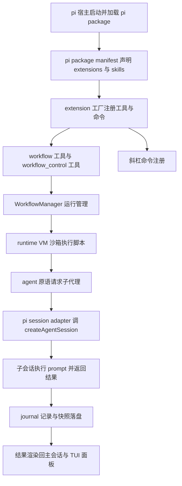
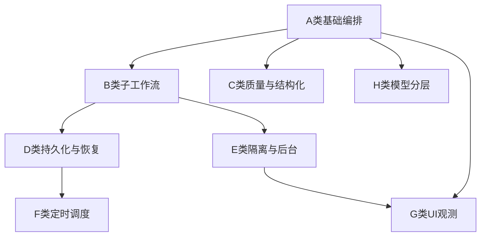

# pi-code-mode 插件需求文档

> 目标：开发一个基于 pi agent 的第三方 package（插件），把 `opencode-dynamic-workflows`（下称 opencode 版）的动态工作流能力移植到 pi 平台，形成 `pi-code-mode` 包，并以 `examples/sample-project` 下的测试脚本分类验收。

## 1. 背景与定位

### 1.1 三个代码库的角色

| 仓库 | 角色 | 类比 |
|---|---|---|
| `thirdparties/opencode-dynamic-workflows` | 功能蓝图。完整的 workflow 编排引擎：DSL、沙箱 VM、journal/resume、composite 子工作流、worktree 隔离、质量 DSL（judgePanel/verify）、schedule 定时调度、TUI 面板 | 「功能百科全书」——要做什么、做到什么程度，照它来 |
| `thirdparties/pi-dynamic-workflows` | 集成范本。已经踩平 pi 平台的全部坑：pi package manifest、`pi.registerTool`、`createAgentSession` 子会话、pi-tui widget、事件路由 | 「同乡带路党」——pi 平台怎么接入、怎么 spawn 子代理，抄它的路 |
| `pi-code-mode`（本仓库） | 新包。runtime 引擎移植自 opencode 版，平台适配层参考 pi-dynamic-workflows | 「合成品」——蓝图的灵魂，范本的躯体 |

### 1.2 一句话需求

做一个 pi package `pi-code-mode`：
- **引擎层**（runtime/VM/DSL/journal/composite/worktree/quality/schedule）从 opencode 版移植——这一层不依赖任何宿主 API，移植成本低；
- **适配层**（session adapter / 插件注册 / TUI 面板）参考 pi-dynamic-workflows 用 pi SDK 重写——这是唯一的宿主触碰面；
- **验收标准**：`examples/sample-project` 的测试脚本按本文第 3 章分类，分批跑通。

### 1.3 总体架构流程

## 2. 平台差异与技术要点

### 2.1 注册方式对照

| 维度 | opencode 版 | pi-dynamic-workflows（范本） | pi-code-mode 方案 |
|---|---|---|---|
| 包声明 | `opencode.json` 的 `plugin` 字段 | `package.json` 的 `pi` 字段：`extensions` + `skills` | 同范本：`pi` manifest |
| 入口 | `src/index.ts` 导出 `PluginModule` | `extensions/workflow.ts` 6 行桥接 + `dist/pi-extension.js` | `extensions/pi-code-mode.ts`，default export `function extension(pi)` |
| 工具注册 | `tool({description, args, execute})` DSL | `pi.registerTool`（typebox schema，`exposure: "deferred"`） | 同范本 |
| 命令 | markdown 文件（`commands/schedule.md`） | `pi.registerCommand` | 同范本，代码内注册 |
| 子代理 | `client.session.prompt`（同步长请求等最终消息，非流式） | `createAgentSession` 创建内存态 AgentSession，流式驱动 | 同范本 |
| 结构化输出 | `format: json_schema` + 网关降级为 prompt 要求 JSON | typebox schema 校验 + 修复循环 | 同范本（pi 无 format 参数问题） |
| TUI | `@opentui/solid` + solid-js | `@earendil-works/pi-tui` widget（`ui.setWidget`） | 同范本 |
| 模型指定 | `"provider/modelId"` 传给 session.prompt | `tier`(small/medium/big) 映射 `model-tiers.json`，或直接 `model` | 两者都支持：opencode 版的 `model` 参数 + pi-dynamic-workflows 的 tier 体系 |

### 2.2 需要决策的差异点

1. **workflow 脚本目录约定**：opencode 版扫 `<项目>/.opencode-workflows/workflows/*.js`（一级目录进注册表）。pi 版建议改为 `.pi/workflows/*.js`（保持 pi 生态惯例），同时**兼容扫描 `.opencode-workflows/workflows/`** 以便 sample-project 零改动跑通。
2. **schedule 的宿主依赖**：opencode 版 ScheduleRuntime 依赖 `client` 创建 root session；pi 版改用 `createAgentSession`。注意 pi-dynamic-workflows 没有调度功能，这部分是从 opencode 版原样移植引擎 + 换 adapter。
3. **后台结果回传**：opencode 版把汇总 `session.prompt` 发回父会话；pi 版用 pi-dynamic-workflows 的 `installResultDelivery` 模式（事件路由回宿主会话）。
4. **`exposure: "deferred"`**：需要 pi >= 0.99；旧宿主按范本的降级分支处理。
5. **`inheritMainModel`**：opencode 版靠显式 model 参数；pi 版建议补 tier 体系（范本已有），`tier-fallback-test.js` 才有对应物。

## 3. sample-project 测试脚本分类

脚本根目录：`thirdparties/opencode-dynamic-workflows/examples/sample-project/`。共 60+ 个 workflow 脚本 + 3 个 benchmark。按**依赖的插件能力维度**分为 8 类，验收时从 A 类到 H 类逐批推进（A/B 通过即 MVP）。

### A. 基础编排（P0 冒烟，最先跑通）

| 脚本 | 依赖能力 |
|---|---|
| `scripts/smoke-test.js` | `agent` / `parallel` / `phase` / `log` / `meta` 校验 |
| `scripts/chain-root.js` `chain-middle.js` `chain-leaf.js` | 顺序 agent 链、prev 结果传递 |
| `scripts/multi-tree-a.js` `multi-tree-b.js` | 多并行分支各自成链 |
| `scripts/concurrency-limit-test.js` | `setConcurrency`、运行级并发上限（16） |
| `scripts/acceptance-10docs.js` | 文档验收综合场景（10 篇文档扇出归纳） |

### B. 子工作流（P0，与 A 同批）

| 脚本 | 依赖能力 |
|---|---|
| `scripts/native/1_spec.js` `2_design.js` `3_code.js` `pipeline_parent.js` | `workflow()` 原语、相对路径引用、prev 传参 |
| `scripts/native/deep_chain_parent.js` `deep_chain_l2.js` `deep_chain_l3.js` `deep_parent.js` `deep_child.js` | 嵌套深度限制（默认 3 层） |
| `scripts/native/self_ref.js` `self_ref_parent.js` | 自环拒绝 |
| `scripts/native/error_child.js` `error_parent.js` | 子工作流错误传播 |
| `scripts/native/mutate_child.js` `mutate_parent.js` | 脚本变更后 resume 感知 |
| `scripts/native/resume_child.js` `resume_parent.js` | journal 跨 scope 回放 |
| `scripts/native/registry_parent.js` | 注册表按名寻址子工作流 |
| `scripts/native/compare_parent.js` | 新旧写法对照 |
| `scripts/composite/seq_parent.js` `seq_fail_parent.js` `seq_parallel_parent.js` `seq_resume_parent.js` | `sequence` 组合原语（含失败门、并行段、resume） |
| `scripts/composite/race_parent.js` `race_slow.js` `race_fallback_parent.js` | `race` 组合（胜出取消兄弟） |
| `scripts/composite/fallback 系（fb_child_parent.js` `fb_first_parent.js` `fb_structural_parent.js`） | `fallback` 组合（可恢复失败塌缩 vs 结构性错误上抛） |
| `scripts/composite/par_child_fail_parent.js` | parallel 中子工作流失败传播 |
| `scripts/composite/failure-gate-test.js` `queue-timer-test.js` | phase 失败门、队列计时 |

### C. 质量与结构化（P1）

| 脚本 | 依赖能力 |
|---|---|
| `scripts/quality-dsl-test.js` | `judgePanel` 评审团 / `verify` 对抗验证 / `checkpoint` 人工确认 |
| `scripts/schema-test.js` | `schema` 结构化输出（先调查后交卷） |

### D. 持久化与恢复（P1）

| 脚本 | 依赖能力 |
|---|---|
| `scripts/resume-test.js` | journal 落盘、`resumeFromRunId`、最长未变前缀回放 |

### E. 隔离与后台（P1）

| 脚本 | 依赖能力 |
|---|---|
| `scripts/worktree-test.js` | `isolation: "worktree"`、git worktree 自动创建与拆除 |
| `scripts/background-test.js` | `background: true`、`workflow_control` 工具、后台结果回传主会话 |

### F. 定时调度（P2，opencode 版独有能力，pi-dynamic-workflows 没有）

| 脚本 | 依赖能力 |
|---|---|
| `.opencode-workflows/workflows/schedule-test.js` | 注册表目录按名寻址、`schedule_*` 工具族（cron 解析、启停、补跑策略） |

### G. UI 观测（P2，需 pi-tui widget 对应实现）

| 脚本 | 依赖能力 |
|---|---|
| `scripts/node-detail-*-test.js`（9 个：ab/failed/large-result/nav/out-of-order/parallel-labels/retry/running-click） | 节点详情面板、点击导航、乱序完成、大结果渲染 |
| `scripts/tui-progress-test.js` `tui-failure-test.js` | 运行进度 widget、失败态显示 |
| `scripts/phase-elapsed-test.js` | phase 计时显示 |
| `scripts/composite/tui-checkpoint-test.js` `tui-enhance-test.js` | TUI 中 checkpoint 确认、增强视图 |
| `scripts/opencode-large-json-parallel-test.js` | 大 JSON 并行结果渲染 |

### H. 模型分层与性能基准（P2 可选）

| 脚本 | 依赖能力 |
|---|---|
| `scripts/tier-fallback-test.js` | tier 映射与回退（`model-tiers.json`） |
| `benchmarks/run-fff-*.ps1` `benchmarks/large-target/` | fff 搜索 A/B 基准（依赖 opencode 命令 `/fff-bench`，pi 版需重写为 pi 命令，仅作性能回归参考，不作为验收门槛） |

> 分类说明：`.opencode/workflows/fff-search-benchmark.js` 是 benchmark 遗留物（不属于本插件注册表体系），不纳入验收。

### 8 类能力的依赖关系

## 4. 功能范围（对应包能力清单）

### P0（MVP）

1. pi package 骨架：`package.json`（`pi` manifest：extensions + skills）、`extensions/pi-code-mode.ts` 桥接、构建产物入口
2. `workflow` 工具 + `workflow_control` 工具（`pi.registerTool`，deferred exposure）
3. runtime 引擎移植：VM 沙箱、确定性 prelude、`agent/parallel/pipeline/sequence/fallback/race/workflow/phase/log/args` 原语、并发限制
4. pi session adapter：`createAgentSession` 子会话、schema 结构化输出、usage 统计
5. workflow 注册表：扫描 `.pi/workflows/`（兼容 `.opencode-workflows/workflows/`）
6. run 快照落盘 + journal 存储
7. `workflow-authoring` skill 移植

### P1

8. journal/resume（最长未变前缀回放、`resumeFromRunId`）
9. worktree 隔离
10. 后台运行 + 结果回传 + `workflow_control`（stop/pause/resume）
11. 质量 DSL：`judgePanel/verify/checkpoint/retry/gate/loopUntilDry`
12. 斜杠命令：`/workflows` 及内置 pattern（deep-research 等，参考范本）

### P2

13. 定时调度：ScheduleRuntime + `schedule_*` 工具族 + `/schedule` 命令
14. TUI 任务面板：pi-tui widget（运行列表、节点详情、checkpoint 确认）、`pi.events` 生命周期事件
15. 模型 tier 体系：`model-tiers.json`、`inheritMainModel`
16. fff 基准命令重写（可选）

## 5. 验收标准

- **MVP 门槛**：A 类 + B 类全部脚本在 pi 中通过 `workflow` 工具执行成功，结果语义与 opencode 版一致（相同脚本相同结构化断言通过）。
- **P1 门槛**：C/D/E 类全部通过；resume 场景按 `resume-test.js` 注释的两步法验证（首跑记 runId、改 prompt 后 `resumeFromRunId` 只重跑变化节点）。
- **P2 门槛**：F/G/H 类通过；schedule 用 `schedule-test.js` 验证 cron 到期触发；TUI 类脚本人工目检面板行为。
- 跑法统一：在 sample-project 目录启动 pi，Main Agent 通过 `workflow` 工具以 `scriptPath` 执行各脚本（与脚本头部注释的用法一致，把 OpenCode 换成 pi）。

## 6. 里程碑建议

| 里程碑 | 内容 | 出口标准 |
|---|---|---|
| M1 骨架 | P0 第 1-2 项，smoke-test.js 跑通 | A 类冒烟脚本通过 |
| M2 引擎 | P0 第 3-6 项 | A 类 + B 类全通过（MVP） |
| M3 恢复与隔离 | P1 第 8-11 项 | C/D/E 类全通过 |
| M4 调度与面板 | P2 第 13-15 项 | F/G/H 类通过 |

## 7. 风险与注意事项

1. **子会话扩展递归**：子代理必须禁用宿主扩展与 workflow 工具（范本的 `noExtensions: true` + `excludeTools` 方案），否则 workflow 里 spawn 的子代理还能再注册编排工具，无限套娃。
2. **非安全沙箱**：vm 沙箱只防意外非确定性（`Math.random/Date.now` 中和、禁 import），不防恶意脚本——与两个参考库一致，文档中明示。
3. **pi SDK 版本门槛**：`exposure: "deferred"` 需 pi >= 0.99；`peerDependencies` 建议对齐范本（`@earendil-works/pi-coding-agent >= 0.80.8`）并按实际用的 API 上调。
4. **构建产物路径**：范本入口是 `dist/` 编译产物 + TS 桥接双路径；本包沿用时 CI 必须先 build，`pi install` 前置 `npm run build`。
5. **目录约定兼容**：sample-project 用 `.opencode-workflows/`，pi 惯例是 `.pi/`；P0 阶段先兼容旧目录保证验收零改动，P2 再提供迁移说明。
6. **usage 统计口径**：opencode 版从 `step-finish` parts 求和补偿上游缺陷；pi 版 token 统计接口不同，需按 pi SDK 的消息结构重新实现，schema-test.js 的 token 断言要相应调整。

## 8. 引用

- opencode 版蓝图：`thirdparties/opencode-dynamic-workflows/`（AGENTS.md 架构红线：runtime 层禁碰宿主 SDK，唯一触碰点在 session adapter）
  - 插件入口：`src/index.ts`；VM 与 DSL：`src/runtime/vm.ts`、`src/runtime/workflow-runtime.ts`
  - 唯一宿主适配点：`src/adapters/opencode-session-adapter.ts`
  - 测试项目与脚本：`examples/sample-project/`（脚本头部注释含各自用法）
- pi 集成范本：`thirdparties/pi-dynamic-workflows/`
  - pi package manifest 范例：`package.json` 的 `pi` 字段
  - extension 工厂与工具注册：`src/pi-extension.ts`、`src/workflow-tool.ts`
  - 子会话创建：`src/agent.ts`（`createAgentSession` + `noExtensions` 防递归）
  - DSL 与沙箱：`src/workflow.ts`、`src/workflow-capability-contract.ts`
  - journal 与共享存储：`src/shared-store.ts`
- pi 官方文档：`D:/DevTools/npm-global/node_modules/@earendil-works/pi-coding-agent/docs/`
  - Packages：`docs/packages.md`（`pi install`、`pi` manifest、依赖声明）
  - Extensions：`docs/extensions.md`（`pi.registerTool`、`pi.registerCommand`）
  - SDK：`docs/sdk.md`（`createAgentSession`、`SessionManager`、`SettingsManager`）
