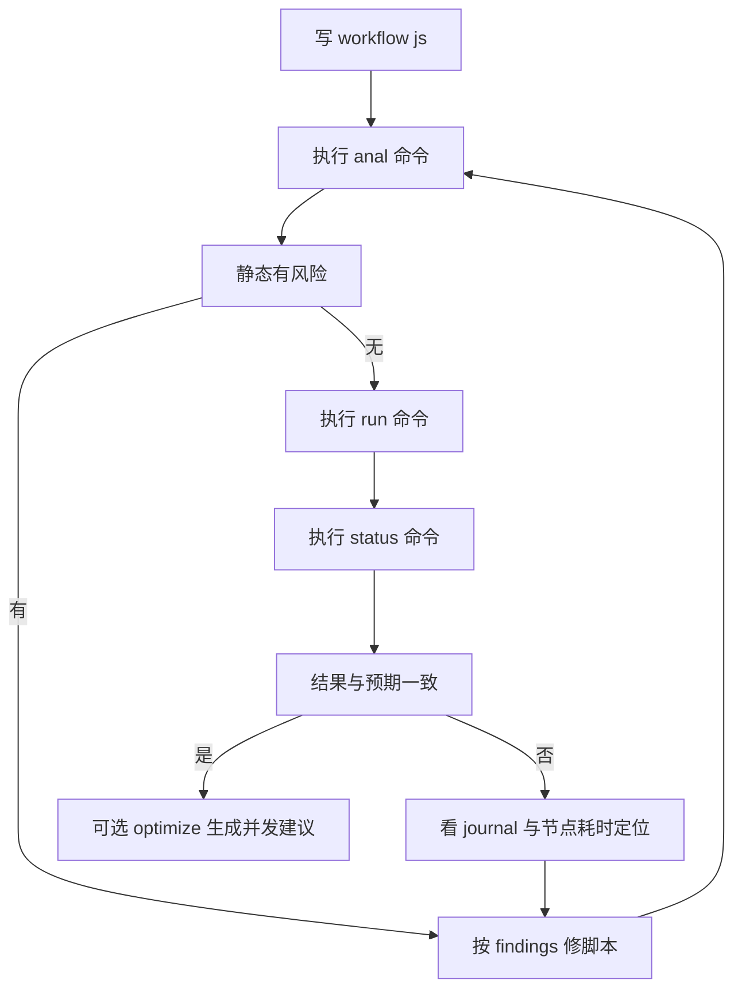

# Workflow JS 开发测试指南（含最小 workflow 实测记录）

- 日期：2026-11-23
- 目的：说明自己写 workflow js 后如何测试，并附一次完整实测输出
- 实测对象：`dev-examples/min-workflow/demo.js`（最小可跑示例）

---

## 一、四条命令的分工

| 命令 | 作用 | 是否执行脚本 | 典型耗时 |
| --- | --- | --- | --- |
| `/workflows anal <路径>` | 静态分析 + AI 规则复核 + Dashboard | **否** | 100ms（纯静态）/ 1~10 分钟（含 AI） |
| `/workflows run <路径> [k=v...]` | 后台真实执行，返回 runId | 是 | 取决于脚本 |
| `/workflows status <runId>` | 查单次运行详情（每 agent 耗时/token/失败） | 否 | 毫秒 |
| `/workflows watch <runId>` | 单 run 实时进度，完成自动回传 | 否 | 持续到你退出 |
| `/workflows cancel <runId>` | 停止在途 run（journal 保留） | 否 | 毫秒 |

辅助：

| 命令 | 作用 |
| --- | --- |
| `/workflows register <路径>` | 注册脚本，之后可用名字代替路径 |
| `/workflows list` | 列出注册表 |
| `/workflows optimize <路径>` | 生成优化候选（不改原文件） |
| `/workflows resume <路径> [--tasks]` | 任务级恢复 |

---

## 二、推荐测试顺序



要点：

1. **先 anal 再 run**：静态检查能提前发现缺 `timeoutMs`、重复注入大对象、动态分片无并发上限等，比跑一次几分钟才发现便宜得多。
2. **run 默认后台**：workflow 可能跑很久，`run` 立刻返回 runId，结果通过 deliver 回传会话。
3. **status 是证据入口**：每个 agent 的 `耗时 / token / 状态` 都在这里；`journal` 在 `.pi/workflows/journal/`，比 stdout 可靠。

---

## 三、最小 workflow 示例

`dev-examples/min-workflow/demo.js`：

```js
// 最小 workflow 示例：用于验证 /workflows anal → run → status 三步
export const meta = {
  id: 'min-demo',
  name: 'min_demo',
  description: '最小可跑示例：一个 agent 问候 + 一个确定性返回值',
  phases: [{ title: '问候' }],
}

const A = args || {}
const who = String(A.who || '世界')

phase('问候')
// timeoutMs 必须写：否则 /workflows anal 会报 TIMEOUT-001
const greeting = await agent(`只回复一句话：你好，${who}`, { timeoutMs: 60000, retries: 0 })

return { ok: true, who, greeting }
```

为什么这样写：

| 写法 | 原因 |
| --- | --- |
| `export const meta` | 注册表识别与 TUI 展示都依赖它；缺失时 `anal` 的目录模式会当成普通 js |
| `phases: [{ title }]` | 让 `status` 能按阶段聚合；没有 phase 时多阶段脚本难定位 |
| `args || {}` | 参数由 `run` 的 `k=v` 或 `args` 注入，直接解构 `args` 会在未传时崩溃 |
| `timeoutMs: 60000` | 缺省会命中 `TIMEOUT-001`；长任务必须显式声明 |
| `retries: 0` | 确定性任务不需要重试；`retries >= 2` 会命中 `RETRY-001` |
| `return {...}` | 结果会进 `status` 的「结果预览」与 deliver 回传 |

---

## 四、实测记录（2026-11-23）

驱动脚本：`dev-examples/min-workflow-run.ts`（直接调子命令实现，与 `/workflows` 路由同一对象）。

### ① `/workflows anal dev-examples/min-workflow/demo.js --no-rule-check --no-open`

```text
[info] 分析中…
dev-examples/min-workflow/demo.js
[info] Analyzer: dev-examples/min-workflow/demo.js
风险分 0/100
调用点 1（估算任务 1）
未发现静态风险。

完整报告：E:\WorkProjects\pi-code-mode\.pi\workflows\reports\demo.analysis.md
Dashboard：...\.pi\workflows\reports\dashboard\demo分析-Dashboard-20261123-01.html
[warning] AI 建议未生成（模型未给出可校验的结构化建议）；静态分析结果已在上方。
```

结论：

- 静态 0 风险 —— 因为显式写了 `timeoutMs`、`retries: 0`，没有并行、没有重复注入。
- `--no-rule-check` 跳过 AI 规则复核，所以几秒完成。
- Dashboard 正常生成并打印绝对路径。

### ② `/workflows run dev-examples/min-workflow/demo.js who=世界`

```text
[info] runId=run-1795402177668-2q1hjc
实时进度: /workflows watch run-1795402177668-2q1hjc（状态行跟踪，完成自动回传）
查询: /workflows status run-1795402177668-2q1hjc ｜ 停止: /workflows cancel run-1795402177668-2q1hjc
```

结论：`run` 是**后台**执行，立刻返回 runId 与三个后续命令提示。`who=世界` 被解析进 `args`。

### ③ `/workflows status run-1795402177668-2q1hjc`

```text
[deliver] [workflow 完成] runId=run-1795402177668-2q1hjc source=background:path:dev-examples/min-workflow/demo.js
名称: min_demo (最小可跑示例：一个 agent 问候 + 一个确定性返回值)
统计: 1 个 agent / 0 个工具节点 / 1 个阶段 / 2018ms
阶段: 问候
节点:
  - run-1795402177668-2q1hjc:0 问候 agent 1 (问候): ok 1944ms 9034tok
结果:
{
  "ok": true,
  "who": "世界",
  "greeting": "你好，世界"
}

runId: run-1795402177668-2q1hjc
状态: completed（path:dev-examples/min-workflow/demo.js）
启动: 2026-11-23T02:49:37.668Z  结束: 2026-11-23T02:49:39.687Z
结果预览: {"ok":true,"who":"世界","greeting":"你好，世界"}
节点:
  - 问候 agent 1 (问候): ok 1944ms
```

关键数据：

| 项 | 值 |
| --- | --- |
| 总耗时 | 2018ms |
| agent 数 | 1 |
| 单 agent 耗时 | 1944ms |
| token | 9034 |
| 状态 | completed |
| 返回值 | `{ ok: true, who: "世界", greeting: "你好，世界" }` |

结论：`args` 注入正确、agent 正常返回、结果回传与落盘都对。

---

## 五、看 what 的地方

| 想知道 | 去哪看 |
| --- | --- |
| 每个 agent 耗时 / token / 失败 | `/workflows status <runId>` |
| 实时进度 | `/workflows watch <runId>` |
| 完整分析报告（含问题簇、代码片段） | `.pi/workflows/reports/<name>.analysis.md` |
| Dashboard（规则检查 / AI 复核 / 问题列表） | `.pi/workflows/reports/dashboard/*.html` |
| 运行证据（不可篡改） | `.pi/workflows/journal/` |
| 优化候选与 diff | `.pi/workflows/optimizations/<opt-id>/review.md` |

---

## 六、常见问题

### 1. `anal` 报 `TIMEOUT-001`

agent 调用没写 `timeoutMs`，且没有 run 级超时。修：

```js
await agent(prompt, { timeoutMs: 600000 })
```

### 2. `anal` 报 `RETRY-001`

`retries: 2` 及以上。确定性任务改成 `retries: 0` 或 `1`；只有瞬时故障（网络抖动）才需要 2。

### 3. `anal` 报 `CONC-002`

`parallel(X.map(...))` 且 X 是运行时集合。这不是缺陷，是提示你确认三件事：分片数、并发上限、单次超时。

### 4. `run` 立刻返回但没看到结果

正常——后台执行。用 `/workflows status <runId>` 或 `/workflows watch <runId>`。

### 5. `status` 只显示「在途」

刚 `run` 完可能还在跑。`watch` 会实时刷；或稍后 `status`。

### 6. 传目录给 `anal`

会分析目录下**全部 js**（每个当平级 workflow），用于「入口 + 子流程」目录结构。

---

## 七、实测结论

```text
最小 workflow 的三步链路（anal → run → status）全部可用：
静态 0 风险 → 后台执行返回 runId → 2.0s 完成 → 结果与 token 明细可查。
```

需要注意的两个已知点：

1. `anal` 默认会跑 AI 规则复核（big 档，可能几分钟）。只想快速看静态就加 `--no-rule-check`。
2. `run` 没有前台模式；短脚本也要走 `status` 才能拿结果（或等 deliver 回传）。

---

## 引用

- 实测脚本：`dev-examples/min-workflow/demo.js`
- 驱动：`dev-examples/min-workflow-run.ts`
- 分析入口：`extensions/commands/workflows/analyze.ts`
- 执行入口：`extensions/commands/workflows/run.ts`
- 状态入口：`extensions/commands/workflows/status.ts`
- 规则说明：`src/engine/analyzer/rules/definitions/`
