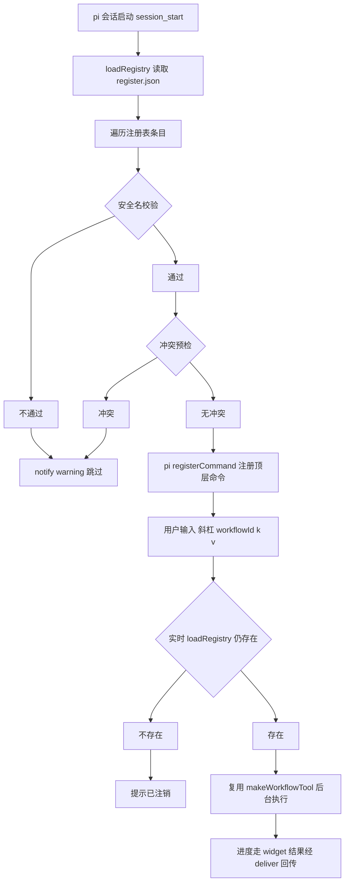

# Workflow 顶层斜杠命令直跑（/<workflowId>）执行计划

> 对应调研：`dev-docs/research/2026-11-20-pi-dynamic-workflows-slash-command-integration.md`（结论：可接入，约 0.5 天）
> 状态：待执行（进度表见文末，滚动更新）
> 涉及模型调用：无（不涉及 model-tiers 档位确认）

---

## 一、目标

workflow 经 `/workflows register <脚本>` 注册后，重启会话即可用顶层斜杠命令 `/<workflowId> [k=v...]` 直接后台执行，等价 `/workflows run <workflowId> [k=v...]`。不新增执行链，仅加命令壳。

验收标准：

1. 注册表内每个 workflow（安全名且无冲突）在重启会话后出现在 `/` 补全列表，可执行，结果回传会话
2. 名字不安全或与宿主/他扩展/本扩展命令冲突的条目：session_start 打 warning 跳过，`/workflows run` 仍可用（功能零损失）
3. `/workflows unregister` 后旧命令调用给出「已注销」提示而非执行（pi 不能注销命令，残留到重启是宿主限制）
4. `npm run test:contract` 全绿，`npm run build` 类型检查通过

## 二、方案总览



与第三方 pi-dynamic-workflows 的三点差异（利用我们的更好条件）：

| 差异点 | 第三方 | 本方案 | 理由 |
|---|---|---|---|
| 存储 | 保存脚本内联到 JSON（三级目录） | 复用现有 register.json manifest（file 引用） | 已存在且更显式，不重复造 |
| 执行 | 自有 startInBackground 全链 | 转发 makeWorkflowTool（scriptPath=id, background） | 执行链现成，run.ts 同款 |
| 参数默认值 | parameters schema 默认值回填 | 不做，k=v 直传 | YAGNI，需要时再补 |

## 三、任务拆解

### T1 新文件 `extensions/commands/workflows/direct-commands.ts`（核心，约 90 行）

```ts
/**
 * workflow 注册表顶层斜杠命令直跑（/<workflowId>）。
 *
 * session_start 时遍历 loadRegistry(cwd)，对每个安全且无冲突的 workflowId
 * 注册顶层斜杠命令，handler 转发 /workflows run 同款执行链（makeWorkflowTool
 * + background）。调用时实时重查注册表：pi 不能注销已注册命令，unregister 后
 * 旧命令残留到重启，实时查表保证其不再执行（提示已注销）。
 *
 * 保留名清单：宿主内置斜杠命令未从包主入口导出（实测 pi 1.4.x index.d.ts 无
 * BUILTIN_SLASH_COMMANDS，仅 dist/core/slash-commands.js 内部使用），故模块内
 * 维护常量；宿主升级后若导出改为 import（校对来源见调研报告第六节）。
 */

import type { ExtensionAPI } from "@earendil-works/pi-coding-agent"
import { loadRegistry } from "../../../src/engine/runtime/workflow-registry.js"
import { makeWorkflowTool, parseWorkflowsRunArgs } from "../../../src/tools/workflow-tools.js"
import type { WorkflowsCommandDeps } from "./types.js"

/** 宿主内置斜杠命令名（pi 1.4.x dist/core/slash-commands.js BUILTIN_SLASH_COMMANDS 抄录） */
const PI_RESERVED_COMMAND_NAMES: ReadonlySet<string> = new Set([
  "settings", "model", "tree", "thinking", "scoped-models", "export", "import",
  "share", "bug", "copy", "name", "session", "changelog", "hotkeys", "fork",
  "clone", "trust", "login", "logout", "new", "compact", "resume", "reload", "quit",
])

/** 本扩展已注册的顶层命令名（pi-code-mode.ts 装配的三个） */
const OWN_COMMAND_NAMES: ReadonlySet<string> = new Set(["workflows", "schedule", "explorer"])

/** 安全名：字母数字开头，仅字母数字下划线连字符，长度 1~64 */
export function isDirectCommandSafeName(name: string): boolean {
  return /^[A-Za-z0-9][A-Za-z0-9_-]{0,63}$/.test(name)
}

/** 冲突原因文案；undefined 表示可用。导出供 register.ts 与测试共用 */
export function directCommandConflict(pi: ExtensionAPI, name: string): string | undefined {
  if (PI_RESERVED_COMMAND_NAMES.has(name)) return `/${name} 是宿主保留命令名`
  if (OWN_COMMAND_NAMES.has(name)) return `/${name} 是本扩展命令名`
  try {
    if ((pi.getCommands?.() ?? []).some((c: { name: string }) => c.name === name))
      return `/${name} 已被其他扩展或命令模板占用`
  } catch {
    // getCommands 不可用时仅跳过该项检查（宿主兼容面，第三方同款降级）
  }
  return undefined
}

/** session_start 装配：注册表内每个安全且无冲突的 workflowId 注册为顶层斜杠命令 */
export function registerWorkflowDirectCommands(
  pi: ExtensionAPI,
  deps: WorkflowsCommandDeps,
  cwd: string,
): void {
  let registry: Map<string, { name: string; description?: string }>
  try {
    registry = loadRegistry(cwd)
  } catch {
    return // 注册表损坏由 /workflows list 的既有报错路径暴露，此处静默退出（不让装配打死会话启动）
  }
  for (const [id, wf] of registry) {
    if (!isDirectCommandSafeName(id)) {
      pi.sendMessage?.({ customType: "workflows-direct", content: `[workflow 直跑] "${id}" 命名不安全（限字母数字下划线连字符），已跳过顶层命令注册，仍可用 /workflows run ${id}`, display: false }).catch(() => {})
      continue
    }
    const conflict = directCommandConflict(pi, id)
    if (conflict) {
      pi.sendMessage?.({ customType: "workflows-direct", content: `[workflow 直跑] ${conflict}，"${id}" 已跳过顶层命令注册，仍可用 /workflows run ${id}`, display: false }).catch(() => {})
      continue
    }
    try {
      pi.registerCommand(id, {
        description: `workflow: ${wf.description || wf.name}（等价 /workflows run ${id}）`,
        handler: async (args: string, ctx: any) => {
          // 调用时实时查表：unregister 后旧命令残留（宿主不可注销），不得执行
          const useCwd = ctx.cwd ?? cwd
          let live: unknown
          try {
            live = loadRegistry(useCwd).get(id)
          } catch (e) {
            ctx.ui.notify(`[/${id}] 注册表读取失败: ${String((e as Error)?.message ?? e)}`, "warning")
            return
          }
          if (!live) {
            ctx.ui.notify(`workflow "${id}" 已注销（/${id} 命令残留至重启会话，重启后消失）`, "warning")
            return
          }
          const tokens = args.trim() ? args.trim().split(/\s+/) : []
          const parsed = parseWorkflowsRunArgs([id, ...tokens])
          if (parsed.error) {
            ctx.ui.notify(parsed.error, "warning")
            return
          }
          const tool = makeWorkflowTool({ ...deps.makeDeps(useCwd), deliver: deps.deliver })
          const r = await tool.execute("cmd", { scriptPath: id, args: parsed.args, background: true }, undefined, undefined, ctx)
          ctx.ui.notify((r as any).content[0].text, "info")
        },
      })
    } catch {
      // 宿主拒绝注册（如冻结 API）：单条失败不中断其余条目
    }
  }
}
```

实现注意：

1. `pi.sendMessage` 若不存在或抛错必须兜住（print/RPC 模式兼容面），`.catch(() => {})`；若宿主签名不匹配改用 `ctx.ui.notify` 需 ctx 的场景则在 handler 内提示。装配期无 ctx.ui（TUI 吞工厂期 console.log），这是用 sendMessage 的原因，与主入口「tier 模板创建结果通知」同款处理（pi-code-mode.ts 71 行注释）
2. `loadRegistry` 会因 register.json 手工改坏（id 重复）抛错——装配期整体 catch 静默退出，handler 内 catch 后 notify，不隐藏根因（报错文案带原始 message）
3. 同一会话多次 session_start（resume/fork 切换）重复注册同名命令是幂等覆盖（宿主 Map.set 语义），无害；重复 notify 可接受，不做去重状态（YAGNI）

### T2 `extensions/commands/workflows/index.ts` 加一行 re-export

```ts
// 文件顶部 import 区加：
import { registerWorkflowDirectCommands } from "./direct-commands.js"
// 文件底部 export 区加（供主入口与 contract 测试引用；同时满足架构守卫
// 「目录内每个子命令文件必须被 index.ts 引用」）：
export { registerWorkflowDirectCommands, isDirectCommandSafeName, directCommandConflict } from "./direct-commands.js"
```

不进 `subcommands` 路由表（它不是 /workflows 的子命令，是独立注册器），仅 re-export。

### T3 `extensions/pi-code-mode.ts` session_start 装配（约 5 行）

在现有 session_start 区（296 行 widgets.apply 附近）加：

```ts
// ---- workflow 注册表顶层斜杠命令直跑（/<workflowId>）----
pi.on("session_start", (_event, ctx) => {
  registerWorkflowDirectCommands(pi, { runManager, makeDeps, deliver }, resolve(ctx.cwd || process.cwd()))
})
```

注意：`resolve` 需确认主入口是否已 import node:path（实现时核对，缺则补）。ctx.cwd 是会话真实项目路径（与 /resume 跨项目语义一致）。

### T4 `extensions/commands/workflows/register.ts` 校验与提示文案

1. 注册成功前补安全名/保留名检查（复用 T1 导出的 `isDirectCommandSafeName` 与 `directCommandConflict`，需拿到 pi——`Subcommand.run` 的 ctx 无 pi，改为把两个纯函数校验放在 register 成功文案里提示，或经 deps 传入 pi。**实现取舍：仅做安全名校验 + 提示文案**，冲突检查留到 session_start 装配期统一做并 notify（同一判定逻辑单点维护，register 期无 pi 上下文））
2. 成功提示追加直跑说明：

```ts
ctx.ui.notify(
  `已注册 workflow "${workflowId}"（配置 ${path.resolve(cwd, ".pi/workflows/register.json")}，脚本保持原位 ${srcPath}）。` +
    (isDirectCommandSafeName(workflowId)
      ? `重启会话后可直接 /${workflowId} [k=v...] 直跑；运行中可用 /workflows run ${workflowId}`
      : `命名不安全（限字母数字下划线连字符），不可直跑，执行用 /workflows run ${workflowId}`) +
    `；移动或删除源文件后需重新 register，/workflows list 查看`,
  "info",
)
```

### T5 contract 测试

1. 新文件 `tests/contract/workflow-direct-commands.test.ts`（无模型，fake pi，参考 `workflows-command.test.ts` 样板）：
   - `isDirectCommandSafeName`：合法（smoke_test / a1-b）/ 非法（空串、中文、含空格、含 `/`、`.git`、超 64、`-abc` 开头连字符）
   - `directCommandConflict`：fake pi（getCommands 返回 [] 与 [{name:"x"}]）× 保留名 / 本扩展名 / 他方命令 / 无冲突四组
   - 注册循环：临时目录手写 register.json 两条（一安全一冲突名）→ fake pi 收集 registerCommand 调用 → 断言只注册安全条目、description 含等价 run 提示
   - handler 注销兜底：注册后删除 register.json → 调 handler → 断言 notify「已注销」且未触达执行链
   - handler 正常链：mock makeWorkflowTool 不可行（模块内直接 import），改为走真链 + background 假脚本会真起 run——**此用例不测执行，只测到「parseWorkflowsRunArgs 出参正确」为止**（执行链由 workflows-command.test.ts 既有覆盖，不重复）
2. `tests/contract/commands-structure.test.ts` 无需修改（direct-commands.ts 经 index.ts re-export 即满足两个守卫断言，跑一遍确认）

### T6 构建与端到端验收

1. `npm run build`（类型关卡，必过）
2. `npm run test:contract`
3. 干净房间端到端（`pi -ne -e <repo绝对路径>`，跳过已装扩展）：
   - `/workflows register dev-examples/sample-project-acceptance/A-basic/smoke-test.js`（若已注册先 unregister）
   - 退出重启 pi → 输入 `/smoke` 确认补全出现 `/smoke_test`
   - `/smoke_test` 执行 → widget 进度 → 结果回传会话
   - `/smoke_test foo=bar` 参数透传正常
   - `/workflows unregister smoke_test` → 再调 `/smoke_test` → 提示「已注销」
   - 注册一个故意冲突名（如 `new`）→ 重启 → warning 跳过且 `/workflows run new` 可用
4. 证据落盘：验收过程截图/输出贴回本文件进度表

## 四、风险与回滚

| 风险 | 对策 | 回滚 |
|---|---|---|
| 装配期异常打死会话启动 | loadRegistry/notify 全兜底，单条失败不中断 | T1 整体 try-catch 包裹 |
| 保留名清单随宿主升级漂移 | 清单注明来源版本；新宿主内置命令冲突时宿主自身有补全跳过诊断兜底 | 冲突条目 warning 跳过，run 通道可用 |
| unregister 后命令残留（宿主限制） | handler 实时查表拒绝执行 | 无需回滚，文案已说明重启消失 |
| 用户不想顶层命令污染补全 | 暂不做开关（YAGNI） | 需要时加 settings 开关一行 |
| fallback 模式（无 register.json 项目）目录扫描出大量旧脚本 | loadRegistry 两模式行为一致地注册——旧项目存量脚本全部变顶层命令，可能噪音大 | **实现时评估**：fallback 模式直接跳过直跑注册（仅 manifest 显式注册享受直跑），倾向此方案 |

## 五、工作量

| 任务 | 预估 |
|---|---|
| T1 direct-commands.ts | 1.5h |
| T2 index.ts re-export | 5min |
| T3 主入口装配 | 10min |
| T4 register.ts 文案 | 15min |
| T5 contract 测试 | 1h |
| T6 构建 + 端到端验收 | 1h |
| 合计 | 约 0.5 天 |

## 六、进度记录（滚动更新）

| 任务 | 状态 | 完成时间 | 备注 |
|---|---|---|---|
| T1 direct-commands.ts | 未开始 | — | — |
| T2 index.ts re-export | 未开始 | — | — |
| T3 主入口装配 | 未开始 | — | — |
| T4 register.ts 文案 | 未开始 | — | — |
| T5 contract 测试 | 未开始 | — | — |
| T6 构建 + 验收 | 未开始 | — | — |

完成后：本文件移入 `dev-docs/planning/completed/`，并按规范同步 `dev-docs/progress/执行进度.md` 与 `dev-docs/progress-result/` 阶段报告。

## 七、参考

- 调研报告：`dev-docs/research/2026-11-20-pi-dynamic-workflows-slash-command-integration.md`（第三方机制、宿主行为实测）
- 第三方源码：thirdparties/pi-dynamic-workflows/src/saved-commands.ts（调用时求值模式）、command-registry.ts（保留名清单 27 个，含 3 个彩蛋名我们不需要）
- 宿主源码：pi-coding-agent dist/core/slash-commands.js（BUILTIN_SLASH_COMMANDS 26 个名字）、dist/core/extensions/loader.js（registerCommand Map.set 幂等语义）、dist/modes/interactive/interactive-mode.js（冲突命令补全跳过诊断）
- 本仓库：extensions/commands/workflows/{register,run,types}.ts、src/engine/runtime/workflow-registry.ts、src/tools/workflow-tools.ts、tests/contract/{commands-structure,workflows-command}.test.ts
