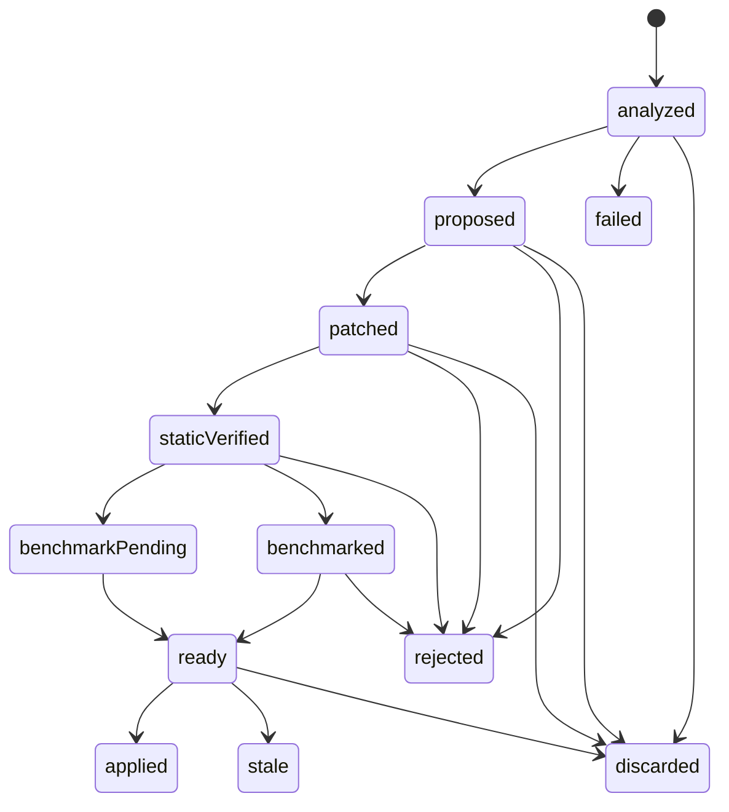

# Workflow Optimize 简化命令执行计划

- 日期：2026-11-20
- 目标：把 pi-code-mode 已有但未接成产品流程的 Analyzer、AI Rule Check、Planner、独立工作区、Benchmark、质量门、备份与基线能力，落地为一个用户可安全使用的 Workflow JS 优化闭环。
- 用户命令面：从 6 条生命周期命令收敛为 3 条，其中日常只需 1 条。
- 关联文档：
  - `dev-docs/design/2026-11-20-workflow-optimization-lifecycle-design.md`
  - `dev-docs/design/2026-11-20-workflow-optimization-command-simplification.md`
  - `CLAUDE.md`「大模型调用规范（强制）」

---

## 一、最终用户接口

```text
/workflows optimize <file-or-dir> [--rules RULE,RULE] [--tier TIER] [--fresh]
/workflows optimize apply <optimization-id>
/workflows optimize rollback <optimization-id>
```

### 1.1 明确不做的命令

以下不作为公开用户命令：

```text
start / status / review / benchmark / discard
```

原因：它们是内部生命周期，不是独立用户意图。

| 内部阶段 | 用户如何看到 |
| --- | --- |
| start | `optimize <target>` 自动执行 |
| status | 每次命令摘要 + session.json；重复执行同 target 自动提示未完成会话 |
| review | `optimize <target>` 自动生成 review.md 并展示摘要 |
| benchmark | `optimize <target>` 自动执行；没有验证器则明确 `待验证` |
| discard | 临时 workspace 按 TTL 清理；审计记录保留 |

### 1.2 用户语义

| 命令 | 用户承诺 | 是否修改生产文件 |
| --- | --- | --- |
| `optimize <target>` | 生成并验证优化候选 | **否** |
| `optimize apply <id>` | 将已验证候选写回原文件 | 是，先备份、再原子写 |
| `optimize rollback <id>` | 从该候选的备份恢复 | 是，需二次确认 |

---

## 二、强制安全不变量

这些是实现验收的硬规则，不是建议。

```text
I1  optimize / review / benchmark 阶段生产文件零写入
I2  只有 optimize apply 唯一允许写生产文件
I3  apply 前必须验证 source hash 未变化
I4  apply 前必须创建 backup manifest
I5  apply 只能用 writeFileAtomic
I6  apply 后必须重新 anal 并落盘最终报告
I7  失败不自动 rollback，保留新状态与 backup，用户显式 rollback
I8  无真实质量验证的候选禁止 apply
I9  所有 LLM 调用必须走 model-tiers.json
I10  PatchSet 的每处 edit 必须能唯一匹配 oldText，禁止整文件 AI 覆盖
```

---

## 三、Optimization Session 设计

### 3.1 目录

```text
.pi/workflows/optimizations/
  opt-YYYYMMDD-NNN/
    session.json
    before.report.json
    before.report.md
    before.dashboard.html
    proposal.json
    patchset.json
    workspace/
      <target 的完整相对目录结构>
    after.report.json
    after.report.md
    after.dashboard.html
    benchmark.json
    review.md
    result.json
    backup/                 # 仅 apply 后生成
      manifest.json
      <原文件备份>
```

说明：

- `workspace/` 必须复制**目标目录树**，不能只复制一个 js 文件。Workflow 常通过相对 `scriptPath` 调子流程；只复制入口会让验证变成假验证。
- `backup/` 仅在 apply 前创建，候选阶段不需要污染生产目录。
- workspace 可 TTL 清理；`session.json`、报告、diff、benchmark、backup manifest 是审计证据，保留。

### 3.2 `session.json`

```ts
export type OptimizationStatus =
  | "analyzed"
  | "proposed"
  | "patched"
  | "static-verified"
  | "benchmark-pending"
  | "benchmarked"
  | "ready"
  | "applied"
  | "stale"
  | "rejected"
  | "failed"
  | "discarded"

export interface OptimizationSession {
  schemaVersion: "1.0"
  id: string
  createdAt: string
  updatedAt: string
  status: OptimizationStatus

  target: {
    kind: "file" | "directory"
    root: string
    /** 所有可改生产文件的 source hash，apply 前逐项重验 */
    sourceHashes: Record<string, string>
  }

  selectedClusters: string[]

  model: {
    generatorTier: string
    generatorModel?: string
    reviewerTier: string
    reviewerModel?: string
  }

  workspace: {
    path: string
    patchApplied: boolean
  }

  validation: {
    patchSchema?: "pass" | "fail"
    sourceUnchanged?: "pass" | "fail"
    static?: "pass" | "fail"
    aiRuleCheck?: "pass" | "fail" | "partial"
    benchmark?: "pass" | "fail" | "pending" | "unavailable"
    quality?: "pass" | "fail" | "pending" | "unavailable"
  }

  reason?: string
}
```

### 3.3 状态迁移



说明：Mermaid 节点名称只用中英文和空格，避免特殊字符。代码中的真实状态值见上方类型。

---

## 四、PatchSet：结构化最小补丁

### 4.1 禁止的接口

禁止：

```ts
patchedSource: string
```

原因：它允许模型整文件重写，无法验证修改范围，也无法支持多文件 target。

### 4.2 PatchSet schema

```ts
interface PatchEdit {
  startLine: number
  endLine: number
  oldText: string
  newText: string
  rationale: string
  relatedCluster: string
}

interface PatchFile {
  path: string
  expectedSourceHash: string
  edits: PatchEdit[]
}

interface PatchSet {
  schemaVersion: "1.0"
  targetRoot: string
  files: PatchFile[]
  needsHumanDecision?: Array<{
    cluster: string
    question: string
    options: string[]
  }>
}
```

### 4.3 Patch validator

新增：`src/engine/optimizer/patch-validator.ts`

| 校验 | 失败处理 |
| --- | --- |
| 文件路径在 target root 内 | reject |
| 不含 `..`、绝对跳转、`.git`、`node_modules`、`thirdparties` | reject |
| `expectedSourceHash` 与 workspace 源一致 | reject |
| 每个 `oldText` 在文件中唯一匹配 | reject |
| edit 的行号/oldText 与 selected cluster 证据相关 | reviewer 或 reject |
| JS 能 parse | reject |
| patch 后 export/meta 基本结构未消失 | reject |
| PatchSet 没有 edits 且没有 needsHumanDecision | reject |

### 4.4 多 edit 应用顺序

同一文件的 edit 按 `startLine` **倒序**应用，避免前面的替换改变后面行号。

同一文件 edit 区间重叠：直接 reject，不尝试智能合并。

---

## 五、O0：命令与会话骨架

### 目标

`/workflows optimize <target>` 能创建可审计会话，但不生成 patch。

### 文件改动

```text
extensions/commands/workflows/
  optimize/
    index.ts
    start.ts
    apply.ts
    rollback.ts
    types.ts

src/engine/optimizer/
  session-store.ts
  session-types.ts
  target-resolver.ts
  review-renderer.ts
```

### 实现步骤

1. 在 `extensions/commands/workflows/index.ts` 注册 `optimize`。
2. `index.ts` 只做路由：无参数显示 help；`apply` / `rollback` 分发；其他参数进 start。
3. 复用 `analyze.ts` 的 target resolver：
   - 文件：单文件 + sibling workflow 聚合
   - 目录：目录下全部 js
   - registry：注册表 script
4. 调用 `analyzeWorkflow()`，默认含静态、AI Rule Check、Planner。
5. 从 `report.clusters` 选安全候选：
   - 默认可选：`DET-001`、`IO-001`、`REC-002`
   - 默认排除：`SERIAL-002`、`CONC-002`、`SIDEFX-001`、`BUDGET-001`
6. 创建 `opt-YYYYMMDD-NNN` 目录与 session.json。
7. 写入 before 报告和初版 review.md。
8. 输出候选 id 和状态 `analyzed`。

### O0 验收

```text
/workflows optimize <target>
```

必须：

- 生成 session 目录。
- 写 before report / dashboard / session.json。
- 生产 source hash 不变。
- 没有安全候选时说明原因，而不是创建空 patch。
- 结构测试检查 optimize 路由已装配。

---

## 六、O1：Patch Generator 与隔离工作区

### 6.1 新模型调用前提

Patch Generator 与 Patch Reviewer 是新的 LLM 调用点，必须先按 CLAUDE.md 询问用户并记录档位决策。

推荐，尚未确认：

| 调用点 | 推荐档位 | 原因 |
| --- | --- | --- |
| Patch Generator | `big` | 改生产 JS，正确性优先 |
| Patch Reviewer | `fast` | 按约束审 diff，速度优先 |

实现前必须调用 `ask_user_question`，不能把推荐视为已确认。

### 6.2 目标目录复制

新增：`src/engine/optimizer/workspace.ts`

算法：

1. 确定 `targetRoot`：文件 target 用父目录；目录 target 用目录本身。
2. 复制 targetRoot 下允许的文本文件（`.js`、必要 `.json`、`.md`）。
3. 排除：`.git`、`node_modules`、`dist`、journal、baseline、优化会话目录。
4. 保留相对路径。
5. `workspace/manifest.json` 记录 copied files 的 source hash。

### 6.3 Patch Generator prompt

输入：

```text
已选问题簇
相关 rule.md
受影响文件的完整源码
关联文件的只读上下文
PatchSet JSON schema
允许范围
Required Validation
```

必须写入 prompt：

```text
不要输出完整文件。
只输出 JSON PatchSet。
每个 oldText 必须来自提供源码且唯一。
不能修改未列出的文件。
不确定时输出 needsHumanDecision，不要猜。
```

### 6.4 Patch Reviewer

输入：

```text
before source
PatchSet
after diff
selected clusters
AI Rule Check 结果
Required Validation
```

输出：

```ts
interface PatchReview {
  decision: "approve" | "reject" | "needs-human"
  findings: Array<{
    severity: "high" | "medium" | "low"
    file: string
    evidence: string
    reason: string
  }>
}
```

### O1 验收

选择 `DET-001` 单个问题簇：

- Generator 生成结构化 PatchSet。
- Validator 通过。
- workspace 文件改变，生产文件 byte-for-byte 未变。
- after 静态分析目标簇减少或消失。
- review.md 含 before/after unified diff。

---

## 七、O2：真实 Benchmark 与质量门

### 7.1 真实执行适配器

新增：`src/engine/optimizer/workflow-benchmark-adapter.ts`

职责：把 workflow 真实运行结果、journal、run snapshot 转成 `BenchmarkRunMetrics`。

```ts
async function runOnce(input: {
  scriptPath: string
  cwd: string
  args: Record<string, unknown>
  label: "before" | "after"
  runDir: string
}): Promise<BenchmarkRunMetrics>
```

必须记录：

- `durationMs`
- agent 数
- input/output token
- failed agent 数
- journal 路径
- Required Validation passed / failed
- output artifact hash

### 7.2 输入规模锁定

before / after 必须：

```text
同 target
同 args
同 inputScale
不同 runDir
相同模型档位
相同并发设置
```

否则 benchmark 状态为 `unavailable`，不能比较。

### 7.3 质量验证来源

优先级：

1. Plan Definition 的 Required Validation。
2. 用户提供的 verifier command / JSON schema。
3. Workflow 产物的 schema + hash + 关键字段断言。
4. 没有以上任何一种：`quality=unavailable`，禁止 apply。

### 7.4 Benchmark accept 规则

```text
after.ok
AND Required Validation 全部通过
AND after failedAgents <= before failedAgents
AND 至少一个主指标改善 >= 5%
AND 没有 evidenceCoverage / validationPass 下降
```

不满足时 session -> `rejected`，保留 workspace 与 review，但不能 apply。

### O2 验收

用一个可短跑的 sample workflow：

- before / after 各跑一次。
- 输出真实指标对比。
- 人为让 after 验证失败，必须 rejected。
- 人为让 after 变慢，必须不 accepted。
- baseline 只记录 accepted after。

---

## 八、O3：review、apply、rollback

### 8.1 自动 review.md

`optimize <target>` 完成后自动生成：

```md
# 优化审阅：opt-xxx

## 原问题簇
## 修改意图
## 文件差异
## 静态验证
## AI Rule Check
## Benchmark
## 质量门
## 可否应用
```

### 8.2 apply

命令：

```text
/workflows optimize apply opt-xxx
```

步骤：

1. 读取 session，要求状态 `ready`。
2. 检查所有生产 source hash；不一致 -> `stale`、拒绝。
3. 创建 `backup/manifest.json` 与原文件备份。
4. 对每个文件调用 `writeFileAtomic`。
5. 写 result.json：记录 beforeHash / afterHash / backup path。
6. 对生产 target 重跑 `anal`（至少静态 + AI Rule Check）。
7. 写 BaselineStore 与 SuggestionReview。
8. session -> `applied`。

### 8.3 rollback

命令：

```text
/workflows optimize rollback opt-xxx
```

步骤：

1. 显示要恢复的文件数与当前 hash。
2. 要求确认。
3. 从 backup manifest 原子恢复。
4. 重跑静态 `anal`。
5. session -> `rolled-back`（需扩展状态）。

### O3 验收

| 场景 | 预期 |
| --- | --- |
| 未 apply | 生产文件不变 |
| apply 前手工改源 | hash mismatch，拒绝 |
| apply 正常 | backup 存在，afterHash 一致 |
| apply 后 anal 失败 | 不自动 rollback，状态和 backup 保留 |
| rollback | 原 hash 恢复，重新 anal 落盘 |

---

## 九、测试矩阵

### 9.1 单元测试

```text
tests/optimizer/
  session-store.test.ts
  target-resolver.test.ts
  patch-validator.test.ts
  workspace.test.ts
  patch-review.test.ts
  workflow-benchmark-adapter.test.ts
  apply-rollback.test.ts
```

必须覆盖：

- 路径穿越。
- oldText 非唯一。
- 重叠 edit。
- 源 hash 已变化。
- workspace 不修改生产文件。
- backup manifest 完整。
- benchmark 质量失败。
- 无 verifier 禁 apply。
- rollback 显式确认。

### 9.2 Contract 测试

```text
tests/contract/optimize-command.test.ts
```

覆盖：

- optimize 路由结构。
- 默认命令解析。
- `apply` / `rollback` 参数解析。
- 文件和目录 target。
- 无模型 fake generator / reviewer。
- 命令摘要不泄露内部 start/status/review/benchmark 子命令。

### 9.3 真实验收

先用短流程，不直接拿 game-requirement-audit 这种 11 子流程、长时模型链路做首验收。

第二阶段再用：

```text
thirdparties/PrdGameSkill/.opencode-workflows/workflows/game-requirement-audit/
```

优先问题簇：

```text
DET-001 → IO-001（有安全文件工具后）→ REC-002
```

禁止作为首个自动 patch：

```text
SERIAL-002 / CONC-002 / SIDEFX-001 / BUDGET-001
```

---

## 十、执行顺序、依赖和完成定义

| 阶段 | 依赖 | 预计输出 | 可独立验收 |
| --- | --- | --- | --- |
| O0 | 无 | optimize 命令 + session 骨架 | 是 |
| O1 | O0 + 用户确认 generator/reviewer 档位 | PatchSet + workspace + review.md | 是 |
| O2 | O1 + 可短跑 workflow/verifier | 真实 Benchmark + 质量门 + baseline | 是 |
| O3 | O2 | apply + backup + rollback | 是 |
| O4 | O2/O3 多次优化记录 | suggestion effectiveness 知识库 | 否，增量 |

### 最小可交付版本

```text
O0 + O1
```

用户可：

```text
/workflows optimize <target>
```

并得到候选优化、完整 diff、静态/AI 复核、工作区路径；原文件不变。

### 完整可应用版本

```text
O0 + O1 + O2 + O3
```

只有这个版本才允许对生产 Workflow JS 执行 `apply`。

---

## 十一、实施前阻塞决策

根据 `CLAUDE.md` 的模型档位强制规范，O1 的两个新 LLM 调用点必须由用户确认：

| 调用点 | 推荐档位 | 选择理由 |
| --- | --- | --- |
| Patch Generator | `big` | 生成生产 JS 修改，正确性优先 |
| Patch Reviewer | `fast` | 约束审查 diff，速度优先 |

确认后，在 `CLAUDE.md` 的已确认档位决策表中登记，再开始 O1。

---

## 十二、预期用户摘要

### 候选已就绪

```text
[优化候选已就绪] opt-20261120-001

目标：game-requirement-audit/
问题簇：DET-001
修改：1 个文件 / 2 处最小补丁

静态：37 条 → 34 条
AI Rule Check：DET-001 hit → pass
Benchmark：耗时 -18% / token -12% / 验证全部通过

原文件未修改。
审阅：.pi/workflows/optimizations/opt-20261120-001/review.md

写回：/workflows optimize apply opt-20261120-001
```

### 候选待验证

```text
[优化候选待验证] opt-20261120-002

Patch 与静态验证已通过，但没有可用的真实质量验证器。
原文件未修改，不能 apply。

请补充 Plan Required Validation 或 verifier 后重新执行 optimize。
```
