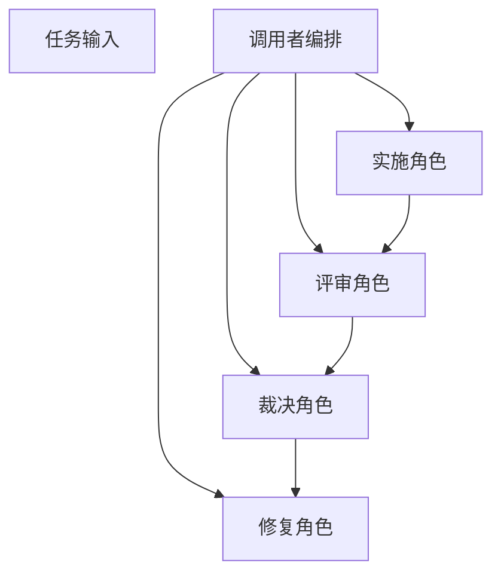

# 内置角色与质量闭环 Workflow 执行计划

- 日期：2026-11-20
- 状态：待实施
- 修订：保留四个可独立运行的角色 workflow，并同时保留基于它们的 `quality-loop` 组合 workflow；调用方仍可按实际任务自由编排其他组合。
- 前置分析：[ak-pi-workflow-roles Agent 体系与内置 Workflow 封装分析](../research/2026-11-20-ak-pi-workflow-roles-agent-analysis.md)
- 参考来源：`thirdparties/ak-pi-workflow-roles`（Apache-2.0，固定版本 `fbe6c7c15b4e5acb34d09796af7af9bbf9080c3f`）

## 1. 决策与目标

本期交付四个**可单独运行的内置角色 workflow**，以及一个显式复用它们的默认组合 workflow `quality-loop`：

| workflow ID | 类型 | 职责 | 是否修改代码 |
| --- | --- | --- | --- |
| `coder` | 独立角色 | 理解任务、修改代码、构建与测试、自验 | 是 |
| `reviewer` | 独立角色 | 独立检查当前改动，输出可核查 findings | 否 |
| `judge` | 独立角色 | 根据任务、变更、验证和评审材料输出裁决 | 否 |
| `fixer` | 独立角色 | 按已确认 findings 修复根因并验证 | 是 |
| `quality-loop` | 组合 workflow | `coder → reviewer → judge → 条件 fixer → 复审/复裁决` | 条件性 |

四个角色 workflow 保持独立：不相互隐式调用，不内嵌固定的审查顺序、重试轮次或模型档位。`quality-loop` 是一个单独、显式的调用方脚本，提供可直接使用的默认质量闭环；用户、后续 workflow 脚本和上层产品能力仍可按实际情形自由组合角色。



上图中的箭头只表示常见的信息流，并非 runtime 强制拓扑。例如，日常需求可只运行 `coder`；“fast 修改 + big 评审”可依次运行 `coder` 与 `reviewer`；高风险需求未来可由另一个编排 workflow 调用全部四个角色。

## 2. 为什么采用独立角色，而非预置闭环

1. **模型档位由每次调用决定**：`coder` 可使用 `fast`，`reviewer` 可使用 `big`；不需要在一个大 workflow 中暴露越来越多的 tier 参数。
2. **调用成本可控**：只想改代码时不应为 judge/fixer 付出额外调用成本。
3. **组合不预设**：不同项目、风险等级和用户偏好会需要不同链路；一期不猜测唯一正确流程。
4. **角色职责清晰**：独立 workflow 的输入、输出、权限和测试可以分别演进。
5. **遵循参考项目原则**：参考项目 ADR 0010 明确由调用方拥有角色组合、重复和停止权。
6. **复用现有能力即可**：本项目已有 workflow registry、直接命令、模型档位和 journal；无需改 runtime。

## 3. 范围与非范围

### 3.1 本期范围

- 在正式 `workflows/` 目录新增 `coder.js`、`reviewer.js`、`judge.js`、`fixer.js` 和 `quality-loop.js`；
- 每个角色脚本只发起一次对应职责的 `agent()` 调用，并返回稳定的结构化结果；
- `quality-loop` 作为调用方，显式组合四个角色，默认限制修复轮数；
- 使用已有 `/workflows register <脚本路径>` 进行注册；
- 为每个脚本编写 parser、registry 和 fake-runner 合同测试；
- 通过现有 RunManager/journal 保存每次角色运行记录；
- 允许用户为每次角色调用单独选择模型档位。

### 3.2 明确不做

1. 不在任何独立角色内部硬编码 `coder → reviewer → judge → fixer` 链路；该链路只属于 `quality-loop` 这个调用方 workflow。
2. 不新增 `Role`、`Soul`、`Court`、角色注册表等 runtime 抽象。
3. 不调用外部 `ak-role` CLI，不移植其票号、账本、多宿主或 CLI 配置。
4. 不自动执行 Git `commit`、`push`、`merge`、发版、创建 PR 等不可逆操作。
5. 不实现 `collector`、`diarist`、`inspector`、`notary`、`auditor`、`doctor` 等扩展角色。
6. 不为角色选择默认模型；每个新增 LLM 调用点的 tier 均需先按项目规则由用户确认。
7. 不让代码根据自由文本关键字决定流程；仅消费受限 JSON 字段。

## 4. 内置角色的通用约定

### 4.1 文件和元信息

```text
workflows/
  coder.js
  reviewer.js
  judge.js
  fixer.js
  quality-loop.js
```

每个文件是一个独立、一级的 JS workflow。建议元信息如下：

```js
export const meta = {
  id: "coder",
  name: "代码实施",
  description: "按任务修改代码、运行必要验证并如实报告结果",
}
```

其他三个文件分别使用 `reviewer`、`judge`、`fixer` 作为 `id`。ID 与现有顶层命令安全命名规则兼容，注册并重启会话后可以分别通过 `/coder`、`/reviewer`、`/judge`、`/fixer` 调用。

### 4.2 输入约定

所有角色共享最小输入：

```ts
{
  task: string,       // 必填：用户目标或要审查/修复的事项
  tier?: string       // 必填语义：调用时应显式指定一个已确认档位
}
```

按角色追加可选输入：

```ts
// coder
{ validation?: string[] }

// reviewer
{ focus?: string, base?: string }

// judge
{ materials?: string[], findings?: unknown[] }

// fixer
{ findings: unknown[], validation?: string[] }
```

一期不引入文件上传、外部路径解析或第二套附件协议。角色应从当前项目工作区、当前 diff 和调用方提供的文本/结构化参数获取需要的事实；引用大材料时优先传路径或现有 journal/run 引用，避免反复注入全文。

### 4.3 通用输出契约

每个脚本必须返回一个对象；实际实现采用当前 DSL 支持的结构化输出能力。若 workflow 脚本层不能直接声明 schema，则 prompt 仅输出 JSON，随后使用现有 `verify()` 做最小形状验证。

```ts
{
  role: "coder" | "reviewer" | "judge" | "fixer",
  status: "completed" | "converged" | "continue" | "escalate",
  summary: string,
  findings: Array<{
    severity: "critical" | "high" | "medium" | "low",
    location: string,
    evidence: string,
    recommendation: string
  }>,
  evidence: string[],
  nextStep: string
}
```

输出约束：

- `findings` 可为空；空 findings 不自动表示整个任务通过；
- `evidence` 应引用文件、diff、命令、测试、日志或已知输入事实；
- `status` 只使用枚举值，调用方绝不能通过 `summary` 中的自然语言猜测分支；
- 上游角色的完整结果可原样传给下游角色，但下游必须自行核查工作区事实，不把模型自述当证据。

## 5. 角色规格

### 5.1 `coder`：代码实施

**输入**：`task`，可选 `validation`。

**职责**：理解任务与已有实现，以最小改动实现需求，运行项目规定的构建和测试，并报告真实结果。

**状态**：

| 状态 | 含义 |
| --- | --- |
| `completed` | 代码已改动，已报告执行过的验证及结果。 |
| `escalate` | 缺少授权、需求不清、必要资源/凭据缺失或存在必须由用户决定的设计选择。 |

**硬边界**：

- 修改 `src/` 后必须先运行 `npm run build`，再进行测试；
- 不执行 commit/push/merge/发布，不改全局模型或宿主配置；
- 不以防御式吞错掩盖问题；失败和阻塞必须如实返回；
- 不因未来可能需求增加抽象或依赖。

### 5.2 `reviewer`：独立代码评审

**输入**：`task`，可选 `focus`、`base`。

**职责**：独立检查当前工作区改动、相关调用路径、测试和任务目标，报告实际可复现的质量问题。

**状态**：

| 状态 | 含义 |
| --- | --- |
| `completed` | 已完成审查，findings 可为空。 |
| `escalate` | 缺少必要基线、材料或审查目标存在无法由评审解决的冲突。 |

**硬边界**：

- 不修改代码，不做 Git 不可逆操作；
- findings 必须带 `location` 和 `evidence`；
- 不把纯风格偏好或无任务依据的“最佳实践”包装成阻塞问题；
- 不复述 coder 自评作为事实，必须自行检查。

### 5.3 `judge`：裁决

**输入**：`task`，可选 `materials` 与 `findings`。

**职责**：审阅任务目标、当前变更、验证证据与已提供 findings，裁决当前结果是否可接受、需修复还是需要用户决定。

**状态**：

| 状态 | 含义 |
| --- | --- |
| `converged` | 需求和验证证据足以支持通过。 |
| `continue` | 存在明确、可执行且范围受限的修复项。 |
| `escalate` | 存在需求冲突、架构取舍、权限不足或无法可靠判定的事实。 |

**硬边界**：

- 不修改代码；
- 对 findings 检查事实依据，不能把前序模型结论直接当真；
- `converged` 必须说明需求覆盖和关键验证依据；
- `continue` 必须给出可由 fixer 执行的清晰事项；
- 无法基于现有证据裁决时必须升级，不可臆测。

### 5.4 `fixer`：问题修复

**输入**：`task`、必填 `findings`，可选 `validation`。

**职责**：仅处理已确认的 findings，在根因处修复，完成必要验证并报告结果。

**状态**：

| 状态 | 含义 |
| --- | --- |
| `completed` | 已完成修复并报告变更和验证。 |
| `escalate` | 修复需要用户决定、缺乏前置条件，或 findings 本身无法可靠执行。 |

**硬边界**：

- 不顺手扩大任务范围；
- 优先删除、简化和复用，而不是增加补丁或新框架；
- 不改提交历史、不推送、不合并；
- 对每条 findings 说明修复动作、验证结果和未解决限制。

## 6. 使用与组合示例

角色注册一次后可独立运行。以下均是调用者决定的例子，而不是角色中的内置行为。

### 6.1 只改代码

```text
/coder task="修复登录接口的超时重试问题" tier=fast
```

适用于低风险、任务明确的改动。用户自行检查结果并决定是否提交。

### 6.2 fast 实施，big 评审

```text
/coder task="修复登录接口的超时重试问题" tier=fast
/reviewer task="评审当前工作区中登录接口超时重试的改动" tier=big
```

这是日常推荐组合：快模型做实现，强模型做独立检查。reviewer 不会自动触发 judge 或 fixer。

### 6.3 评审后人工决定是否修复

```text
/reviewer task="评审当前工作区改动" tier=big
/fixer task="修复以下已确认问题" findings="<reviewer 输出的 findings>" tier=fast
```

适合用户想保留对 findings 取舍的控制。

### 6.4 高风险人工门控链

```text
/coder task="实现支付回调幂等处理" tier=big
/reviewer task="审查支付回调相关改动" focus="correctness,security" tier=big
/judge task="裁决支付回调改动是否可接受" materials="<coder 与 reviewer 输出>" tier=ultra
```

若 judge 返回 `continue`，调用者可将其 findings 交给 fixer；若返回 `escalate`，先由用户做产品/架构决策。

### 6.5 默认质量闭环

`quality-loop` 保留为开箱即用的默认组合：

```text
coder → reviewer → judge → 条件 fixer → reviewer → judge
```

默认最多进行一轮修复。judge 返回 `converged` 时结束并交回调用者；返回 `escalate` 时立即交由用户决策；一轮修复后仍为 `continue` 时返回未收敛结果，而不是无限循环。

`quality-loop` 不复制四个角色的 prompt。它通过现有 workflow 机制调用独立角色 workflow，或传递相同的受限输入/输出契约；具体调用语法以实施时 `workflow-authoring` Skill 和 runtime 支持为准。

默认档位应保持可配置，例如：

```text
coder=fast reviewer=big judge=big fixer=fast
```

调用者可覆盖每个角色的 tier；组合脚本必须显式记录实际使用的档位。

### 6.6 后续可编排的工作流

在 `quality-loop` 之外，当存在稳定的真实使用模式后，再新增其他组合 workflow。例如：

```text
fast-implement-big-review
coder-review-judge
release-quality-gate
```

这些都是调用方层的脚本，应复用独立角色 workflow，而不是将组合逻辑重新写进角色本身。

## 7. 注册与发现

一期不新增命令，复用已有注册入口：

```text
/workflows register workflows/coder.js
/workflows register workflows/reviewer.js
/workflows register workflows/judge.js
/workflows register workflows/fixer.js
```

现有机制将脚本原位路径记录至 `.pi/workflows/register.json`。重启会话后，符合名称约束的工作流可作为顶层命令运行；当前会话内可通过 `/workflows run <id>` 使用。

不增加“内置 registry”或复制脚本的安装机制。若后续四个角色稳定使用，且四次手动注册被证明是实际摩擦，再新增 `/workflows register-builtin <name>`，并且只复用 `addToManifest()`、脚本校验和已有 manifest 格式。

## 8. 模型档位决策门

角色与模型档位必须解耦。每次运行可以选择不同 tier，例如 `coder=fast`、`reviewer=big`、`judge=ultra`。

但在实施新角色 workflow 前，项目规则要求用户先确认每个新增 LLM 调用点使用哪个档位。实施开始前应一次性询问：

| 角色 | 建议首选 | 原因 |
| --- | --- | --- |
| coder | `fast` | 日常修改和验证优先低延迟、低成本。 |
| reviewer | `big` | 独立评审需要更强的代码理解和证据判断。 |
| judge | `big` 或 `ultra` | 裁决高风险改动时按任务风险选择。 |
| fixer | `fast` | 已有受限 findings 时以快速定向修复为主。 |

确认后，所有 `agent()` 必须显式写入相应 `tier`，并通过 `.pi/workflows/model-tiers.json` 解析。档位解析不到时必须由既有能力 warning 后回退会话默认；不得硬编码 provider/model。确认结果要回填项目 `CLAUDE.md` 的已确认决策表。

## 9. 实施任务拆解

### P0：实现前核验

| 编号 | 工作 | 交付物 | 验收 |
| --- | --- | --- | --- |
| P0-1 | 阅读 `workflow-authoring` Skill | 实施记录 | 确认当前 DSL 的 `agent()`、结构化结果和 `phase()` 写法。 |
| P0-2 | 确认四个角色的默认 tier | 用户决策、CLAUDE.md 记录 | 每个 `agent()` 使用已确认档位。 |
| P0-3 | 检查 runtime 支持的 schema/verify 接口 | 最终脚本结构 | 不假设未实现的 DSL API。 |

### P1：实现独立角色与默认组合

| 编号 | 工作 | 文件 | 验收 |
| --- | --- | --- | --- |
| P1-1 | 新建 coder workflow | `workflows/coder.js` | 任务校验、一次 agent 调用、稳定输出。 |
| P1-2 | 新建 reviewer workflow | `workflows/reviewer.js` | 独立审查 prompt、稳定 findings 输出。 |
| P1-3 | 新建 judge workflow | `workflows/judge.js` | `converged/continue/escalate` 三态裁决。 |
| P1-4 | 新建 fixer workflow | `workflows/fixer.js` | 必填 findings、受限修复范围和稳定输出。 |
| P1-5 | 新建 quality-loop workflow | `workflows/quality-loop.js` | 显式调用角色链，正常、升级与一轮修复出口完整。 |
| P1-6 | 统一角色输出辅助逻辑 | 各脚本最少必要重复 | 只在重复已造成维护负担时抽取纯 JS helper；否则保持单文件简单。 |

### P2：测试

| 编号 | 工作 | 验收 |
| --- | --- | --- |
| P2-1 | 为四个脚本增加 parser 测试 | `meta` 合法、至少一次 agent 调用、无非法随机/时钟依赖。 |
| P2-2 | 增加 registry 注册/读取测试 | 临时项目中四个 ID 都可登记与读取。 |
| P2-3 | 为 coder/fixer 写 fake-runner 测试 | 参数、tier、验证要求和状态输出正确。 |
| P2-4 | 为 reviewer 写 fake-runner 测试 | 可返回空 findings，且评审不触发代码修改角色。 |
| P2-5 | 为 judge 写 fake-runner 测试 | 可分别返回 converged/continue/escalate，且不触发 fixer。 |
| P2-6 | 做 quality-loop 链路测试 | 正常收敛、judge 升级、一次修复后收敛、轮次耗尽四种路径均正确。 |
| P2-7 | 做 tier 透传测试 | 每一角色脚本与 quality-loop 的角色调用都有显式、正确的 tier。 |
| P2-8 | 构建与回归 | `npm run build`、`npm run test:engine`、`npm run test:contract` 全通过。 |

### P3：宿主联调与文档

| 编号 | 工作 | 验收 |
| --- | --- | --- |
| P3-1 | 以 `pi -e` 或本地路径安装联调 | 五个工作流均能发现、注册、启动和落 journal。 |
| P3-2 | 先用最小 prompt 预热已选模型 | 通过后再运行长任务。 |
| P3-3 | 用低风险改动验证 `coder fast → reviewer big` | journal、结果和人工检查证明两次调用独立生效。 |
| P3-4 | 用低风险改动验证 `quality-loop` | 默认链路可运行，阶段顺序、tier 和终局均可从 journal 追溯。 |
| P3-5 | 更新进度和执行报告 | `dev-docs/progress/` 与 `dev-docs/progress-result/` 同步记录。 |

## 10. 测试矩阵

真实模型联调不能替代 deterministic 测试。测试使用现有 `node:test` 与 fake `AgentSessionRunner`/`AgentAdapter`。

| 用例 | 输入 | 关键断言 |
| --- | --- | --- |
| coder 解析 | `coder.js` | `parseWorkflowScript()` 成功，meta.id 为 `coder`。 |
| reviewer 解析 | `reviewer.js` | meta.id 为 `reviewer`。 |
| judge 解析 | `judge.js` | meta.id 为 `judge`。 |
| fixer 解析 | `fixer.js` | meta.id 为 `fixer`。 |
| 单角色注册 | 每个脚本 | `loadRegistry()` 可以按 ID 读取正确路径。 |
| coder 调用 | task + fast | fake runner 收到 coder prompt 和 `fast`。 |
| reviewer 调用 | task + big | fake runner 收到 reviewer prompt 和 `big`，不会执行其他角色。 |
| judge 三态 | 三组 fake 结果 | 分别返回 converged、continue、escalate。 |
| fixer 输入 | findings + fast | findings 被传递；缺失 findings 明确失败。 |
| 独立性 | 任意单角色 run | 一个 workflow 中只发生该角色自己的 agent 调用。 |
| quality-loop 正常收敛 | coder → reviewer → judge | judge converged 后不运行 fixer。 |
| quality-loop 修复回路 | coder → reviewer → judge continue → fixer → reviewer → judge | 最多一轮 fixer；最终结果和阶段记录正确。 |
| quality-loop 升级 | 任意阶段 escalate | 立即返回，不执行不必要的后续阶段。 |

真实联调至少记录：run ID、journal 路径、每个角色的原始输出、最终 Git diff、验证命令与人工结论。证据优先级为 journal/run snapshot 高于 stdout。

## 11. 风险与处置

| 风险 | 处置 |
| --- | --- |
| 角色输出不是有效 JSON | 用 schema/verify 做最小形状校验；失败如实暴露，禁止通过文本猜状态。 |
| 角色职责膨胀 | 每个 workflow 只做一件事；组合逻辑另写调用方 workflow。 |
| 模型档位被误固定 | tier 作为每次调用参数，且实施前要求用户确认默认建议。 |
| reviewer 变为 coder 自评 | reviewer prompt 要求独立检查工作区和证据，不接收“请相信上游”的指令。 |
| judge 越权修改代码 | judge prompt 明确只裁决；fake-runner 测试确保无后续角色自动调用。 |
| 日常调用成本过高 | 使用单角色 workflow；不强制调用完整审查链。 |
| 参考项目复杂度蔓延 | 不移植 CLI、票号、宿主或全套角色；只有真实痛点才增加角色。 |

## 12. 完成定义

满足以下条件才归档本计划至 `dev-docs/planning/completed/`：

1. `workflows/` 中存在四个独立角色脚本和一个 `quality-loop` 组合脚本，均有稳定、唯一的 `meta.id`；
2. 每个角色都有明确职责、输入、输出和不可逆操作边界；quality-loop 只承担显式组合；
3. 用户已确认并记录每个角色的 tier 建议或默认策略；
4. 四个脚本的 parser、registry、独立性和 tier 透传测试通过；
5. `npm run build`、`npm run test:engine`、`npm run test:contract` 全通过；
6. 已完成一次低风险 `coder fast → reviewer big` 宿主联调和一次 `quality-loop` 联调，并保留 journal 证据；
7. 没有独立角色自动 commit、push、merge 或隐式调度其他角色；quality-loop 仅按公开组合语义调度角色；
8. 更新 `dev-docs/progress/执行进度.md` 并创建对应阶段报告；
9. 代码、测试和文档均已提交并推送。

## 13. 组合工作流的后续准入条件

后续可以创建组合 workflow，但必须先有真实重复使用的证据。建议门槛如下：

| 组合 | 创建条件 |
| --- | --- |
| `fast-implement-big-review` | 多次用户手动连续执行 coder fast 和 reviewer big，且输入传递方式已稳定。 |
| `coder-review-judge` | 评审 findings 经常需要独立裁决，用户不希望每次手工整理材料。 |
| `coder-review-judge-fixer` | 已有 quality-loop 不能覆盖的、经验证不同修复轮次或门禁策略需求。 |
| 发布门禁链 | 有真实发布风险、验证基线和明确的人工批准节点。 |

组合工作流应只调用这些独立角色，不复制角色 prompt；由组合脚本明确记录拓扑、轮次、模型档位和停机条件。

## 参考

- 分析报告：`dev-docs/research/2026-11-20-ak-pi-workflow-roles-agent-analysis.md`
- 当前 registry：`src/engine/runtime/workflow-registry.ts`
- 当前注册命令：`extensions/commands/workflows/register.ts`
- 模型档位：`.pi/workflows/model-tiers.json`
- 参考项目角色注册表：`thirdparties/ak-pi-workflow-roles/src/packaged-role-registry.ts`
- 参考项目组合原则：https://github.com/Akagilnc/ak-pi-workflow-roles/blob/main/docs/adr/0010-callers-own-role-composition-and-repetition.md
