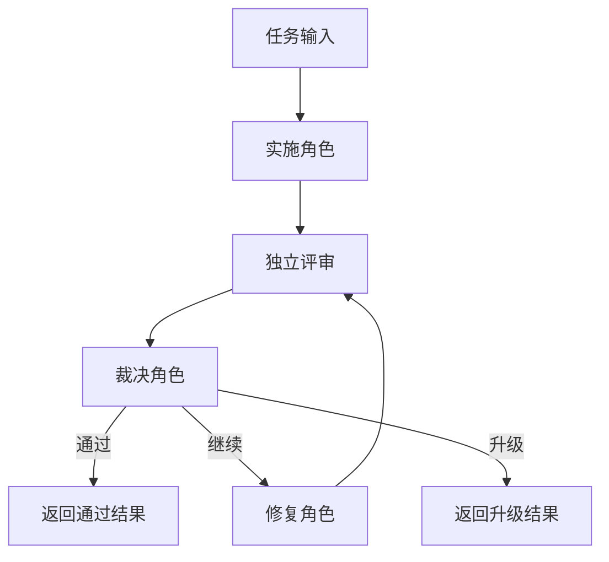

# 内置质量闭环 Workflow 执行计划

- 日期：2026-11-20
- 状态：待实施
- 前置分析：[ak-pi-workflow-roles Agent 体系与内置 Workflow 封装分析](../research/2026-11-20-ak-pi-workflow-roles-agent-analysis.md)
- 参考来源：`thirdparties/ak-pi-workflow-roles`（Apache-2.0，固定版本 `fbe6c7c15b4e5acb34d09796af7af9bbf9080c3f`）
- 目标：将参考项目最具通用价值的“实施、独立评审、裁决、修复”闭环封装为本项目可注册、可审计、可恢复的内置 workflow。

## 1. 执行摘要

第一期只交付一个内置 workflow：`quality-loop`。

它用当前 workflow DSL 编排四个逻辑角色：

1. `coder`：实施任务并执行必要验证；
2. `reviewer`：独立读取代码与改动，列出可复现问题；
3. `judge`：以任务目标、验证证据和评审结果为依据裁决；
4. `fixer`：仅在裁决要求继续时修复问题，再进入复审和复裁决。

不复制参考项目的 CLI、票号账本、多宿主运行时、Soul 文件体系和全部角色。workflow 不自动 `commit`、`push`、`merge` 或发布；不可逆动作由调用者和用户保留。



## 2. 范围与边界

### 2.1 本期范围

| 项目 | 决策 |
| --- | --- |
| workflow 标识 | `quality-loop` |
| 执行方式 | 现有 DSL 的 `agent()`、`sequence()`、`verify()`、`checkpoint()` 等原语 |
| 注册方式 | 复用 `/workflows register <脚本路径>` 和 `.pi/workflows/register.json` |
| 角色数量 | 四个：coder、reviewer、judge、fixer |
| 修复轮次 | 默认 1 轮，参数可提高到最多 2 轮 |
| 最终结论 | `converged`、`continue`、`escalate` |
| 记录 | 复用现有 RunManager 与 journal，不引入第二套账本 |
| 测试 | parser、registry、fake runner 分支测试和合同测试 |

### 2.2 明确不做

1. 不修改 workflow runtime，不新增 `Role`、`Soul`、`Court` 等抽象。
2. 不调用外部 `ak-role` CLI。`runTool()` 只允许项目目录内脚本，且引入外部 CLI 会耦合安装、宿主和配置状态。
3. 不自动执行 Git 合并、提交、推送、发版或创建 PR。
4. 不在第一期实现 `collector`、`diarist`、`notary`、`inspector`、`auditor`、`doctor` 等角色。
5. 不要求普通的小改动都走质量闭环；它面向跨模块、风险较高或用户明确要求多角色审查的工作。
6. 不用自由文本中的固定句式作为分支协议；分支只读取受限的结构化 `status` 与 `findings`。

## 3. 设计原则

### 3.1 采用的参考项目原则

| 原则 | 在本项目的落实 |
| --- | --- |
| 角色职责隔离 | 四次独立 `agent()` 调用，实施者不兼任裁决者。 |
| 组合归调用方 | workflow 脚本显式写明阶段、分支和轮次，角色 prompt 不自行召唤其他角色。 |
| 机器只咬契约 | 统一使用受限 JSON 输出和 status 枚举；不解析自然语言标题或关键字。 |
| 证据优先 | reviewer/judge prompt 要求引用文件、命令、测试或 diff 事实。 |
| 不可逆操作外置 | 最终结果只建议下一步，Git 操作仍由调用者决定。 |
| 有限循环 | 修复轮数固定上限；无法收敛直接 `escalate`。 |

### 3.2 简化原则

- `inspector` 与 `reviewer` 在一期重合度较高，先不拆出第二个审查席位。
- `gatekeeper` 的“该谁继续审”在一期由脚本静态分支表达，无需额外模型调用。
- `navigator` 是确定性路线表理念，可在结果中用普通对象输出 next step，不额外启动 agent。
- 不复制参考项目的长 Soul；只提炼每个角色的最小职责、边界和交付契约，以减少 prompt 成本与维护面。

## 4. 输入、输出与状态契约

### 4.1 工作流参数

`args` 使用以下约定：

```ts
{
  task: string,                    // 必填：要完成的工作
  validation?: string[],           // 可选：建议运行的验证命令或验收条件
  maxRepairRounds?: number,        // 可选：1 或 2，默认 1
  tier?: string                    // 可选：已确认的模型档位
}
```

参数规则：

- `task` 缺失或为空时，脚本应以明确错误结束；
- `validation` 仅作为验证建议和验收条件传递，不能绕过项目安全规则；
- `maxRepairRounds` 只接受 `1` 或 `2`，任何其他值使用默认值 `1`；
- `tier` 的处理遵循本项目既有的 `model-tiers.json` 解析规则。

### 4.2 阶段输出统一形状

每个 LLM 阶段都要求只返回下列 JSON 对象。真实实现应使用 DSL/adapter 支持的结构化输出能力；如果现有 API 对 workflow 脚本不能直接声明 schema，则先由 prompt 要求 JSON，再由 `verify()` 进行最小形状校验，不能依赖自然语言标题。

```ts
{
  status: "completed" | "continue" | "converged" | "escalate",
  summary: string,
  findings: [
    {
      severity: "critical" | "high" | "medium" | "low",
      location: string,
      evidence: string,
      recommendation: string
    }
  ],
  evidence: string[],
  nextStep: string
}
```

角色对状态的合法使用：

| 角色 | 正常状态 | 含义 |
| --- | --- | --- |
| coder | `completed` / `escalate` | 任务已完成并有验证证据；或缺少授权/前置条件。 |
| reviewer | `completed` / `escalate` | 已完成独立审查；或因缺乏可审查材料升级。 |
| judge | `converged` / `continue` / `escalate` | 放行、要求修复或交由用户决策。 |
| fixer | `completed` / `escalate` | 已按 findings 修复并验证；或修复需要额外决策。 |

说明：`reviewer` 的 findings 可以为空；空 findings 不自动等同于 `converged`，最终仍由 `judge` 根据任务、代码、测试与审查证据裁决。

### 4.3 最终工作流输出

`quality-loop` 应显式返回以下对象，保证 Dashboard、journal 后处理和调用者可以稳定消费：

```ts
{
  status: "converged" | "continue" | "escalate",
  summary: string,
  roundsCompleted: number,
  nextStep: string,
  stages: {
    implementation: unknown,
    reviews: unknown[],
    judgments: unknown[],
    repairs: unknown[]
  }
}
```

- `converged`：质量闭环完成，`nextStep` 为“由调用者检查变更并决定提交或合并”。
- `continue`：轮次已经耗尽但仍有可修问题，`nextStep` 为“人工处理 findings 后重新运行”。
- `escalate`：存在需求冲突、授权不足、无法验证或设计取舍，`nextStep` 为“请求用户提供决定”。

## 5. 角色 Prompt 规格

Prompt 的实现应放在一个脚本文件内，避免多个文件造成注册、版本和引用管理复杂度。每个角色 prompt 必须包含任务、上游结构化产物和明确边界。

### 5.1 coder

**目标**：以最小改动完成任务，执行必要的构建和测试，并报告真实结果。

**必须要求**：

- 先理解任务和已有代码；复用既有模式；不为未来需求加抽象；
- 直接修改工作区，变更后遵守仓库既有构建/测试纪律；
- 列出修改文件、执行的验证命令和结果；
- 不能完成时说明确切阻塞原因，不得以伪造“已验证”掩盖失败；
- 不做 `commit`、`push`、`merge`、发布或改动用户全局配置。

### 5.2 reviewer

**目标**：独立审查实施结果，寻找真实问题而不是复述 coder 的自评。

**必须要求**：

- 自行检查任务、当前 diff、相关调用路径和测试；
- findings 必须带位置和可核查 evidence；
- 不因“最好实践”而提出无任务依据的重构；
- 没有发现时返回空数组，不能虚构问题；
- 不改代码、不执行不可逆 Git 操作。

### 5.3 judge

**目标**：依据任务、coder 证据和 reviewer findings，决定是否收敛。

**必须要求**：

- 检查每项 findings 是否有事实证据；
- `converged` 必须说明为什么需求已满足、关键验证是否充分；
- `continue` 必须给出可执行且范围受限的修复项；
- 遇到产品选择、冲突需求、权限不足或证据不能判定时必须 `escalate`；
- 不修改工作区，不将无证据的模型说法当作事实。

### 5.4 fixer

**目标**：只修复 judge 已确认的事项，在根因处一次修净，并重新验证。

**必须要求**：

- 仅处理 judge 的 `findings`，不顺手扩大范围；
- 优先删简、复用，避免补丁式掩盖问题；
- 对每条修复说明修改、验证和剩余限制；
- 若需要用户做设计决策，直接 `escalate`；
- 不改提交历史、不推送、不合并。

## 6. 脚本设计

### 6.1 目标文件

新增正式脚本：

```text
workflows/quality-loop.js
```

选择单文件的原因：

- 现有 registry 在 fallback 模式仅扫描一级 `.js` 文件；
- manifest 注册记录源脚本路径，单文件最容易移动、注册与审计；
- 角色 prompt 和分支仍是同一工作流的内部实现，拆分没有收益。

脚本的 `meta` 初稿：

```js
export const meta = {
  id: "quality-loop",
  name: "质量闭环",
  description: "实施、独立评审、裁决与有限修复的多角色代码质量闭环",
}
```

### 6.2 编排伪代码

以下是目标流程，不应在实现前额外引入新的 DSL 原语：

```js
export const meta = { /* 上述元信息 */ }

const task = String(args.task ?? "").trim()
if (!task) throw new Error("quality-loop 需要 args.task")

const tier = args.tier ?? "<实施前经用户确认的档位>"
const maxRepairRounds = args.maxRepairRounds === 2 ? 2 : 1

const implementation = await phase("实施", () => agent(coderPrompt(task), { tier }))
const reviews = []
const judgments = []
const repairs = []

for (let round = 0; round <= maxRepairRounds; round += 1) {
  const review = await phase("独立评审", () => agent(reviewerPrompt(task, implementation, repairs), { tier }))
  reviews.push(review)

  const judgment = await phase("裁决", () => agent(judgePrompt(task, implementation, review, repairs), { tier }))
  judgments.push(judgment)

  if (judgment.status === "converged" || judgment.status === "escalate") {
    return finalResult(judgment, implementation, reviews, judgments, repairs)
  }

  if (round === maxRepairRounds) {
    return exhaustedResult(implementation, reviews, judgments, repairs)
  }

  const repair = await phase("修复", () => agent(fixerPrompt(task, judgment), { tier }))
  repairs.push(repair)
  if (repair.status === "escalate") {
    return finalResult(repair, implementation, reviews, judgments, repairs)
  }
}
```

实际编码时须按 `skills/workflow-authoring/SKILL.md` 的当前 DSL 约束调整函数名称、结构化结果读取方式和 `phase()` 签名。写脚本前必须重新阅读该 Skill。

### 6.3 并发策略

一期全链路保持串行：review 必须看到 implementation，judge 必须看到 review，fixer 必须看到 judge。

不在一期引入多 reviewer 并行或 `judgePanel`，理由：

- 先保证契约、审计和回路上限正确；
- 多 reviewer 会加大模型成本、去重和冲突裁决复杂度；
- 后续若有真实证据表明单 reviewer 漏检，可增加 `parallel()` 并由 judge 汇总，不改变总架构。

## 7. 注册、命令与使用方式

### 7.1 第一阶段注册

不新增 CLI 子命令，使用已存在命令注册：

```bash
/workflows register workflows/quality-loop.js
/workflows run quality-loop task="修复登录接口的超时重试问题"
```

注册后重启会话，若命名符合直接命令约束，可直接运行：

```text
/quality-loop task="修复登录接口的超时重试问题"
```

### 7.2 后续可选体验优化

确认该 workflow 稳定且至少有真实使用后，再考虑增加：

```text
/workflows register-builtin quality-loop
```

该命令只能复用现有 `addToManifest()` 与脚本校验逻辑；不引入第二套 registry，不复制脚本，不变更 `loadRegistry()` 语义。

## 8. 模型档位决策门

本项目硬性规则要求：新增 LLM 调用点前必须由用户确认 `fast`、`big`、`ultra` 或自定义档位，并通过 `.pi/workflows/model-tiers.json` 解析，禁止依赖宿主默认模型或硬编码 provider/model。

因此实施开始前必须先执行一次用户确认：

| 选项 | 建议 | 适用性 |
| --- | --- | --- |
| `fast` | 推荐首版 | 四阶段闭环的成本与延迟可控，适合先验证交接契约。 |
| `big` | 高风险任务 | 审查和裁决更复杂、任务价值较高时使用。 |
| `ultra` | 极高风险任务 | 仅在成本可接受且需要最高能力时使用。 |
| 自定义 | 特殊环境 | 用户提供已有 model tier 名称。 |

确认后，脚本中所有 `agent()` 调用必须显式填写 `tier`；档位解析失败时由既有 runtime 打印 warning 并回退会话默认。确认结果还应回填到 `CLAUDE.md` 的“已确认的档位决策”表。

## 9. 实施任务拆解

### P0：设计冻结与调用前确认

| 编号 | 工作 | 交付物 | 验收 |
| --- | --- | --- | --- |
| P0-1 | 重新阅读 workflow-authoring Skill 和其中的结构化输出示例 | 实施记录 | 明确 DSL 当前支持的结果读取和 `phase` 调用方式。 |
| P0-2 | 让用户确认新 workflow 的模型档位 | 用户决策 + CLAUDE.md 记录 | 任何 `agent()` 新调用都使用已确认 tier。 |
| P0-3 | 对照 runtime 能力校验 JSON 结构化输出和循环写法 | 细化伪代码 | 不假设 DSL 未提供的 API。 |

### P1：脚本最小实现

| 编号 | 工作 | 文件 | 验收 |
| --- | --- | --- | --- |
| P1-1 | 新建 `quality-loop` 单文件 workflow | `workflows/quality-loop.js` | `meta` 可解析，至少含一次 `agent()`，脚本无随机与时钟依赖。 |
| P1-2 | 编写四个最小角色 prompt | 同一脚本 | 每个 prompt 明确职责、输入、输出、禁止的不可逆操作。 |
| P1-3 | 实现正常通过路径 | 同一脚本 | coder、reviewer、judge 都成功时返回 `converged`。 |
| P1-4 | 实现有限修复路径 | 同一脚本 | judge 为 `continue` 时调用 fixer，之后复审和复裁。 |
| P1-5 | 实现升级与上限出口 | 同一脚本 | 任一升级或轮次耗尽都返回结构化终局，不无限循环。 |

### P2：测试与注册验证

| 编号 | 工作 | 文件 | 验收 |
| --- | --- | --- | --- |
| P2-1 | 增加脚本 parser/registry 测试 | `tests/engine/` | 临时项目可注册、读取 `quality-loop`。 |
| P2-2 | 增加通过路径 fake-runner 测试 | `tests/engine/` 或 `tests/tools/` | `converged` 时未调用 fixer。 |
| P2-3 | 增加修复路径 fake-runner 测试 | 同上 | `continue` 时正确执行一轮 fixer 后复审。 |
| P2-4 | 增加上限和升级路径测试 | 同上 | 超轮次为 `continue`；任意升级为 `escalate`。 |
| P2-5 | 增加 tier 透传断言 | 同上 | 每一次 `agent()` 都得到显式确认的 tier。 |
| P2-6 | 构建与回归 | 全仓 | `npm run build`、`npm run test:engine`、`npm run test:contract` 全部通过。 |

### P3：宿主联调与文档

| 编号 | 工作 | 交付物 | 验收 |
| --- | --- | --- | --- |
| P3-1 | 本项目本地路径安装或 `pi -e` 联调 | 一次真实 run journal | `quality-loop` 被 registry 识别、可启动、阶段可观察。 |
| P3-2 | 预热模型 | 最小 prompt 结果 | 在长任务前确认已选 tier 可用。 |
| P3-3 | 控制联调并发与看门狗 | 运行记录 | 同时最多两个长任务，超时按项目规则终止子进程树。 |
| P3-4 | 更新进度与阶段报告 | `dev-docs/progress/`、`dev-docs/progress-result/` | 里程碑状态、交付、commit、遗留项完整。 |

## 10. 测试设计细节

### 10.1 单元和合同测试

测试不调真实模型，使用现有 fake `AgentSessionRunner` / `AgentAdapter`。每个测试仅验证一个决定性分支。

| 用例 | fake 返回序列 | 关键断言 |
| --- | --- | --- |
| 解析与注册 | 无 | `parseWorkflowScript()` 成功；registry 按 id 读到源脚本。 |
| 直接收敛 | coder completed → reviewer completed → judge converged | 3 次 agent 调用；无 fixer；最终 `converged`。 |
| 一轮修复后收敛 | coder → reviewer → judge continue → fixer completed → reviewer → judge converged | 6 次 agent 调用；`roundsCompleted` 正确。 |
| 轮次耗尽 | coder → reviewer → judge continue → fixer → reviewer → judge continue | 最终 `continue`，无第三次修复。 |
| 需求升级 | coder escalates 或 judge escalates | 最终 `escalate`，不执行后续不必要 agent。 |
| tier 透传 | 任意路径 | 每次 fake runner 接收同一显式 tier。 |

### 10.2 真实联调

真实联调不是基础测试的替代品，只验证宿主、模型、提示词和 journal 的实际接线。

最小场景：选择一个独立、低风险、可验证的小修复任务。验收时保存：

- run ID 与 journal 文件；
- 每阶段原始输出和终局对象；
- 实际执行命令、退出状态与耗时；
- 最终 Git diff；
- 人工确认的“是否确有质量增益”。

不得把 stdout 截断视为唯一证据，应以 journal 与 run snapshot 为准。

## 11. 风险与处置

| 风险 | 信号 | 处置 |
| --- | --- | --- |
| JSON 输出不稳定 | `verify` 无法提取 status | 让阶段返回可验证结构；失败如实结束/升级，不靠文本猜测。 |
| 审查与裁决同质化 | reviewer 和 judge 重复相同无证据意见 | 强化 judge 对证据复核的 prompt；暂不增加更多角色。 |
| 无穷修复 | 多轮仍是相同 finding | 严格执行 1–2 轮上限，交由用户决策。 |
| 成本过高 | 简单任务也产生长链调用 | 仅按需运行；后续再增加 fast/balanced/quality profile。 |
| prompt 过长 | 上游完整输出反复注入 | 只传结构化阶段结果和必要证据指针；不复述代码全文。 |
| 真实修改破坏工作区 | coder/fixer 直接修改当前工作区 | 先用低风险任务联调；复杂任务在分支或独立工作区执行。 |
| 参考实现污染 | 直接复制 Soul 或架构细节 | 基于职责重新写 prompt；保留 Apache-2.0 来源和 NOTICE。 |

## 12. 完成定义

下列条件全部满足才可将本计划归档到 `dev-docs/planning/completed/`：

1. `quality-loop` 脚本位于正式 `workflows/` 目录，拥有稳定 `meta.id`；
2. 已确认并记录模型档位；
3. 正常、修复、上限、升级、tier 透传五类 fake-runner 测试通过；
4. `npm run build`、`npm run test:engine`、`npm run test:contract` 全通过；
5. 至少一条真实低风险联调完成，journal 证据可追溯；
6. 用户仍保有 commit/push/merge 等不可逆操作的最终控制权；
7. 更新 `dev-docs/progress/执行进度.md` 并新建本阶段独立执行报告到 `dev-docs/progress-result/`；
8. 新增/变更文档、代码和测试均已提交并推送。

## 13. 后续扩展门槛

只有在以下信号出现后，才增加角色或功能：

| 后续能力 | 触发条件 |
| --- | --- |
| 并行多 reviewer | 真实 run 显示单 reviewer 稳定漏检，且漏检可被不同 lens 补足。 |
| inspector | 需要将正确性、性能、测试质量做独立发布门禁。 |
| secretariat/countersign | 多次出现“编码前需求和架构决策不清”导致返工。 |
| collector | GitHub PR/CI 外部证据已成为稳定输入。 |
| diarist | 多会话需求决策难以追溯，现有 journal 查询不足。 |
| auditor | 高风险变更需要复核 judge 结论且接受额外成本。 |
| register-builtin 命令 | `quality-loop` 已稳定使用，手工注册成为可证实的摩擦。 |

## 参考

- 分析报告：`dev-docs/research/2026-11-20-ak-pi-workflow-roles-agent-analysis.md`
- 当前 registry：`src/engine/runtime/workflow-registry.ts`
- 当前注册命令：`extensions/commands/workflows/register.ts`
- 模型档位：`.pi/workflows/model-tiers.json`
- 参考项目角色清单：`thirdparties/ak-pi-workflow-roles/src/packaged-role-registry.ts`
- 参考项目路线表：`thirdparties/ak-pi-workflow-roles/src/navigator-route-table.ts`
- 参考项目组合原则：https://github.com/Akagilnc/ak-pi-workflow-roles/blob/main/docs/adr/0010-callers-own-role-composition-and-repetition.md
- 参考项目公开接口原则：https://github.com/Akagilnc/ak-pi-workflow-roles/blob/main/docs/adr/0052-public-cli-is-the-only-supported-external-role-interface.md
