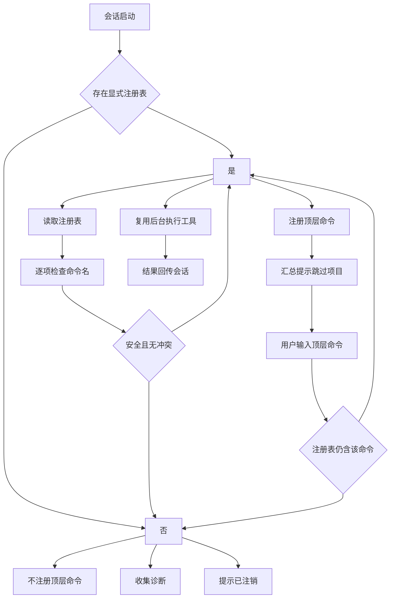

# Workflow 顶层斜杠命令直跑（/<workflowId>）执行计划

> 对应调研：`dev-docs/research/2026-11-20-pi-dynamic-workflows-slash-command-integration.md`
> 状态：已实施（T1-T5 完成，T6 自动化部分完成，交互式端到端待人工）
> 涉及模型调用：无（不涉及 model-tiers 档位确认）

---

## 一、目标与边界

用户用 `/workflows register <脚本>` 显式注册 workflow 后，在**下一次会话启动**即可输入 `/<workflowId> [k=v...]` 后台执行；效果等价于 `/workflows run <workflowId> [k=v...]`。

本功能只是现有 workflow 工具的顶层命令入口，**不新增**脚本存储、执行器、后台 Run、结果回传或参数协议。

### 明确边界

| 范围 | 决策 | 原因 |
|---|---|---|
| `.pi/workflows/register.json` 显式 manifest | 支持直跑 | 用户明确选择的 workflow，补全列表可控 |
| `.opencode-workflows/workflows/` 旧目录扫描 fallback | **不支持直跑** | 避免历史项目中大量脚本污染顶层补全；仍完全保留 `/workflows run <路径或名称>` |
| 注册后不重启当前会话 | 不即时生成顶层命令 | pi 缺少可靠的命令撤销/替换 API；与第三方实现的 session_start 时机一致 |
| unregister 后当前会话的旧顶层命令 | 保留名称但拒绝执行 | pi 无注销命令 API；重启会话后消失 |
| 参数 | 复用 `key=value` | 与既有 `parseWorkflowsRunArgs()` 一致，不引入 parameters schema |
| 设置开关 | 暂不提供 | 显式 manifest 已控制规模；YAGNI |

### 验收标准

1. manifest 内每个安全、无冲突的 workflowId 在重启会话后出现在 `/` 补全中，并能启动后台 run、回传结果。
2. workflowId 不安全或命令名冲突时，session_start **汇总一次 warning**，跳过顶层注册；`/workflows run <id>` 仍可执行。
3. `/workflows unregister <id>` 后，在同一会话调用残留 `/<id>` 只提示已注销，绝不执行旧脚本；重启后该命令消失。
4. 不创建 manifest 的 legacy 项目不产生任何新顶层命令。
5. `npm run build`、`npm run test:contract` 均通过。

## 二、评审结论与修正

| 编号 | 原计划问题 | 影响 | 修订决策 |
|---|---|---|---|
| R1 | 把 `pi.sendMessage(...).catch()` 写入代码骨架 | 宿主 `ExtensionAPI.sendMessage()` 返回 `void`，会直接类型失败 | 注册器返回诊断数组；session_start 的 `ctx.ui.notify()` 一次展示 |
| R2 | 声称 session_start 没有 `ctx.ui` | 设计了不必要的隐藏消息通道 | session_start 回调的第二参是 `ExtensionContext`，包含 `ui`、`cwd`，直接使用 |
| R3 | fallback 是否注册留到“实现时评估” | 行为不确定，验收不可判定 | 固定为仅 manifest 模式支持，legacy 不注册 |
| R4 | `loadRegistry()` 失败后静默返回 | 违反项目“暴露根因”的约定，用户不知道顶层命令为何消失 | 诊断中包含原始异常消息，由 session_start warning 显示 |
| R5 | 保留命令列表只列出 24 个公开内置命令 | interactive 还有 debug 等直达命令，可能碰撞 | 使用第三方已验证的 27 个兼容保留名（公开 24 个 + debug/arminsayshi/dementedelves） |
| R6 | `getCommands()` 冲突结果没有区分本轮已注册条目 | 容易把已存在的同扩展命令误判成外部冲突 | 注册器维护本轮 `registered` 集合；对该集合幂等跳过；外部冲突才拒绝 |
| R7 | 测试提出“正常 handler 真跑 workflow”又不实际执行 | 测试目标矛盾，可能引入真实模型调用 | 只测注册、冲突、legacy 排除、注销拒绝和非法参数短路；执行链继续由既有 `/workflows run` 合约测试覆盖 |

## 三、设计



### 执行路径复用

`/<id> a=1` 的 handler：

```ts
const parsed = parseWorkflowsRunArgs([id, ...args.trim().split(/\s+/).filter(Boolean)])
const tool = makeWorkflowTool({ ...deps.makeDeps(ctx.cwd), deliver: deps.deliver })
await tool.execute("cmd", { scriptPath: id, args: parsed.args, background: true }, undefined, undefined, ctx)
```

这与 `extensions/commands/workflows/run.ts` 完全同链：注册表解析、脚本读取、解析校验、journal、RunManager、后台结果回传全部由既有工具负责。

### 命令名规则

顶层命令仅接受 `^[A-Za-z0-9][A-Za-z0-9_-]{0,63}$`，因此允许现有 `smoke_test` 与 `a1-b`，拒绝空白、路径分隔符、点开头、Unicode 空白和控制字符。此规则仅决定能否获得直跑别名，**不改变**现有 workflowId 的注册合法性，避免破坏已注册项目。

### 冲突规则

按以下顺序检测：

1. pi 保留命令名（27 个兼容清单）。宿主主入口未导出 `BUILTIN_SLASH_COMMANDS`，因此模块内维护清单并注明宿主版本来源。
2. 本扩展固定顶层命令：`workflows`、`schedule`、`explorer`。
3. `pi.getCommands()` 返回的 prompt template 或其他扩展命令。
4. 本轮已成功注册的 workflowId：幂等跳过，不重复调用 `registerCommand`。

`pi.getCommands()` 不包含宿主内置命令，故第 1 步不可省略。所有冲突均只影响顶层别名，不影响 `/workflows run <id>`。

## 四、实施任务

### T1：新增 `extensions/commands/workflows/direct-commands.ts`

职责仅为“注册直跑别名并转发既有执行链”。不创建新的 manager、storage 或参数解析器。

建议公共契约：

```ts
import type { ExtensionAPI, ExtensionCommandContext } from "@earendil-works/pi-coding-agent"
import { loadManifest, loadRegistry } from "../../../src/engine/runtime/workflow-registry.js"
import { makeWorkflowTool, parseWorkflowsRunArgs } from "../../../src/tools/workflow-tools.js"
import type { WorkflowsCommandDeps } from "./types.js"

export interface DirectCommandRegistration {
  registered: string[]
  skipped: string[]
}

export function isDirectCommandSafeName(name: string): boolean
export function directCommandConflict(pi: ExtensionAPI, name: string): string | undefined

/**
 * 只在 manifest 模式下注册。返回可展示的跳过原因；不直接操作 UI，
 * 以便在 session_start 聚合通知并能用 fake pi 做无 UI contract 测试。
 */
export function registerWorkflowDirectCommands(
  pi: ExtensionAPI,
  deps: WorkflowsCommandDeps,
  cwd: string,
): DirectCommandRegistration
```

核心伪代码：

```ts
if (!loadManifest(cwd)) return { registered: [], skipped: [] }

let registry
try {
  registry = loadRegistry(cwd)
} catch (error) {
  return { registered: [], skipped: [`无法读取 workflow 注册表: ${message(error)}`] }
}

const registered = new Set<string>()
const skipped: string[] = []
for (const [id, workflow] of registry) {
  if (!isDirectCommandSafeName(id)) {
    skipped.push(`/${id}: 名称不适合作为顶层命令`)
    continue
  }
  if (registered.has(id)) continue
  const conflict = directCommandConflict(pi, id)
  if (conflict) {
    skipped.push(`/${id}: ${conflict}`)
    continue
  }

  try {
    pi.registerCommand(id, {
      description: `workflow: ${workflow.description || workflow.name}（等价 /workflows run ${id}）`,
      handler: (args, ctx) => runDirectWorkflow(id, args, ctx, deps),
    })
    registered.add(id)
  } catch (error) {
    skipped.push(`/${id}: 注册失败: ${message(error)}`)
  }
}
return { registered: [...registered], skipped }
```

`runDirectWorkflow` 的实现规则：

1. `ctx.cwd` 为唯一工作目录来源；不闭包捕获 session_start 的 cwd，确保 resume/fork 语义正确。
2. 首先 `loadManifest(ctx.cwd)`，再 `loadRegistry(ctx.cwd).has(id)`；不存在则 `ctx.ui.notify('workflow "id" 已注销…', 'warning')` 并 return。
3. 读取异常必须将原始 message 放入 warning，随后 return；不可吞掉。
4. 用 `parseWorkflowsRunArgs([id, ...tokens])` 校验参数，错误时 warning 并 return。
5. 完整复用 `makeWorkflowTool({ ...deps.makeDeps(ctx.cwd), deliver: deps.deliver })`，带 `background: true`；将工具返回文本通过 `ctx.ui.notify` 提示。

禁止项：不在注册器中发送自定义 session 消息、不直接使用 `RunManager`、不自行读 workflow 脚本、不为参数 schema 增加新配置。

### T2：`extensions/commands/workflows/index.ts` 引用新文件

加一条 re-export：

```ts
export { registerWorkflowDirectCommands } from "./direct-commands.js"
```

这是非路由注册器，不加入 `/workflows` 的 `subcommands` 表。re-export 同时满足 `commands-structure.test.ts` 对目录内命令文件被 index 引用的架构守卫。

### T3：`extensions/pi-code-mode.ts` 在既有 session_start 装配

从 index import `registerWorkflowDirectCommands`。在一个既有或新的 session_start 回调中使用真实会话 cwd：

```ts
pi.on("session_start", (_event, ctx) => {
  const result = registerWorkflowDirectCommands(pi, { runManager, makeDeps, deliver }, ctx.cwd)
  if (result.skipped.length) {
    ctx.ui.notify(`以下 workflow 未注册顶层斜杠命令：\n${result.skipped.join("\n")}`, "warning")
  }
})
```

不需要 `path.resolve()`：`ctx.cwd` 在 ExtensionContext 契约中已是当前工作目录，避免无意义的路径处理。若宿主 `getCommands()` 在 session_start 尚未绑定失败，`directCommandConflict` 将返回明确的“命令列表不可用”诊断并跳过注册，不能悄然放过冲突。

### T4：更新 `extensions/commands/workflows/register.ts` 成功提示

保持当前注册行为和兼容性，不阻止不符合直跑规则的旧 workflowId。成功提示按 `isDirectCommandSafeName(workflowId)` 分支：

- 安全名：`重启会话后可直接 /<id> [k=v...] 直跑；当前会话请使用 /workflows run <id>`。
- 非安全名：`该 id 不适合作为顶层命令，执行请使用 /workflows run <id>`。

冲突不在 register 阶段预报：`Subcommand` 依赖未暴露 `pi`，并且其他扩展/模板可能在下次会话加载时变化；以 session_start 的实时冲突检测为唯一事实源。

### T5：contract 测试

新增 `tests/contract/workflow-direct-commands.test.ts`，使用临时项目目录、手写 manifest、fake pi 和 fake ctx；不触发真实 workflow/模型。

| 用例 | 断言 |
|---|---|
| 名称规则 | `smoke_test`、`a1-b` 合法；空、空白、路径、点号、中文、连字符开头、超过 64 字符非法 |
| 保留与固定冲突 | `new`、`debug`、`workflows`、`schedule`、`explorer` 均有冲突原因 |
| 外部冲突 | fake `getCommands()` 返回同名时拒绝注册 |
| manifest 注册 | 两个安全条目注册、description 明确标注等价 `/workflows run` |
| legacy 排除 | 仅构建 `.opencode-workflows/workflows/*.js`、没有 manifest 时，零次 `registerCommand` |
| 非安全条目 | 条目保留在 manifest，但 `skipped` 含原因且不注册 |
| 注销兜底 | 注册 handler 后删除 manifest 或移除 id，调用 handler 仅 warning「已注销」，不触达 `makeDeps` |
| 非法参数短路 | 调用 handler 传 `flag`，仅 warning `key=value` 错误，不触达 `makeDeps` |
| 注册表损坏 | 重复 id manifest 返回含原始错误的 skipped 诊断，不抛出且不注册 |

既有 `tests/contract/workflows-command.test.ts` 已覆盖 `parseWorkflowsRunArgs` 与 `/workflows run` 路由；不复制这些测试，也不执行真实 workflow。

### T6：验证

按项目纪律，修改 `src/` 前必须先 `npm run build`。本次改动只在 `extensions/` 与 `tests/`，但仍统一执行：

1. `npm run build`
2. `npm run test:contract`
3. 干净房间：`pi -ne -e <repo绝对路径>`
4. `/workflows register dev-examples/sample-project-acceptance/A-basic/smoke-test.js`
5. 重启会话，输入 `/smoke`，确认补全存在 `/smoke_test`
6. `/smoke_test foo=bar`：确认后台 run 开始、进度显示、最终结果回传
7. `/workflows unregister smoke_test` 后再次 `/smoke_test`：确认仅提示已注销
8. 再次重启：确认 `/smoke_test` 不再出现
9. 验证 legacy 测试项目：确认不会出现目录扫描 workflow 的顶层命令

联调前按专项约定先以最小提示验证模型可用；同时只运行一个长 workflow run，并以 journal/run snapshot 作为验收主证据。

## 五、文件清单与工作量

| 文件 | 改动 | 预估 |
|---|---|---:|
| `extensions/commands/workflows/direct-commands.ts` | 新增注册器、冲突检测、转发 handler | 1.5h |
| `extensions/commands/workflows/index.ts` | re-export | 5min |
| `extensions/pi-code-mode.ts` | session_start 装配与汇总 warning | 10min |
| `extensions/commands/workflows/register.ts` | 注册成功提示 | 15min |
| `tests/contract/workflow-direct-commands.test.ts` | fake pi contract 测试 | 1h |
| 构建与端到端验收 | T6 | 1h |
| 合计 |  | 约 0.5 天 |

## 六、风险与回滚

| 风险 | 对策 | 回滚 |
|---|---|---|
| pi 无法注销已注册命令 | handler 实时检查 manifest/registry，拒绝已注销项 | 重启会话清除残留 |
| 宿主新增保留命令 | 保留清单注明来源；冲突诊断可见；升级 pi 时更新该常量 | 顶层别名跳过，`/workflows run` 可用 |
| 其他扩展命令冲突 | `getCommands()` 实时预检，拒绝注册并汇总提示 | 保留原执行入口 |
| 注册表损坏 | 向用户展示原始错误，不注册任何顶层别名 | 修复 manifest 后重启 |
| legacy 脚本污染补全 | 固定只支持 manifest 模式 | 无需回滚 |
| 用户不需要该体验 | 只影响显式注册项；将来可增设置开关 | 删除 T3 装配即可完全关闭 |

## 七、进度记录

| 任务 | 状态 | 完成时间 | 备注 |
|---|---|---|---|
| 报告评审与计划修订 | 已完成 | 2026-11-20 | 修复 R1-R7，明确 manifest-only 边界 |
| T1 direct-commands.ts | 已完成 | 2026-11-20 | 注册器 + 27 保留名 + 调用时求值 |
| T2 index.ts re-export | 已完成 | 2026-11-20 | 架构守卫通过 |
| T3 主入口装配 | 已完成 | 2026-11-20 | session_start + 汇总 warning |
| T4 register.ts 提示 | 已完成 | 2026-11-20 | 按命名安全性分支文案 |
| T5 contract 测试 | 已完成 | 2026-11-20 | 12 项断言全绿；契约套件 229/229 |
| T6 构建与验收 | 部分完成 | 2026-11-20 | build + test:contract 通过；真实注册表装配自检通过；交互式 TUI 端到端待人工 |

完成实施后，将本文件移入 `dev-docs/planning/completed/`，并按项目规范同步 `dev-docs/progress/执行进度.md` 与 `dev-docs/progress-result/` 阶段报告。

## 八、参考

- 调研报告：`dev-docs/research/2026-11-20-pi-dynamic-workflows-slash-command-integration.md`
- 第三方：`thirdparties/pi-dynamic-workflows/src/saved-commands.ts`、`command-registry.ts`
- 宿主：`pi-coding-agent/dist/core/slash-commands.js`、`core/extensions/loader.js`、`core/agent-session.js`
- 本仓库：`extensions/commands/workflows/{register,run,types}.ts`、`src/engine/runtime/workflow-registry.ts`、`src/tools/workflow-tools.ts`
