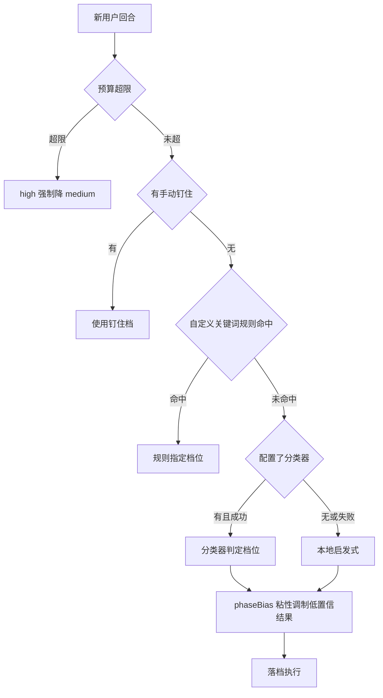

# pi-model-router 模型路由配置机制分析（REF-004）

> 分析日期：2026-11-16　|　对象：`thirdparties/pi-model-router`（v0.5.5 @ `9339ed0`，MIT，只读）
> 分析方法：`docs/ARCHITECTURE.md` + `extensions/`（config/routing/provider/index 共 ~2700 行）源码走读
> 关联：本仓库 `src/engine/agent/model-tiers.ts`（model-tiers.json 分层解析）的直接对标物

## 一句话定位

pi 平台的**按回合智能模型路由扩展**：用户选择一个 `router/<profile>` 虚拟模型后，每个回合由路由器根据任务意图自动落到 high/medium/low 三档物理模型上——用户只选"策略档位"，不选具体模型。

## 类比理解

把 router 想象成**酒店前台房型调度员**：客人（每个 user 回合）只说要什么，调度员决定房型（tier）——提到"深挖/仔细/step by step"给套房（high），说"快速/简单"给标间（low），正常需求大床房（medium）；`phaseBias` 让常客连续住同类房型（阶段粘性）；预算烧完自动从套房降到套房两倍价的行政房（high→medium 降档）；某房型满房（模型故障/限流）按备选清单换酒店（fallback 链）。关键规则：**换房型只发生在新入住**（新 user 回合），续住（工具结果 continuation）绝不换房——因为换房会丢会员积分（prompt cache 与 thinking signature）。

## 1. 配置面（JSON 结构）

### 1.1 双层加载与合并

| 层 | 路径 | 优先级 |
|----|------|--------|
| 全局 | `<agentDir>/model-router.json` | 低 |
| 项目 | `<项目>/.pi/model-router.json` | **高（覆盖全局）** |

`mergeConfig(mergeConfig(base, global), project)` 深合并 → `normalizeConfig` 归一化 → 解析告警（warnings）随结果返回，不打断。**与本仓库 model-tiers 的"全局+项目合并"策略完全同构**（我们：`~/.pi/workflows/model-tiers.json` + 项目 `.opencode-workflows/model-tiers.json` 同名键覆盖）。

### 1.2 配置结构四块

```jsonc
{
  "models": {                      // 物理模型别名表
    "gpt-pro": {                   //   别名 -> provider/model + 上下文窗口 + token 上限
      "model": "openai/gpt-5.4-pro",
      "contextWindow": 256000,     //   供宿主预请求自动压缩判断
      "maxTokens": 64000,
      "thinkingLevels": ["high", "medium", "low"]  // 该模型支持的思考等级
    }
  },
  "profiles": {                    // 策略档位（用户选择面）
    "auto": {
      "high":   { "model": "gpt-pro", "thinking": "high", "fallbacks": ["sonnet"] },
      "medium": { "model": "flash",   "thinking": "medium" },
      "low":    { "model": "nano",    "thinking": "low" }
    }
  },
  "rules": [                       // 关键词强制覆盖（最高优先级之一）
    { "matches": ["deploy", "production"], "tier": "high", "reason": "生产任务安全检查" },
    { "matches": "changelog", "tier": "low" }
  ],
  "classifierModel": "auto",       // 意图分类器："auto" 用宿主原生分类器，或具体模型
  "phaseBias": 0.5,                // 阶段粘性偏置 0~1
  "maxSessionBudget": 1.0,         // 会话花费上限（美元），超限 high 自动降 medium
  "autoPinFirstTurnDecision": false, // 首回合决策自动钉住
  "debug": false
}
```

要点：**模型引用既可写别名也可直接写 `provider/model` 全名**（profiles.low.cheap 档示例里就有直接全名）；`fallbacks` 只在 high 档示例出现，实际每档都可配。

## 2. 运行时路由决策流（按 `request.reason` 四分派）

每次向 `router/*` 虚拟模型发请求，`route(request, ctx)` 按请求原因分派：

| reason | 场景 | 路由行为 |
|--------|------|----------|
| `direct` | 压缩摘要等后台请求 | 直接落 medium（或钉住档），**不跑分类器、不动路由状态** |
| `continuation` | 工具结果续跑（同一回合内） | **粘性**保持本回合已选模型（保 prompt cache 与 thinking signature），除非新钉住/预算超限/带图片 |
| `retry` | 请求失败自动重试 | 在该档 `fallbacks` 链上从 `failed.model` 之后取下一个 |
| `user` | 新用户回合（含 steer/followUp） | 走完整 tier 选择管线（见 §3） |

## 3. tier 选择管线（`user` 回合，7 级优先级）



（图示为优先级降级链：预算 → 钉住 → 规则 → 分类器 → 启发式 → 粘性调制）

### 3.1 本地启发式（分类器关闭/失败时的兜底，纯本地零成本）

按顺序匹配，命中即停：

1. **显式 high 信号**：`best/deep/carefully/thoroughly/comprehensive/step by step/ultrathink` 等关键词 → high
2. **显式 low 信号**：`fast/cheap/quick/brief/one sentence` 等 → low
3. **摘要类关键词** → low（轻量转换）
4. **规划信号**：规划关键词 / `why ` 开头 / 词数 ≥ highThreshold / 提示词 ≥ 4 行 → high
5. **实现关键词** → medium（有界执行）
6. **查询信号**：查询关键词 + 词数 ≤ 24 + 无工具结果 → low（只读快查）
7. **粘性回看**：上一决策是 planning 且仍无工具结果且词数 > lowThreshold → 继续 high
8. **实现进行中**：已有工具结果 / 上一阶段 implementation → medium
9. 兜底：词数 ≤ lowThreshold → low

### 3.2 phaseBias 的调制公式（粘性的数学表达）

```
highThreshold = max(40, 120 − (上一阶段为 planning ? phaseBias × 80 : 0))
lowThreshold  = max(4,  12  − (上一阶段为 implementation/planning ? phaseBias × 8 : 0))
```

即 `phaseBias` 越高（默认 0.5），处于 planning 阶段时进入 high 的词数门槛越低（最多降到 40 词）、轻量判定的门槛越低——**越粘在当前阶段**。对分类器路径，phaseBias 同样调制低置信度分类结果的偏置。

### 3.3 预算降档

`maxSessionBudget` 配置且会话累计花费超限 → tier 为 high 时强制改 medium（phase 同步改 implementation，reason 追加降档说明）。花费统计覆盖助手回合 + 工具使用 + 压缩 + 分支摘要。

## 4. 宿主集成机制（pi 平台接入面）

| 机制 | API | 作用 |
|------|-----|------|
| 虚拟模型注册 | `pi.registerVirtualModel("router/<profile>")` / `unregister` | **选择与分派分离**：`model_change` 会话条目只记虚拟名（重放安全、可跨物理模型迁移），assistant 消息记录真实物理 provider/model/thinking → 原生 footer 显示、`/session` 按物理模型分账、路由到小上下文模型时宿主**自动预压缩** |
| 状态持久化 | `pi.appendEntry("router-state", ...)` | 活动档案/钉住/花费跨重启恢复；会话分支（session_tree）各自独立状态 |
| 事件钩子 | `session_start` / `session_tree` / `session_compact` / `turn_start` / `turn_end` / `model_select` / `thinking_level_select` | 状态恢复、压缩后上下文重算、回合边界路由、宿主切模型/切思考等级联动 |
| 用户命令 | `/router pin|fix|unpin` 等 + 自动补全 | 钉住/解钉/档案切换 |
| 可观测 | `setStatus` 状态行 + 可选 widget + debug 日志 | 当前档位/花费/决策理由可见 |

## 5. fallback 链与重试

每档的候选链 = `[tier.model, ...tier.fallbacks]` 去重；retry 时取 `failed.model` 在链中的下一个（不在链中则把失败模型移到链尾重排）。参考项目 `extensions/provider.ts:153-159` 的 `preferred 重排`：指定偏好模型存在时把它挪到队首。**失败在链内消化，不打扰用户**；链耗尽才上抛。

## 6. 与本仓库 model-tiers 的对照

| 维度 | pi-model-router | 本仓库现状 | 差距/可借鉴 |
|------|-----------------|-----------|------------|
| 配置结构 | models 别名表 + profiles×tiers 两级（别名解耦物理模型） | 平铺 `tier 名 → provider/modelId` 单层映射 | **别名表值得借鉴**：同一物理模型可复用别名换参数（contextWindow/maxTokens/thinkingLevels），profile 组合自由 |
| 加载合并 | 全局+项目深合并 + normalize + warnings | 同构（全局+项目同名键覆盖） | 相当 |
| 选档时机 | 每 user 回合动态决策（启发式/分类器/预算/钉住） | workflow 脚本 `agent(prompt, { tier })` **静态声明** | 范式差异：他们面向"对话每回合"，我们面向"工作流节点"；启发式对 workflow 场景意义有限（脚本作者已显式声明 tier） |
| fallback | 每档 fallbacks 链 + retry 推进 | 无（失败即抛，靠引擎 fallback() 原语在脚本层重试） | **脚本层 fallback() 已覆盖**；但 tier 级"模型不可用自动换同档备选"值得评估 |
| 预算降档 | 会话花费统计 + 超限 high→medium | 无 | workflow 长链路场景有价值（P2 候选） |
| 粘性偏置 | phaseBias 调制阈值 | 无 | 对话场景价值高，workflow 场景弱（节点显式声明） |

**结论**：本仓库不需要引入"按回合动态路由"（workflow 节点的 tier 是作者显式声明的静态决策）；**可借鉴的是配置结构升级**（models 别名表 + profiles 组合，让 model-tiers.json 支持"档案"概念）与 **tier 级 fallback 链**（tier 配置可带备选模型数组，agent 节点失败时同档自动换备选再抛错）。是否立项待需求确认，先记录。

## 引用说明

- 参考项目源码：`thirdparties/pi-model-router/docs/ARCHITECTURE.md`（官方架构文档）、`extensions/config.ts`（双层加载合并，:487-499）、`extensions/routing.ts`（启发式与 phaseBias 调制，:300-395）、`extensions/provider.ts`（reason 分派与 fallback 重排，:153-159, :342-560）、`extensions/index.ts`（事件钩子与状态持久化）
- 登记条目：`thirdparties/REFERENCES.md` REF-004
- 本仓库对照实现：`src/engine/agent/model-tiers.ts`
