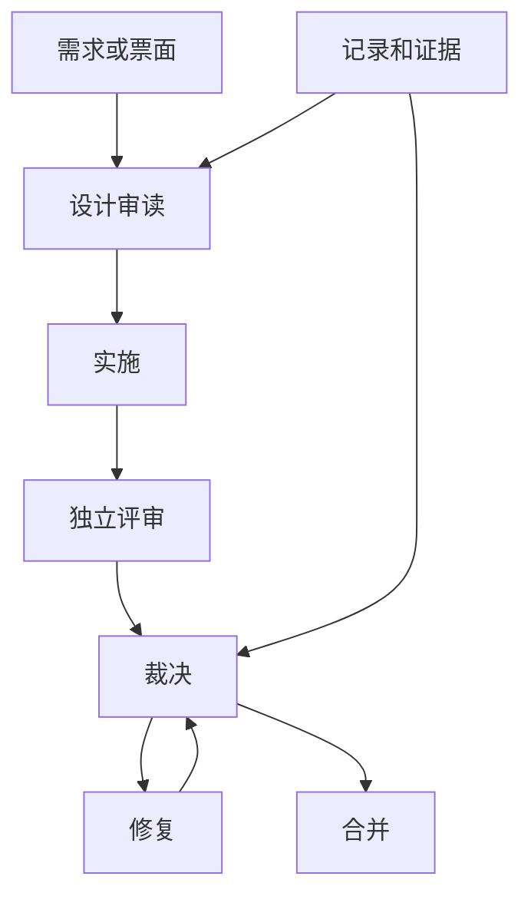
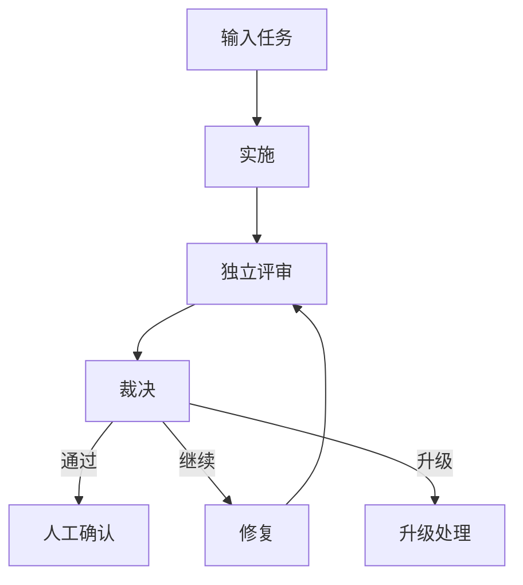
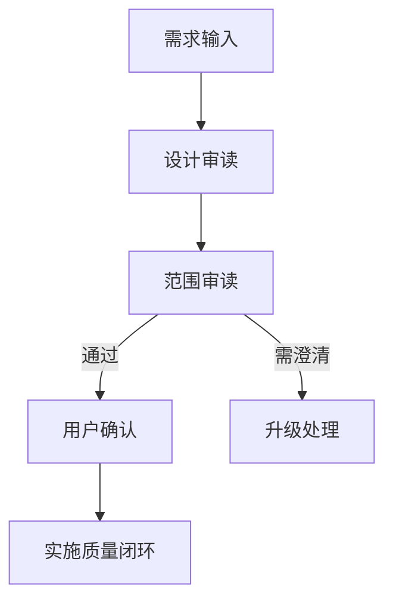

# ak-pi-workflow-roles Agent 体系与内置 Workflow 封装分析

- 分析日期：2026-11-20
- 参考项目：`thirdparties/ak-pi-workflow-roles`
- 固定版本：`fbe6c7c15b4e5acb34d09796af7af9bbf9080c3f`
- 许可证：Apache-2.0
- 目的：评估其多角色治理模型，并给出封装为本项目内置 workflow 的最小可行方案。

## 1. 结论摘要

该项目不是一个“自动完成开发全流程”的单一编排器，而是一组职责严格隔离、通过结构化回执衔接的角色席位。它将实施、审查、裁决、证据收集、合并、设计审读和过程记录拆开，并明确规定：**角色组合、重试和不可逆操作由调用方掌握**。

这一思想与本项目的 workflow DSL 高度契合：

- 参考项目的“角色”可映射为本项目的一次或多次 `agent()` 调用；
- 参考项目的“调用方拥有组合权”可映射为一个或多个 workflow 脚本；
- 本项目已有 `sequence`、`parallel`、`fallback`、`verify`、`judgePanel`、`checkpoint` 等编排原语，无需为角色体系新增引擎概念；
- 不应直接依赖或包装 `ak-role` CLI：当前 `runTool()` 只执行项目目录内脚本，且这会引入外部安装、宿主、配置与账本模型的耦合。

推荐先实现一个小而完整的内置工作流：**实施 → 独立评审 → 裁决 →（必要时）修复 → 复裁决**。它覆盖最有价值的 `coder / reviewer / judge / fixer` 闭环，保留人工确认合并；票据庭审、审计、外部证据收集等作为后续独立 workflow，而非第一期一次性复刻整个“官署体系”。

## 2. 参考项目的架构模型

该图表达的是职责关系，不代表所有角色都必须在每次运行中出现。其核心边界如下。

1. **Soul 与运行时分层**：`souls/*.md` 只定义角色不可约的专业判断；字段和回执形状由 TypeScript schema 定义；唯一的调用与终止语义属于 runtime；CLI 用法属于 README/帮助文档。
2. **角色不派发角色**：寺监级角色不内嵌拓扑；上层调用者负责选择顺序、次数与停止条件。
3. **独立性优先于便利性**：审查角色不应变成实施角色的附庸。例如 reviewer 以固定评审对象工作，judge 对所有 LLM 声称自行核证。
4. **结构化交卷**：角色的结论通过回执工具和 typed output 传递，而不是用某段文本格式做控制协议。
5. **最终权力留给调用者/人**：角色不拥有 merge/push 等不可逆权限；自动化只提供事实、判断和下一步建议。

## 3. 角色清单与可迁移性

### 3.1 第一优先级：形成开发质量闭环

| 参考角色 | 职责 | 适合映射的内置阶段 | 建议 |
| --- | --- | --- | --- |
| `coder` 将作监 | 按已授权任务实现并自验 | `implement` | 必需。实施 agent，要求修改代码、构建与测试。 |
| `reviewer` 御史台 | 独立审查改动并列出 findings | `review` | 必需。与实施 agent 使用独立会话，不让其沿用实施结论。 |
| `judge` 大理寺 | 根据任务、代码、测试和评审结论裁决是否收敛 | `judge` | 必需。只输出通过/继续/升级及可执行理由，不直接修改代码。 |
| `fixer` 修内司 | 按裁决中的问题做“按类修复” | `repair` | 必需。仅在 judge 判为继续时调用。 |
| `inspector` 台院 | 从正确性、复杂度、测试质量进行门禁审查 | `quality-gate` | 第二期。可先由 reviewer 覆盖，避免第一期多一层同质审查。 |
| `merger` 校书郎 | 专注合并冲突 | `merge-assist` | 按需独立 workflow。默认不授予 merge 权。 |

### 3.2 第二优先级：需求和设计治理

| 参考角色 | 职责 | 适合映射的内置阶段 | 建议 |
| --- | --- | --- | --- |
| `secretariat` 中书省 | 将难以回滚的设计决定转化为需确认的问题 | `design-review` | 对中大型变更有价值；输出决策问题或方案稿。 |
| `countersign` 给事中 | 施工前完整审读任务票面 | `scope-gate` | 可与设计审读合并为轻量“开工门禁”。 |
| `notary` 符宝郎 | 判断设计/实现是否符合用户已确认的意图 | `intent-check` | 适合在需求明确、且有可引用决策记录时启用。 |
| `gatekeeper` 门下省 | 依据上游交卷决定应由谁继续审 | `router` | 不建议第一期独立实现；workflow 的显式分支已足够。 |

### 3.3 按需工具型角色

| 参考角色 | 职责 | 适用场景 | 建议 |
| --- | --- | --- | --- |
| `collector` 通进司 | 收集 PR、CI、bot 和人工外部评审证据 | GitHub PR 工作流 | 后续与 GitHub/MCP 集成后实现。 |
| `diarist` 起居郎 | 从会话中整理决策与依据 | 长任务、多会话需求演变 | 可复用本项目 journal，后续单独实现。 |
| `gleaner-left` 左拾遗 | 不带历史偏见地对整体 diff 捡遗漏 | 发布前独立扫漏 | 可作为廉价、独立的最后检查。 |
| `navigator` 游奕使 | `(角色, 状态)` 到下一步建议的确定性查表 | TUI/报告呈现 | 不需要 LLM；可作为纯 TypeScript 辅助函数。 |
| `doctor` 太医署 | 诊断系统性问题，提出处方但不修复 | 技术债、稳定性专项 | 项目原作者也标记为待重新设计，暂不移植。 |
| `auditor` 审刑院 | 复核 judge/doctor 结论是否有充分证据 | 高风险变更、发布门禁 | 价值高但成本也高，应最后引入。 |
| `analyst` 太史 | 对冻结运行记录进行统计分析 | 长期质量与成本分析 | 与本项目 Analyzer/Dashboard 方向重叠，应先复用现有分析能力。 |

## 4. 关键工作流组合

### 4.1 推荐的第一期质量闭环

建议的运行约束：

- 最大修复轮次固定为 1 或 2，超过上限返回 `escalate`，避免 LLM 自循环；
- 每一阶段输出应在 workflow 返回对象中保留原文和结构化摘要，便于 journal 与 Dashboard 审计；
- `judge` 只负责裁决，不写代码；`reviewer` 不复述 implement 的自评；
- 合并、推送、发布不进入该 workflow，维持用户可控的不可逆边界；
- 默认将 agent 调用显式标注为已确认的模型档位。当前项目既有调用点已确认 `fast`；若新增内置 workflow 的模型调用属于新增调用点，实施前须按项目规则再次让用户确认档位。

### 4.2 可选的前置设计门禁

这条链适用于跨模块、引入新依赖、修改架构边界或存在多个可选方案的任务。普通 bug 修复不需要强行经过该链，避免治理成本高于改动本身。

## 5. 与当前项目的映射

本项目已经拥有可直接承载此方案的能力。

| 当前能力 | 位置 | 对应作用 |
| --- | --- | --- |
| Workflow DSL 与 VM 执行器 | `src/engine/runtime/workflow-runtime.ts` | 用 `agent`、`sequence`、`parallel`、`verify`、`judgePanel`、`checkpoint` 编排角色。 |
| 脚本校验 | `src/engine/runtime/vm.ts` | 解析 `meta` 并防止不合法脚本进入 registry。 |
| workflow registry | `src/engine/runtime/workflow-registry.ts` | 以 `.pi/workflows/register.json` 注册并按 ID 加载脚本。 |
| 宿主工具接入 | `src/tools/workflow-tools.ts` | 统一走 RunManager、journal、adapter 和 tier 解析执行。 |
| 直接命令 | `extensions/commands/workflows/direct-commands.ts` | 已注册 workflow 可暴露为顶层斜杠命令。 |
| 模型档位 | `.pi/workflows/model-tiers.json` | 所有 `agent()` 必须显式走 tier，禁止依赖宿主默认模型。 |
| 运行日志与可视化 | `.pi/workflows/journal/`、Explorer | 支持保存阶段输出、恢复和展示，部分承担参考项目的起居录/账本价值。 |

因此不推荐：

1. 修改 runtime 以新增“Role”或“内置角色注册表”抽象；已有 DSL 足以组合角色。
2. 通过 `runTool()` 调用外部 `ak-role`。其路径白名单、外部安装前置和独立宿主配置会增加不必要耦合。
3. 完整复制参考项目的 Soul、账本和 typed tool 协议。它们服务于参考项目的独立 CLI、多宿主和票号治理体系，不是 workflow DSL 的最低需求。
4. 让固定格式文本成为控制信号。应使用 agent structured output 或现有 `verify`/`judgePanel` 结果，遵循参考项目“机器只咬契约”的原则。

## 6. 最小实施方案

### 6.1 交付边界

第一期只新增一个内置 workflow，例如 `quality-loop`：

- 输入：任务描述、可选验证命令、最大修复轮数；
- 阶段：`coder` → `reviewer` → `judge` → 条件 `fixer` → `reviewer` → `judge`；
- 输出：最终状态（`converged` / `continue` / `escalate`）、阶段产物、未解决问题；
- 权限：不自动 commit/push/merge；
- 默认不接入 GitHub collector、会话 diarist 或审计 auditor。

### 6.2 文件与注册方式

建议将正式内置脚本置于包内单独的一级目录，例如 `workflows/quality-loop.js`，保持单文件以匹配现有 registry 的一级扫描和单文件管理方式。

开箱即用的注册不应改引擎。第二步可增加一个轻量 `/workflows register-builtin <name>` 子命令，复用已有 manifest 写入逻辑，把包内脚本的绝对路径写入 `.pi/workflows/register.json`。如果先不增加该命令，用户直接走已有 `/workflows register <脚本路径>` 已可完成验证。

### 6.3 测试

新增测试应沿用本项目既有的 `node:test` + fake runner：

1. 用临时项目目录注册脚本，断言 registry 能发现并读取；
2. fake agent 返回预设的 implement/review/judge 输出，断言通过路径不会调用 fixer；
3. judge 返回 continue 时，断言最多按配置调用 fixer 和复审；
4. 达到循环上限时，断言结果升级而不是无限重试；
5. 断言所有 agent 调用携带指定 tier。

每次修改 `src/` 后仍必须先运行 `npm run build`，再运行对应测试；单纯新增 `.js` workflow 脚本也应至少经过 workflow parser/registry 测试。

## 7. 风险、取舍与防护

| 风险 | 说明 | 最小防护 |
| --- | --- | --- |
| 上下文污染 | 实施者、评审者和裁决者互相复述结论会降低独立性 | 分开 agent 调用；给 reviewer/judge 明确要求自行核查。 |
| 无限修复 | LLM 可能反复提出或修复同类问题 | 固定轮次上限，超限 `escalate`。 |
| 成本和延迟 | 多席位线性调用明显比单 agent 更慢 | 仅用于中高风险改动；低风险任务走普通 workflow。 |
| 结构化输出不稳定 | 自由文本不可作为可靠分支依据 | 将 `status`、`findings`、`evidence` 做成受限结构化输出。 |
| 许可证与归属 | Soul 的直接复制或实质性改编受 Apache-2.0 约束 | 保留参考来源与 NOTICE；优先基于职责重新写本项目 prompt。 |
| 角色过度拟制 | 把 15 个角色全部内置会制造维护负担 | 先交付四角色质量闭环，按真实痛点再扩展。 |

## 8. 分期建议

| 阶段 | 目标 | 包含角色 | 完成标准 |
| --- | --- | --- | --- |
| P0 | 可运行的代码质量闭环 | coder、reviewer、judge、fixer | 一条注册后可执行的内置 workflow；通过 fake-runner 分支测试。 |
| P1 | 使用体验与报告 | navigator 思想的确定性下一步建议 | Explorer/journal 清晰展示阶段、结论、剩余问题。 |
| P2 | 复杂需求前置治理 | secretariat、countersign | 大型任务可先生成设计问题并要求确认。 |
| P3 | 外部证据和高风险审计 | collector、inspector、notary、auditor | GitHub/CI 证据可追溯；发布级任务有额外门禁。 |

## 9. 最终建议

将该项目作为“**职责隔离与可审计交接**”的方法论来源，而不是要移植的完整运行时。当前项目最合适的第一步是用已有 DSL 实现一个四角色质量闭环 workflow；无需新增 runtime 抽象，也无需调用 `ak-role` CLI。这样既保留它最有价值的独立评审和裁决思想，又避免把其票号、宿主、账本和多 CLI 复杂度搬入本项目。

## 参考

- 本地参考项目 README：`thirdparties/ak-pi-workflow-roles/README.zh-CN.md`
- 本地术语与职责：`thirdparties/ak-pi-workflow-roles/GLOSSARY.md`
- 本地角色注册表：`thirdparties/ak-pi-workflow-roles/src/packaged-role-registry.ts`
- 本地路线表：`thirdparties/ak-pi-workflow-roles/src/navigator-route-table.ts`
- 本地角色职责：`thirdparties/ak-pi-workflow-roles/souls/`
- 参考项目仓库：https://github.com/Akagilnc/ak-pi-workflow-roles
- 参考项目组合责任 ADR：https://github.com/Akagilnc/ak-pi-workflow-roles/blob/main/docs/adr/0010-callers-own-role-composition-and-repetition.md
- 参考项目公开接口 ADR：https://github.com/Akagilnc/ak-pi-workflow-roles/blob/main/docs/adr/0052-public-cli-is-the-only-supported-external-role-interface.md
