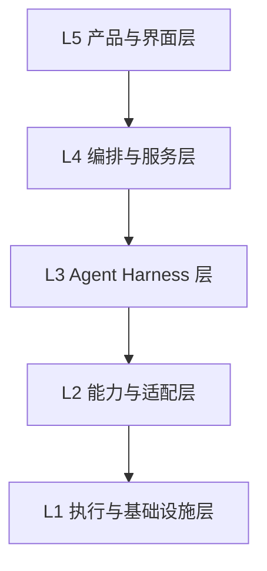

# PiBot 与 pi-code-mode 架构设计对比

- 日期：2026-11-23
- 类型：调研笔记（架构对比）
- 对比对象：
  - **PiBot**（`thirdparties/PiBot`，REF-023，锁定 commit `008198f`，Apache-2.0）：基于 pi agent kernel 的本地优先桌面多 Agent 团队应用
  - **pi-code-mode**（本项目）：面向 Pi Agent 的代码式工作流编排插件（Workflow Engineering Framework）
- 阅读来源：PiBot `AGENTS.md`、`docs/guide/zh/`、`packages/*/package.json` 与关键包目录结构；本项目 `src/`、`extensions/`、`dev-docs/design/workflow-engineering-framework.md`

---

## 一、一句话定位对比

| | PiBot | pi-code-mode |
| --- | --- | --- |
| 是什么 | 桌面应用产品：一支命名 Bot 团队在用户自己电脑上工作（单聊/群聊/例行任务/操作电脑） | pi 宿主的编排插件：JavaScript DSL 调度多个子 Agent 的工程化框架 |
| 核心抽象 | **Bot**（人设+模型+技能+权限+记忆的常驻实体） | **Workflow**（JS 业务逻辑）+ **Plan**（执行策略）两个独立产物 |
| 用户 | 终端消费者（含 Android 端） | 使用 pi 的开发者 / Agent 本身 |
| 与 pi 关系 | pi 是 pinned npm 依赖，只在一个包里导入 | pi 是宿主，本项目以 extensions/skills/tools 形态挂载进去 |

类比：PiBot 是把 pi 内核装进了一台「多引擎整机」（自带驾驶舱、仪表盘、审批刹车），pi-code-mode 是给裸 pi 发动机加装的一套「可编程行车电脑 + 赛道数据分析仪」。

---

## 二、形态与分发

| 维度 | PiBot | pi-code-mode |
| --- | --- | --- |
| 端矩阵 | desktop（Electron）、cli、mobile（React Native + Expo）、relay（Cloudflare Worker）、runner（headless）、browser-extension | 单一 npm 包（pi 插件），bin 快捷指令 `pi-code-mode install/remove/test` |
| 构建 | electron-vite、pnpm workspaces、Biome、Vitest | tsc 双 tsconfig（src 主目标 + extensions 目标）、tsx 直跑测试、jiti 直载 TS 宿主联调 |
| 包数量 | 约 50 个 workspace 包 | 1 个包，内部按目录分层 |
| 发布单元 | 安装包 + 角色库在线分发（带签名校验） | npm 包 + 本地路径安装（自托管） |

**差异本质**：PiBot 为「多端一致」付出包数量与基建成本；pi-code-mode 为「随宿主演进」选择了最小分发面（插件目录形态一命令一文件，架构守卫测试强制装配）。

---

## 三、分层架构对比

有趣的是两边都是"五层"，但语义完全不同：PiBot 是**技术分层**，pi-code-mode 是**业务能力分层**。

### PiBot：L1→L5 技术分层（依赖只向下）



- 每个 `package.json` 声明 `"pibot": { "layer": … }`，`tools/dev/domain-boundaries.ts` 在 lint 中**强制执行**分层边界。
- 能力包一律拆成 `@pibot/<capability>-contract`（zod 接口与共享字符串）与 `@pibot/<capability>`（实现，含 `/store` `/brain` `/host` `/ui` 入口），能力之间只允许依赖对方的 contract。
- 关键硬约束：brain 不依赖 Electron（同代码可 headless 跑）；Electron 能力经 `packages/protocol` 的接口注入。

### pi-code-mode：五层业务框架（语义分层，非强制）

```
Workflow Authoring   Skill：理解需求、生成与优化 Workflow JS
Workflow Plan        执行计划、资源预算、质量策略（.plan.json）
Workflow JS          业务逻辑（agent()/parallel()/pipeline() DSL）
Workflow Analyzer    AST 分析、调用图、预算估算、规则检查、优化建议
Workflow Runtime     执行引擎、Agent 调度、并发控制、Journal、恢复
Workflow Evaluator   真实耗时/Token/成本/失败率，Benchmark 反馈闭环
```

- 物理落点是 `src/` 单包内目录：`engine/{runtime,plan,analyzer,evaluator,optimizer,governance,persistence,events,schedule,adaptive,isolation,agent}`、`adapter/`、`manager/`、`mcp/`、`tools/`、`explorer/`。
- 分层靠**目录惯例 + 少量架构守卫测试**（`tests/contract/commands-structure.test.ts` 只覆盖命令装配链），没有依赖方向强制。

**结论**：PiBot 的分层是"用工具守住的结构"，pi-code-mode 的分层是"用文档守住的结构"。本项目已有 contract 测试基建，补依赖方向守卫的成本不高（见第七节）。

---

## 四、与 pi 内核的集成方式（最核心的差异）

| | PiBot | pi-code-mode |
| --- | --- | --- |
| 引入形态 | `@earendil-works/pi-coding-agent` pinned 精确版本（npm 依赖） | peerDependency `>=1.3.0` + pi extensions 机制（宿主 jiti 直载 TS） |
| 导入边界 | **只允许 `packages/agent` 导入 pi**，其余包不得触碰 | 全项目都在宿主扩展进程内运行，adapter 层封装 `createAgentSession` 等宿主 API |
| 数据隔离 | 不读不写 `~/.pi`，凭据/模型/会话自管数据目录 | 读写项目内 `.pi/workflows/`（Plan、journal、run snapshot、model-tiers.json） |
| 能力暴露 | 自建 Bot/群聊/例行任务产品面 | 暴露 workflow 工具族 + 斜杠命令 + widget + skill 给宿主会话 |

类比：PiBot 把 pi 当「发动机」整机封装（用户看不到 pi）；pi-code-mode 把 pi 当「母舰」，自己是放出去的「舰载机」，深度共享宿主会话上下文。

---

## 五、协议与类型治理

| | PiBot | pi-code-mode |
| --- | --- | --- |
| 接口契约 | UI↔brain 的每个方法和事件都用 zod 定义在 `packages/protocol`，两端共享类型 | `src/engine/types/` 手写 TS 接口共享；Plan 用 JSON Schema 校验（`plan-validator.ts`） |
| 边界校验 | IPC/RPC/文件/env/网络响应/pi 结果，**进入即 zod 解析** | Plan 文件有校验；工具参数、事件总线、journal 读取靠 TS 类型 + 约定，无运行时校验 |
| RPC 入口 | 统一 wrapper：校验 → 脱敏日志 → 执行 → 协议错误码映射 | 各工具（workflow/plan/schedule/analyze）各自组装参数与错误处理，无统一管道 |
| 错误模型 | 业务错误显式码，程序错误归 `internal`，禁止静默吞错 | `engine/runtime/errors.ts` 有错误分类，工具层错误呈现尚未统一编码 |

---

## 六、安全、治理与可观测

| 关注点 | PiBot | pi-code-mode |
| --- | --- | --- |
| 工具权限 | **所有** agent 可调工具过 `packages/policy`（grants/targets/paths/secrets），无旁路 | 仅 MCP 有白名单策略（`mcp-policy.ts` 默认拒绝，server/tool 两级 allow/deny + exposure） |
| 命令隔离 | 独占 `packages/execution`，基于 `@anthropic-ai/sandbox-runtime`，其他包禁止 spawn | `engine/isolation/worktree.ts`（git worktree 文件隔离），无进程级沙箱 |
| 审批门禁 | 风险步骤人工审批（approvals）+ 审计日志 | budget-gate 预算闸门 + 看门狗（超时杀进程树）+ journal 落盘审计 |
| 密钥 | secrets 包统一管理，不进日志/renderer/pi 配置 | 依赖宿主 provider 配置，模型档位强制走 `model-tiers.json`（禁止宿主默认与硬编码） |
| 日志 | 结构化 JSON（模块/Bot id/run id），强制脱敏 | journal + run snapshot 落盘；MCP 调用摘要脱敏（`McpToolCallSummary` REDACT_KEY） |
| 修复哲学 | 同为本仓纪律：**禁止防御性代码吞错**，报错必须指向根因 | 一致（`src/mcp/mcp-policy.ts` 未命中即拒绝，不静默降级；档位缺失打印 warning 回退） |

PiBot 把「policy 无旁路」写进硬约束并靠包依赖结构保证（其他包根本 import 不到绕过的口子）；pi-code-mode 的治理面集中在 workflow 生命周期（预算、超时、审计），agent 内部工具行为托管给宿主。

---

## 七、可互鉴清单

### 7.1 pi-code-mode 可借鉴（按性价比排序）

1. **分层依赖守卫工具化**：PiBot 用 `package.json` 声明 layer + lint 强制。本项目已有 `tests/contract/` 基建，加一个 dependency-cruiser/esbuild 元数据守卫测试（如 `adapter/` 不得 import `tools/`、`tools/` 不得 import `extensions/`）即可把「目录惯例」升级为「强制结构」。
2. **RPC 单入口 wrapper**：四个工具族（workflow/plan/schedule/analyze）收敛到统一管道（参数校验 → 脱敏日志 → 执行 → 错误码映射），后续加工具不再各写一套样板。
3. **prompt 文件化 + 生成校验**：PiBot 长 prompt 放 `prompts/<name>.md` 旁路代码并有 `gen:prompts` 一致性检查。本项目 analyzer/planner 的 prompt 内嵌 TS 字符串，改 prompt 要动代码且无 lint 防漂移。
4. **边界运行时校验**：journal/Plan/事件从磁盘读入时统一 zod/Schema 解析（Plan 已有，journal 尚无），防损坏文件静默进入恢复链路。
5. **统一错误码**：`errors.ts` 已有分类，但工具层返回给 Agent 的错误信息未走统一编码映射，Agent 端难以程序化区分「预算不足 / 档位缺失 / 节点失败」。

### 7.2 PiBot 可借鉴 pi-code-mode（简列）

- Workflow 工程化三件套：Plan（策略与业务分离）、Analyzer（AST 静态分析 + 优化建议）、Evaluator（真实 Benchmark 闭环）——PiBot 目前只有运行时编排，无静态质量面。
- 模型档位路由（`model-tiers.json`，reasoning 模型误用于结构化任务实测慢 5-10 倍的教训）。
- Journal 断点恢复语义与 run snapshot 落盘证据链。

---

## 八、总结

| 命题 | 判断 |
| --- | --- |
| 两者是否竞争关系 | 否。PiBot 是 pi 内核之上的**整机产品**，pi-code-mode 是 pi 宿主内的**编排框架**；前者把 pi 藏起来，后者把 pi 放大 |
| 架构成熟度差异 | PiBot 有约 50 包、强制分层、zod 协议、policy 无旁路——是「产品级工程纪律」的范本；pi-code-mode 五层业务框架语义清晰但结构约束靠惯例，处于「框架基建期」 |
| 最值得抄的一件事 | **把分层与边界从文档约定升级为工具强制**（PiBot 的 layer 声明 + domain-boundaries lint），这是 PiBot 全部工程纪律的地基 |
| 与本项目定位的关系 | PiBot 的 policy/execution/approval 是「Agent 用工具的治理」，本项目 governance/budget/journal 是「Workflow 编排的治理」——两者互补，不重叠 |

---

## 引用说明

- PiBot 仓库（submodule）：`thirdparties/PiBot`，关键文件：
  - `AGENTS.md`（项目定位、硬约束、工程实践）
  - `docs/guide/zh/02-bots-and-roles.md`（Bot/角色/群聊产品面）
  - `packages/agent/package.json`（pi pinned 依赖与 L3 声明）
  - `packages/orchestration|policy|scheduler|routines|teams/src/`（编排/权限/调度/例行/群聊包结构）
  - `LICENSE`（Apache-2.0）
- 本项目架构基线：`dev-docs/design/workflow-engineering-framework.md`（五层框架与三大原则）
- 本项目分层实现：`src/engine/`、`src/adapter/`、`src/manager/`、`src/mcp/`、`src/tools/`、`extensions/commands/`
- PiBot 引入登记：`thirdparties/REFERENCES.md` REF-023
- pi 内核上游：`thirdparties/pi`（REF-005）
